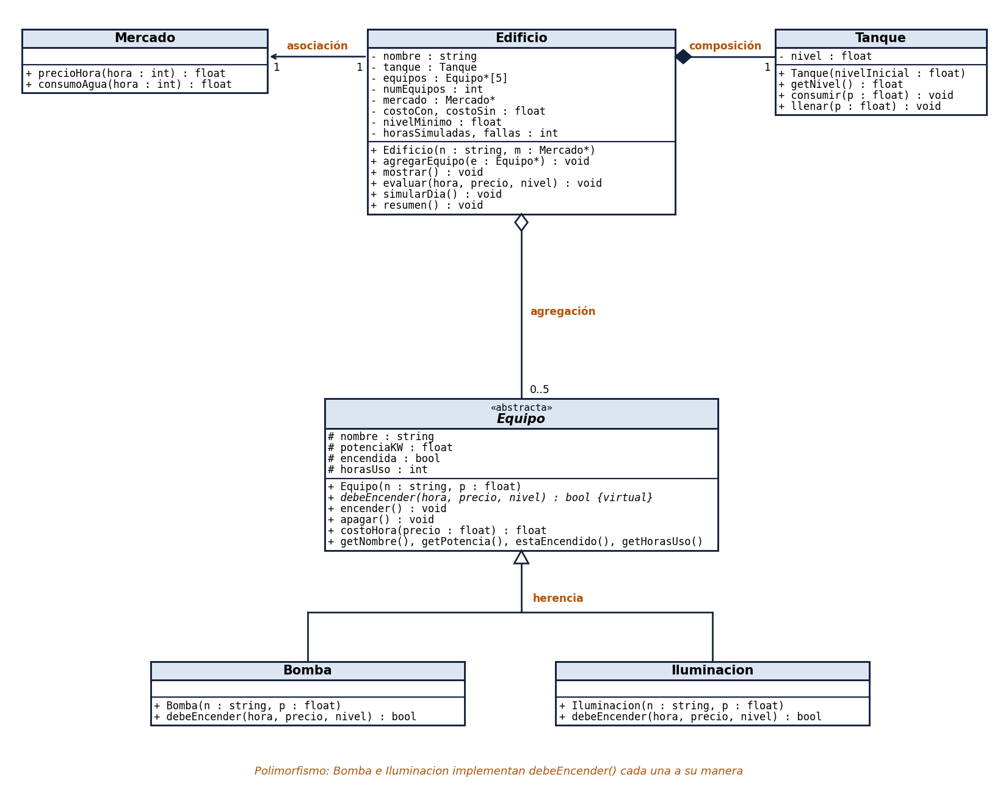
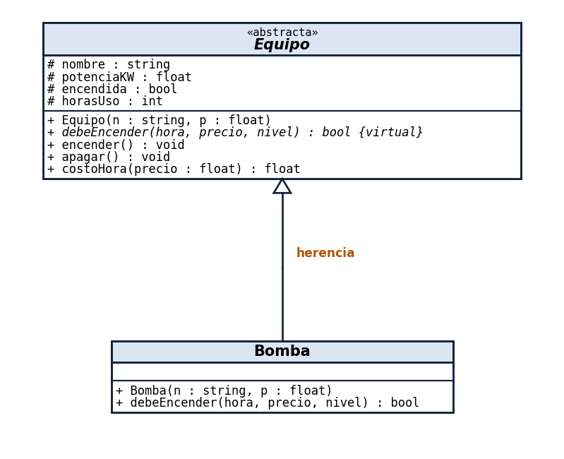
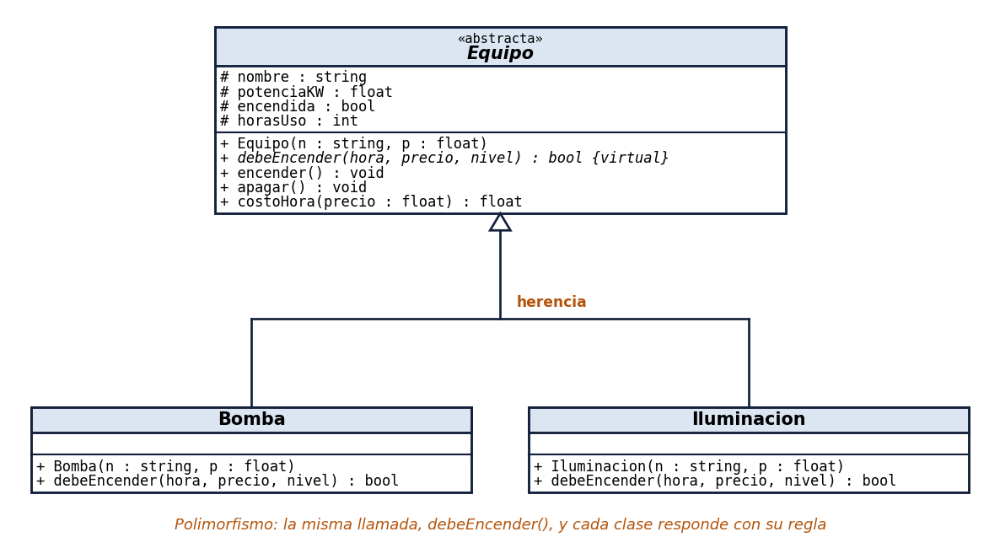
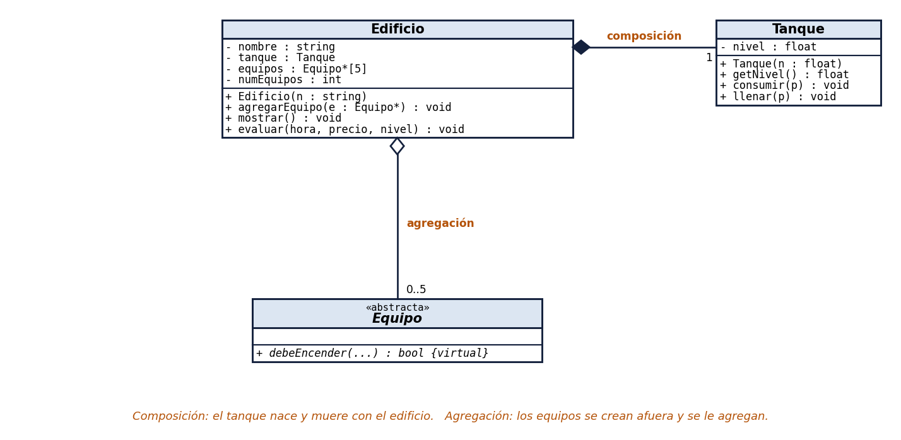
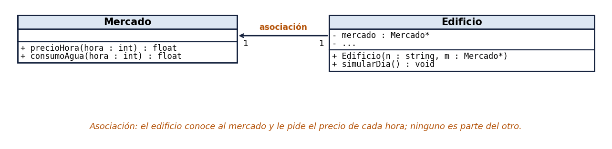

# Clase AAA – Lunes 26 y Encuentro Sincrónico viernes 30 de octubre de 2026

## AquaControl v2: clases con herencia, polimorfismo y relaciones, y la simulación de un día

> **Curso:** Programación Orientada a Objetos (PREICA2602B020043) · IU Digital de Antioquia · 2026-2
> **Docente:** Carlos Arturo Castro Castro
> **Lenguaje:** C++ en VS Code (el entorno que instalaron con el **TUTORIAL-Cpp-VSCode**)

### ¿De qué trata esta clase?

Con El Niño 2026 el precio de la energía en Colombia se multiplicó por 4,4: pasó de **212 COP/kWh** en enero a **942** en agosto, y a las 6 de la tarde llegó a **1.612** (datos de XM). En esta clase construimos **AquaControl**, el programa que controla los equipos de un edificio:

- una **bomba** que sube el agua al tanque elevado, y que conviene prender cuando la energía está barata;
- las **luces** de las zonas comunes, que se prenden de noche.

El programa simula un día completo y compara cuánto cuesta la energía **con** el gestor y **sin** él.

AquaControl es el **modelo** de la **Evidencia 2**: cada equipo de estudiantes construye **WattControl**, el mismo tipo de programa para los equipos eléctricos de **su negocio** (panadería, taller, lavandería, finca o minimercado).

| Término | Qué significa en esta clase |
|---|---|
| **Herencia** | Una clase nueva que **es un** tipo de otra y recibe todo lo que ella tiene. `Bomba` **es un** `Equipo`. |
| **Polimorfismo** | La **misma** orden produce un resultado **distinto** según el objeto. A la bomba y a las luces se les pregunta lo mismo, `debeEncender()`, y cada una responde con su propia regla. |
| **Composición** | Un objeto **es parte** de otro y no existe sin él. El `Tanque` es parte del `Edificio`. |
| **Agregación** | Un objeto **tiene** otros que se crearon por fuera. El `Edificio` tiene `Equipo`s que se crean primero y después se le agregan. |
| **Asociación** | Un objeto **conoce** a otro y le pide datos, sin que el otro sea parte suya. El `Edificio` le pide los precios al `Mercado`. |

### Cómo está organizada esta guía

Primero vienen los **conceptos resumidos** y el **diagrama de clases**. Luego, la clase tiene **5 partes**, numeradas de 0 a 4. El programa se construye en **8 pasos**, y un paso más (el 9) es para trabajar en equipo con GitHub.

| Día | Partes | Pasos |
|---|---|---|
| **Lunes 26** (encuentro AAA) | 0, 1 y 2 | Pasos 1 a 3: constantes, herencia y polimorfismo |
| **Viernes 30** (encuentro sincrónico) | 3 y 4 | Pasos 4 a 9: relaciones entre clases, menú, simulación, `break`, `continue`, resumen y GitHub |

---

## Conceptos resumidos

### Lo de la Unidad 2: datos, constantes y control

| Concepto | En una frase | En AquaControl |
|---|---|---|
| **Tipo de dato** | Qué clase de valor guarda una variable. | `int hora`, `float precio`, `bool horaPico`, `char unidad`, `string nombre` |
| **Constante (`const`)** | Un valor que no cambia mientras el programa corre. Se escribe una sola vez, arriba. | `const float PRECIO_BARATO = 600.0;` |
| **Directiva (`#define`)** | Una orden para el **preprocesador** (el programa que revisa el archivo antes de compilarlo): cambia el nombre por el valor en todo el archivo. | `#define HORAS_DIA 24` |
| **Número mágico** | Un número escrito suelto en el código, sin nombre. Nadie sabe qué significa. **No se usan.** | `if (precio < 600)` ❌ → `if (precio < PRECIO_BARATO)` ✅ |
| **Operadores de comparación** | Comparan dos valores y dan `true` o `false`: `<`, `>`, `<=`, `>=`, `==` (igual) y `!=` (distinto). Igual se escribe `==`; un solo `=` **guarda** un valor. | `precio < PRECIO_BARATO`, `hora >= PICO_INICIO` |
| **Operadores lógicos** | Unen condiciones: `&&` (y), `\|\|` (o), `!` (no). | `!horaPico && precio < PRECIO_BARATO` |
| **`do-while`** | Repite **al menos una vez** y vuelve a repetir mientras la condición sea verdadera. | El menú y la validación de datos |
| **`switch`** | Elige qué hacer según el valor de una variable. | Las opciones del menú |
| **`for`** | Repite un número conocido de veces. | Las 24 horas del día |
| **`break`** | Sale del ciclo **de inmediato**. | Precio de escasez: se detiene la simulación |
| **`continue`** | Salta **al siguiente** ciclo, sin hacer lo que falta del actual. | Falla la lectura del precio: esa hora todo queda apagado y se pasa a la siguiente |

### Las tablas de verdad

| A | B | `A && B` (y) | `A \|\| B` (o) | `!A` (no) |
|---|---|---|---|---|
| true | true | **true** | **true** | false |
| true | false | false | **true** | false |
| false | true | false | **true** | **true** |
| false | false | false | false | **true** |

`&&` es verdadero solo si **las dos** son verdaderas. `||` es verdadero si **al menos una** es verdadera. `!` invierte el valor.

**Ejemplo con la hora pico** (`hora >= 18 && hora <= 20`):

| `hora` | `hora >= 18` | `hora <= 20` | `&&` | ¿Hora pico? |
|---|---|---|---|---|
| 19 | true | true | **true** | Sí |
| 22 | true | false | false | No: ya pasó |
| 10 | false | true | false | No: todavía no llega |

**Ejemplo con la noche** (`hora >= 18 || hora <= 5`): con `&&` ninguna hora sería de noche, porque ninguna es a la vez mayor o igual a 18 **y** menor o igual a 5. Por eso las luces usan `||`.

| `hora` | `hora >= 18` | `hora <= 5` | `\|\|` | ¿Es de noche? |
|---|---|---|---|---|
| 22 | true | false | **true** | Sí |
| 3 | false | true | **true** | Sí |
| 10 | false | false | false | No |

### Lo nuevo de POO: herencia, polimorfismo y relaciones

| Concepto | En una frase | En AquaControl |
|---|---|---|
| **Clase y objeto** | La clase es el **molde** (qué datos y qué acciones tiene); el objeto es **una cosa concreta** hecha con ese molde. | La clase `Bomba` y el objeto `bomba`, de 5,5 kW |
| **Constructor** | El método que se ejecuta **solo** al crear el objeto, para darle sus valores iniciales. Se llama igual que la clase. | `Bomba bomba("Bomba", POTENCIA_BOMBA);` |
| **Clase base** (o clase padre) | La clase que tiene lo común a varias clases. | `Equipo`: nombre, potencia, encendido, horas de uso |
| **Clase derivada** (o clase hija) | La clase que hereda de la base y agrega o cambia algo. | `Bomba` e `Iluminacion` |
| **Visibilidad** | Dice **quién puede usar** un atributo o un método. Hay 3: `private`, `protected` y `public`. | `protected:` y `public:` en la clase `Equipo` |
| **`private`** (`-` en UML) | Solo lo usa **la misma clase**. Ni las hijas ni el `main`. | El `nivel` del `Tanque`: solo el tanque lo cambia, con `llenar()` y `consumir()` |
| **`protected`** (`#` en UML) | Lo usan la clase y **sus hijas**, pero **no** el `main`. | Los atributos de `Equipo` (`nombre`, `potenciaKW`, `encendida`, `horasUso`) |
| **`public`** (`+` en UML) | Lo usa **cualquier parte** del programa, también el `main`. | Los métodos `encender()`, `apagar()`, `getPotencia()` y `debeEncender()` |
| **Método virtual** | Un método que la clase base **sí** programa (trae una versión por defecto) y que las clases hijas **pueden** reescribir a su manera. Si una hija no lo reescribe, usa el de la base. | `virtual ~Equipo() {}`: el destructor de `Equipo` |
| **Método virtual puro (`= 0`)** | Un método que la clase base **no** programa: solo dice que existe. Cada hija **debe** escribirlo; si no, no compila. | `virtual bool debeEncender(...) = 0;` en `Equipo` |
| **Clase abstracta** | Una clase con un método virtual puro. **No se pueden crear objetos de ella**: solo de sus hijas. | No existe "un equipo" así, en general: existe una bomba o unas luces. |
| **`override`** | Le dice al compilador: "este método reemplaza al virtual de la clase base". Si el nombre está mal escrito, avisa. | `bool debeEncender(...) override` |
| **Puntero (`*`) y dirección (`&`)** | `&bomba` es la dirección del objeto en la memoria; un puntero `Equipo*` guarda esa dirección. | `Equipo* equipos[2] = {&bomba, &luces};` |
| **`->`** | Llama un método a través de un puntero (es como el punto `.`, pero para punteros). | `equipos[i]->debeEncender(...)` |

**Puntero (`*`) y dirección (`&`): no son dos formas de hacer lo mismo, se usan juntos:**

| Símbolo | Qué hace | Ejemplo |
|---|---|---|
| `&` | **Saca la dirección** de un objeto: dónde está guardado en la memoria. | `&bomba` da algo como `0x61fe10` |
| `*` | **Declara un puntero**: una variable que guarda una dirección. | `Equipo* p;` es una variable que guarda la dirección de un `Equipo` |
| `->` | **Usa el objeto** a través del puntero. | `p->encender();` |

```cpp
// El objeto: la bomba de verdad
Bomba bomba("Bomba", 5.5);
// & saca la direccion de la bomba; el puntero p la guarda
Equipo* p = &bomba;
// Con -> se usa la bomba a traves del puntero: la bomba se enciende
p->encender();
```

| Analogía | En C++ |
|---|---|
| La **casa** | El objeto `bomba` |
| La **dirección** de la casa: "Calle 10 # 20-30" | `&bomba` |
| Un **papelito** donde se anota la dirección | El puntero `Equipo* p` |
| Ir a la casa con lo que dice el papelito | `p->encender()` |

**¿Para qué usa punteros AquaControl?** Para 3 cosas:

| Para qué | Paso | Código | Por qué con puntero |
|---|---|---|---|
| **Polimorfismo** | 3 | `Equipo* equipos[2] = {&bomba, &luces};` | La bomba y las luces son de tipos distintos (`Bomba` e `Iluminacion`): no caben juntas en un arreglo normal. Sus **direcciones** sí caben en un arreglo de `Equipo*`, porque las dos **son** `Equipo`. |
| **Agregación** | 4 | `Equipo* equipos[MAX_EQUIPOS];` en `Edificio` | Los equipos se crean **afuera**, en el `main`. El edificio guarda solo su dirección, no una copia: así es la **misma** bomba. Si el edificio desaparece, la bomba sigue existiendo. |
| **Asociación** | 6 | `Mercado* mercado;` en `Edificio` | El edificio solo **conoce** al mercado para pedirle precios: guarda su dirección, pero el mercado no es suyo. |
| *Composición (sin puntero)* | 4 | `Tanque tanque;` en `Edificio` | El tanque **está dentro** del edificio, no se guarda su dirección: nace y muere con él. |

> ⚠️ **El `*` tiene dos usos.** Al **declarar** (`Equipo* p`) dice "esto es un puntero". Dentro del código, `*p` significa "el objeto al que apunta". En AquaControl solo se usa el primero: en vez de `(*p).encender()` se escribe `p->encender()`, que es lo mismo y se lee más fácil.

**Método virtual o virtual puro:**

| | Método virtual | Método virtual puro |
|---|---|---|
| ¿La clase base lo programa? | **Sí**: trae una versión por defecto | **No**: solo dice que existe |
| ¿La hija lo escribe? | **Puede**, si quiere cambiarlo | **Debe**; si no, no compila |
| Cómo se escribe | `virtual void mostrar() { ... }` (con código) | `virtual bool debeEncender(...) = 0;` (sin código, con `= 0`) |
| Qué le pasa a la clase | Sigue siendo normal: se pueden crear objetos de ella | Queda **abstracta**: no se pueden crear objetos de ella |
| Ejemplo de la vida real | Un restaurante tiene un menú del día por defecto: cada sede **puede** cambiarlo o servir el de siempre | La casa matriz dice que cada sede **debe** tener su horario, pero no da ninguno: una sede sin horario no puede abrir |

> 💡 En AquaControl, `Equipo` no puede saber cuándo encenderse: depende de si es una bomba o unas luces. Por eso `debeEncender()` es **virtual puro** y `Bomba` e `Iluminacion` **deben** escribir cada una su regla.

**Las 3 visibilidades:**

| Visibilidad | En UML | ¿Lo usa la misma clase? | ¿Lo usan las clases hijas? | ¿Lo usa el `main`? |
|---|---|---|---|---|
| `private` | `-` | ✅ | ❌ | ❌ |
| `protected` | `#` | ✅ | ✅ | ❌ |
| `public` | `+` | ✅ | ✅ | ✅ |

**¿Por qué los atributos de `Equipo` son `protected`?**

| Si fueran… | Qué pasaría |
|---|---|
| `private` | `Bomba` e `Iluminacion` **no** podrían leer `potenciaKW` ni `encendida` en su propio código, aunque los heredaron. |
| `public` | Cualquiera podría cambiarlos desde el `main`, por ejemplo `bomba.horasUso = -5;`, y dañar los datos. |
| `protected` ✅ | Las hijas los usan, y el `main` solo los lee o cambia con los métodos públicos: `getPotencia()`, `encender()`, `apagar()`. Si el `main` escribe `bomba.potenciaKW = 100;`, sale un error de compilación. |

### Las 5 relaciones, con un ejemplo de la vida real

| Relación | Se lee | Ejemplo de la vida real | En AquaControl | En el código |
|---|---|---|---|---|
| **Herencia** | "**es un**" | Un carro **es un** vehículo | `Bomba` **es un** `Equipo` | `class Bomba : public Equipo` |
| **Polimorfismo** | "la misma orden, distinta respuesta" | A un carro y a una bicicleta se les dice "avance": cada uno avanza a su manera | Se le pregunta `debeEncender()` a cada equipo y cada uno usa su regla | `virtual` y `override` |
| **Composición** | "**es parte de**, y muere con él" | El corazón es parte de la persona | El `Tanque` es parte del `Edificio` | Un atributo objeto: `Tanque tanque;` |
| **Agregación** | "**tiene**, pero existen por separado" | Un equipo de fútbol tiene jugadores; si el equipo desaparece, los jugadores siguen existiendo | El `Edificio` tiene `Equipo`s creados afuera | Un arreglo de punteros: `Equipo* equipos[5];` |
| **Asociación** | "**conoce a** / **usa**" | Un paciente conoce a su médico, pero ninguno es parte del otro | El `Edificio` le pide precios al `Mercado` | Un puntero: `Mercado* mercado;` |

> ⚠️ **Agregación y asociación se ven parecidas en el código:** las dos usan punteros. La diferencia está en el significado. Con la **agregación**, el edificio **tiene** los equipos como suyos: los guarda en su lista, los enciende, los apaga y suma sus horas. Con la **asociación**, el edificio solo **le pide un servicio** al mercado (el precio de cada hora); el mercado no es del edificio y otros podrían usarlo.

> 💡 **El polimorfismo no es una línea del diagrama.** Herencia, composición, agregación y asociación se dibujan con flechas o rombos. El polimorfismo se ve en el **método en cursiva** de la clase base (`debeEncender()`) que cada hija vuelve a escribir. En la Evidencia 2 se cuenta entre las 5 relaciones porque se pide **señalarlo en el código**.

---

## Diagrama de clases



**Cómo se lee:**

| Elemento del diagrama | Qué significa |
|---|---|
| Caja con 3 partes | Arriba el **nombre** de la clase, en el medio los **atributos** y abajo los **métodos**. |
| `-` / `+` / `#` | **Privado** (`private`) / **público** (`public`) / **protegido** (`protected`). |
| Nombre en *cursiva* y `«abstracta»` | **Clase abstracta**: `Equipo` no tiene objetos propios. |
| Método en *cursiva* con `{virtual}` | **Método virtual puro**: cada clase hija lo implementa. |
| Flecha con **triángulo hueco** △, de `Bomba` e `Iluminacion` hacia `Equipo` | **Herencia**: el triángulo apunta a la clase base. |
| Línea con **rombo relleno** ◆ junto a `Edificio`, hacia `Tanque` | **Composición**: el rombo va del lado del **todo**. |
| Línea con **rombo hueco** ◇ junto a `Edificio`, hacia `Equipo` | **Agregación**: el rombo va del lado del que **tiene**. |
| Flecha simple → de `Edificio` a `Mercado` | **Asociación**: `Edificio` conoce a `Mercado`. |
| `1`, `0..5` | **Multiplicidad**: un edificio tiene **un** tanque y **de 0 a 5** equipos. |

> 📌 **Para la Evidencia 2:** cada equipo de estudiantes entrega el diagrama de clases de **su** WattControl, con las 5 relaciones.

---

## Mapa de la clase

| Día | Parte | Pasos | Resultado |
|---|---|---|---|
| Lunes 26 | 0. Preparar | Crear la carpeta y el archivo | `aquacontrol.cpp` abierto en VS Code |
| Lunes 26 | 1. El problema | Conceptos y diagrama de clases | — |
| Lunes 26 | 2. Constantes, herencia y polimorfismo | Pasos 1 a 3 | La bomba y las luces deciden distinto ante la misma lectura |
| Viernes 30 | 3. Relaciones, menú y simulación | Pasos 4 a 8 | Simulación de 24 horas: 53 % de ahorro con el gestor |
| Viernes 30 | 4. Equipo en GitHub y Evidencia 2 | Paso 9 | Repositorio con `main`, una rama `feature/` y su merge |

## Resumen de los pasos

| # | Parte | Qué se hace | ¿Para qué? | Resultado esperado | Qué significa el resultado |
|---|---|---|---|---|---|
| 0 | 0 | Crear la carpeta `aquaControlCpp` y el archivo `aquacontrol.cpp` | Tener el proyecto en su propia carpeta. | El EXPLORER muestra `AQUACONTROLCPP` con el archivo. | Todo listo. |
| 1 | 2 | Constantes, `#define` y tipos de datos | Poner todos los valores del problema en un solo lugar. | La configuración y `Es hora pico? 1` / `si`. | Un `bool` se muestra como 1 (true) o 0 (false). |
| 2 | 2 | Clase abstracta `Equipo` y la clase hija `Bomba` | Herencia y la regla de bombeo con operadores lógicos. | 5 lecturas: BOMBEAR, ESPERAR, ESPERAR, BOMBEAR, ESPERAR. | La bomba aplica las 3 condiciones de la regla. |
| 3 | 2 | Clase `Iluminacion` y un arreglo `Equipo*` | Polimorfismo. | A las 19 h la bomba espera y las luces se encienden. | La misma pregunta, dos respuestas distintas. |
| 4 | 3 | Clases `Tanque` y `Edificio` | Composición y agregación. | El edificio con su tanque al 50 % y sus 2 equipos. | El edificio evalúa cada equipo. |
| 5 | 3 | Menú con `do-while` y `switch`, y validación | Que el usuario ingrese la lectura. | El menú rechaza hora 25, nivel 150 y precio -5. | Los datos inválidos no entran. |
| 6 | 3 | Clase `Mercado` y simulación de 24 horas con `for` | Asociación y simulación. | Tabla de 24 horas; costo con gestor $26.127 y sin gestor $62.338. | El gestor evita las horas caras. |
| 7 | 3 | `break` y `continue` | Reaccionar a una falla y a un precio de escasez. | En la 2.ª simulación: falla a las 15 h y escasez a las 20 h. | `continue` salta una hora; `break` termina la simulación. |
| 8 | 3 | Opción 4: resumen y ahorro | Sacar conclusiones. | Bomba 6 h; ahorro $38.303 (53,0 %). | El gestor reduce el costo a menos de la mitad. |
| 9 | 4 | Repositorio en GitHub con una rama `feature/` unida a `main` | Trabajar en equipo sin dañar `main`. | `git log --oneline` muestra 2 commits; `Costo promedio por hora: $1417`. | Cada cambio se hace en una rama, se revisa con `git diff` y se une a main. |

---

## Parte 0 · Preparar el proyecto

### 0.1 Crear la carpeta y el archivo

Igual que en la clase de MiConsumo:

1. En el **Escritorio**, crear la carpeta `aquaControlCpp` (sin espacios ni tildes).
2. En VS Code: **File → Open Folder...** → elegir `aquaControlCpp` → **Yes, I trust the authors**.
3. En el EXPLORER: **New File...** → `aquacontrol.cpp` → Enter.

---

## Parte 1 · El problema

Un edificio residencial de Medellín bombea agua desde un tanque subterráneo hasta un tanque elevado con una **bomba de 5,5 kW**. Hoy la bomba se prende por nivel, **a cualquier hora**, incluso a las 6 de la tarde, cuando la energía es más cara. Además, las **luces** de las zonas comunes (1,2 kW) se quedan prendidas todo el día.

> **Pregunta:** ¿cómo programar un gestor que llene el tanque en las horas de energía barata, evite la hora pico, nunca deje el edificio sin agua y prenda las luces solo de noche?

### Diccionario: las entidades del problema

Cada **cosa** del problema se vuelve una **clase** del programa:

| Entidad | Qué es en la vida real | Clase en el programa | Qué datos guarda | Qué sabe hacer |
|---|---|---|---|---|
| **Equipo** | Cualquier aparato eléctrico del edificio. No existe "un equipo" en general: existe una bomba o unas luces. | `Equipo` (abstracta) | Nombre, potencia en kW, si está encendido y horas de uso | Encenderse, apagarse, calcular el costo de una hora y decidir si debe encenderse |
| **Bomba** | El motor que sube el agua desde el tanque subterráneo hasta el tanque elevado. Gasta **5,5 kW**. | `Bomba` (hija de `Equipo`) | Lo mismo que `Equipo` | Decidir con **su** regla: bombea si el tanque está muy bajo, o si la energía está barata, no es hora pico y el tanque no está lleno |
| **Luces** | La iluminación de las zonas comunes: pasillos, escaleras y portería. Gastan **1,2 kW**. | `Iluminacion` (hija de `Equipo`) | Lo mismo que `Equipo` | Decidir con **su** regla: se prenden solo de noche |
| **Tanque** | El tanque elevado de agua del edificio. Su nivel va de 0 % (vacío) a 100 % (lleno). | `Tanque` | El nivel, en % | Llenarse (cuando la bomba trabaja) y vaciarse (cuando la gente gasta agua) |
| **Mercado** | El mercado de energía (la bolsa de XM), que fija el precio de cada hora. | `Mercado` | Nada: solo calcula | Dar el precio de una hora, dentro del rango real de su franja, y cuánta agua se gasta en esa hora |
| **Edificio** | El conjunto residencial que administra todo. | `Edificio` | Nombre, su tanque, sus equipos, el mercado que consulta y los resultados de la simulación | Agregar equipos, evaluar una lectura, simular un día y mostrar el resumen |

**Las palabras del problema:**

| Palabra | Qué significa |
|---|---|
| **kW** (kilovatio) | La **potencia**: cuánta energía gasta un equipo **mientras está encendido**. |
| **kWh** (kilovatio hora) | La **energía** gastada: potencia × horas. La bomba 2 horas: 5,5 kW × 2 h = 11 kWh. |
| **Precio de bolsa** | Lo que cuesta 1 kWh en una hora del día, en pesos (COP/kWh). Cambia cada hora. |
| **Hora pico** | De las 18 a las 20 h: la hora en que más gente usa energía y el precio sube. |
| **Nivel crítico** | 20 %: por debajo, el edificio se puede quedar sin agua. Se bombea a cualquier precio. |
| **Nivel objetivo** | 80 %: con energía barata, el tanque se llena hasta aquí. |
| **Gestor** | El programa que decide, hora por hora, qué equipo se enciende y cuál espera. |

### Las reglas de AquaControl

| Equipo | Se enciende si… | Con operadores lógicos |
|---|---|---|
| **Bomba** | El tanque está por debajo del 20 % (siempre, para no quedarse sin agua), **o** no es hora pico **y** la energía está barata **y** el tanque está por debajo del 80 %. | `nivel < NIVEL_CRITICO \|\| (!horaPico && precio < PRECIO_BARATO && nivel < NIVEL_OBJETIVO)` |
| **Luces** | Es de noche: desde las 18 h o hasta las 5 h. | `hora >= NOCHE_INICIO \|\| hora <= NOCHE_FIN` |

### Los precios reales de cada franja horaria

Los precios que usa la simulación están dentro de los rangos **reales** del precio de bolsa de XM entre el 21 y el 27 de septiembre de 2026:

| Franja | Horas | Precio mínimo | Precio máximo | Promedio |
|---|---|---|---|---|
| Madrugada | 0 a 6 | 398 | 640 | 525 |
| Mañana y mediodía | 7 a 14 | 456 | 970 | 562 |
| Tarde | 15 a 17 | 596 | 1.040 | 742 |
| **Hora pico** | **18 a 20** | **705** | **1.612** | **1.154** |
| Noche | 21 a 23 | 565 | 970 | 703 |

---

## Cómo se trabaja cada paso

| 1. Explicar | 2. Escribir | 3. Ejecutar | 4. Comentar |
|---|---|---|---|
| El docente explica el concepto con el diagrama. | Cada estudiante **borra todo** el archivo (**Ctrl+A** y **Supr**), pega el **archivo completo** del paso y guarda con **Ctrl+S**. | **▷ → ⌄ → Run C/C++ File** | Se lee la salida con la tabla de "Qué significa". |

> 📌 Cada paso trae el **archivo completo**: así nadie se pierde buscando dónde pegar. La explicación de cada paso cubre **solo lo que se agregó** frente al paso anterior.

> 💡 **Cada paso trae su propio `main`.** Las clases de los pasos anteriores se quedan iguales; el `main` se cambia en cada paso, porque prueba lo nuevo de ese paso.

---

## Parte 2 · Constantes, herencia y polimorfismo (lunes 26)

### Paso 1 · Constantes, `#define` y tipos de datos

**Concepto:** todos los valores del problema se escriben **una sola vez**, arriba, con un nombre. Si mañana cambia la potencia de la bomba, se cambia en un solo lugar.

**Qué hacer:** pegar **todo** este código en `aquacontrol.cpp` y guardar:

```cpp
// =============================================================
// AquaControl v2 - Gestor de energia de un edificio (El Nino 2026)
// Paso 1: constantes, #define y tipos de datos
// =============================================================
// --- Librerias: codigo que ya existe y que se trae al programa -------------
// iostream: cout (escribir en pantalla) y cin (leer del teclado)
#include <iostream>
// iomanip: setw (ancho de columna) y setprecision (cantidad de decimales)
#include <iomanip>
// string: el tipo string, para guardar textos
#include <string>
// cstdlib: rand() y srand(), para generar numeros al azar
#include <cstdlib>

// Permite escribir cout en vez de std::cout (todo lo de la libreria esta en "std")
using namespace std;

// --- Directivas del preprocesador ------------------------------------------
// Antes de compilar, el preprocesador cambia cada nombre por su valor en todo el archivo.
// No llevan = ni ; al final.
// Horas de la simulacion: un dia
#define HORAS_DIA 24
// Cuantos equipos puede tener el edificio, como maximo (tamano del arreglo del paso 4)
#define MAX_EQUIPOS 5
// Semilla de rand(): con la misma semilla, todos obtienen los mismos precios al azar
#define SEMILLA 2026

// --- Constantes: todos los valores del problema, en un solo lugar ----------
// const = no se pueden cambiar despues. Si cambia un valor, se cambia solo aqui.
// kW de la bomba de agua
const float POTENCIA_BOMBA = 5.5;
// kW de la iluminacion de las zonas comunes
const float POTENCIA_LUCES = 1.2;
// % que sube el tanque en una hora de bombeo
const float SUBIDA_HORA = 12.0;
// % del tanque al empezar la simulacion
const float NIVEL_INICIAL = 50.0;
// %: si el tanque esta por debajo, se bombea siempre, para no quedarse sin agua
const float NIVEL_CRITICO = 20.0;
// %: con energia barata, el tanque se llena hasta aqui
const float NIVEL_OBJETIVO = 80.0;
// COP/kWh: si el precio esta por debajo, la energia esta barata
const float PRECIO_BARATO = 600.0;
// COP/kWh: si el precio pasa de aqui, se detiene la simulacion (paso 7)
const float PRECIO_ESCASEZ = 1500.0;
// La hora pico empieza a las 18 h (6 pm)...
const int PICO_INICIO = 18;
// ...y termina a las 20 h (la hora 20 esta incluida: hasta las 9 pm)
const int PICO_FIN = 20;
// Las luces se prenden desde las 18 h (6 pm)...
const int NOCHE_INICIO = 18;
// ...hasta las 5 h (la hora 5 esta incluida)
const int NOCHE_FIN = 5;
// 1 de cada 20 lecturas del precio falla (paso 7)
const int FALLA_CADA = 20;

// main: el programa empieza a ejecutarse aqui
int main() {
    // cout escribe en pantalla; << une las partes; endl salta a la linea siguiente.
    // Se muestran los valores de las directivas y constantes de arriba
    cout << "===== AquaControl: configuracion =====" << endl;
    cout << "Horas del dia:   " << HORAS_DIA << endl;
    cout << "Bomba:           " << POTENCIA_BOMBA << " kW" << endl;
    cout << "Luces:           " << POTENCIA_LUCES << " kW" << endl;
    cout << "Nivel critico:   " << NIVEL_CRITICO << " %" << endl;
    cout << "Nivel objetivo:  " << NIVEL_OBJETIVO << " %" << endl;
    cout << "Precio barato:   menos de " << PRECIO_BARATO << " COP/kWh" << endl;
    cout << "Hora pico:       de " << PICO_INICIO << " a " << PICO_FIN << " h" << endl;

    // Tipos de datos: cada variable guarda un tipo de valor
    // string: texto, entre comillas dobles
    string edificio = "Torres del Rio";
    // int: numero entero
    int hora = 19;
    // float: numero con decimales (en C++ el decimal se escribe con punto)
    float precio = 1093.5;
    // char: un solo caracter, entre comillas sencillas
    char unidad = '%';
    // bool: verdadero (1) o falso (0). Es hora pico si la hora es >= 18 && ("y") <= 20
    bool horaPico = hora >= PICO_INICIO && hora <= PICO_FIN;

    // Muestra las variables. endl al inicio deja una linea en blanco
    cout << endl << "Edificio: " << edificio << endl;
    // El nivel sale de la constante NIVEL_INICIAL, no de un numero escrito suelto
    cout << "Hora " << hora << ", precio " << precio << " COP/kWh, nivel " << NIVEL_INICIAL << " " << unidad << endl;
    // Un bool se muestra como 1 (verdadero) o 0 (falso)
    cout << "Es hora pico? " << horaPico << endl;
    // Operador ternario: (condicion ? si es verdad : si es falso)
    cout << "Es hora pico? " << (horaPico ? "si" : "no") << endl;
    // return 0: el programa termino bien
    return 0;
}
```

| Parte | Qué hace |
|---|---|
| `#include <...>` | Trae al programa una **librería**: código que ya existe y que no hay que escribir. Se ponen siempre al comienzo del archivo. |
| `#include <iostream>` | Trae `cout` (escribir en pantalla) y `cin` (leer del teclado). Sin ella, el programa no puede mostrar nada. |
| `#include <iomanip>` | Trae `setw` y `setprecision`, para alinear columnas y fijar decimales (se usan en los pasos 4 y 6). |
| `#include <string>` | Trae el tipo `string`, para guardar textos como el nombre del edificio. |
| `#include <cstdlib>` | Trae `rand()` y `srand()`, para generar números al azar (se usan en el paso 6). |
| `using namespace std;` | Todo lo de las librerías está dentro de un grupo llamado `std`. Con esta línea se escribe `cout` en vez de `std::cout`. |
| `#define HORAS_DIA 24` | **Directiva:** antes de compilar, el preprocesador cambia `HORAS_DIA` por `24` en todo el archivo. No lleva `=` ni `;`. |
| `#define MAX_EQUIPOS 5` | Cuántos equipos puede tener el edificio (paso 4). |
| `#define SEMILLA 2026` | El punto de partida de los números al azar (paso 6). |
| `const float SUBIDA_HORA = 12.0;` … `const int FALLA_CADA = 20;` | Las demás constantes del problema. Hoy solo se muestran algunas; cada una se usa en el paso que dice su comentario. |
| `const float POTENCIA_BOMBA = 5.5;` | **Constante:** una variable que no se puede cambiar. Tiene tipo (`float`) y lleva `=` y `;`. |
| Nombres en MAYÚSCULAS | Es la costumbre para las constantes: se reconocen a simple vista. |
| `string edificio = "Torres del Rio";` | Tipo **texto**, entre comillas dobles. |
| `int hora = 19;` | Tipo **entero**. |
| `float precio = 1093.5;` | Tipo **decimal**. En C++ el decimal se escribe con **punto**. |
| `char unidad = '%';` | Tipo **un solo carácter**, entre comillas sencillas. |
| `bool horaPico = hora >= PICO_INICIO && hora <= PICO_FIN;` | Tipo **verdadero o falso**. `&&`: es hora pico si la hora es **mayor o igual a 18 y** **menor o igual a 20**. |
| `(horaPico ? "si" : "no")` | **Operador ternario**: si `horaPico` es verdadero, escribe `si`; si no, `no`. |
| `int main() { ... }` | La función principal: el programa **empieza** a ejecutarse en la primera línea de `main`. |
| `cout << ... << endl;` | `cout` escribe en pantalla, `<<` va uniendo las partes y `endl` salta a la línea siguiente. |
| `return 0;` | Termina `main` y le avisa al sistema que el programa terminó bien. |

**¿`#define` o `const`?** Los dos le ponen nombre a un valor, pero no son lo mismo:

| | `#define HORAS_DIA 24` | `const int PICO_INICIO = 18;` |
|---|---|---|
| Qué es | Una orden para el **preprocesador**: reemplaza el texto antes de compilar | Una **variable** que no se puede cambiar |
| Tipo de dato | No tiene: es solo texto que se reemplaza | Sí tiene: `int`, `float`… |
| Cómo se escribe | Sin `=` y sin `;` | Con `=` y con `;` |
| Si se usa mal | El error puede salir en otra línea y es difícil de entender | El compilador avisa en la línea exacta y con el tipo |
| En AquaControl | Tamaños y valores fijos del programa: horas del día, máximo de equipos, semilla | **Todos los valores del problema**: potencias, niveles, precios y horas |

> 💡 En C++ moderno se prefiere `const`, porque tiene tipo y el compilador lo revisa. `#define` se ve aquí porque el curso lo pide y porque aparece en mucho código existente.

**Resultado real:**

```text
===== AquaControl: configuracion =====
Horas del dia:   24
Bomba:           5.5 kW
Luces:           1.2 kW
Nivel critico:   20 %
Nivel objetivo:  80 %
Precio barato:   menos de 600 COP/kWh
Hora pico:       de 18 a 20 h

Edificio: Torres del Rio
Hora 19, precio 1093.5 COP/kWh, nivel 50 %
Es hora pico? 1
Es hora pico? si
```

| Lo que aparece | Qué significa |
|---|---|
| `Bomba: 5.5 kW` … `Hora pico: de 18 a 20 h` | Los valores de las constantes. |
| `Nivel critico: 20 %` y no `20.0 %` | `NIVEL_CRITICO` es `float` y vale `20.0`, pero `cout` no muestra los decimales que son cero. `5.5` sí se muestra con su decimal. |
| `nivel 50 %` | El valor de `NIVEL_INICIAL`, seguido del `char` `unidad` (`%`). |
| `Es hora pico? 1` | `cout` muestra un `bool` como `1` (verdadero) o `0` (falso). A las 19 h **sí** es hora pico. |
| `Es hora pico? si` | Con el operador ternario se muestra una palabra en vez de un número. |

Al ejecutar por primera vez aparecen cosas nuevas en VS Code:

| Lo que aparece | Qué es |
|---|---|
| `PS C:\Users\...\aquaControlCpp> C:\Users\...\aquacontrol.exe` | La primera línea de la terminal: VS Code ejecuta el programa ya compilado. |
| `aquacontrol.exe` en el EXPLORER | El programa compilado: lo creó g++ a partir de `aquacontrol.cpp`. Se vuelve a crear cada vez que se ejecuta **Run C/C++ File**. |
| La carpeta `.vscode` en el EXPLORER | La configuración de VS Code para compilar (`tasks.json`). La crea sola la primera vez; no hay que tocarla. |
| A la derecha de la terminal: `C/C++: g++.exe build active file` y `C:\Users\...\aqua...` | Dos terminales: en la primera **compiló** (✓ = sin errores) y en la segunda **ejecutó**. Se puede pasar de una a otra con un clic. |

> 💡 **Pruebe:** escriba `PRECIO_BARATO = 700;` dentro de `main` y compile. Sale `error: assignment of read-only variable 'PRECIO_BARATO'`: una constante no se puede cambiar. Borre la línea después de probar.

---

### Paso 2 · Herencia: la clase abstracta `Equipo` y la clase `Bomba`

**Concepto:** la bomba y las luces tienen cosas en común (nombre, potencia, encendido, horas de uso, costo). Eso va en una **clase base**, `Equipo`. Lo que cambia es la **regla** para encenderse: cada clase hija tiene la suya.



**Qué hacer:** **borrar todo**, pegar el archivo completo del paso 2 y guardar:

```cpp
// =============================================================
// AquaControl v2 - Gestor de energia de un edificio (El Nino 2026)
// Paso 2: clase base Equipo y herencia (Bomba)
// =============================================================
// --- Librerias: codigo que ya existe y que se trae al programa -------------
// iostream: cout (escribir en pantalla) y cin (leer del teclado)
#include <iostream>
// iomanip: setw (ancho de columna) y setprecision (cantidad de decimales)
#include <iomanip>
// string: el tipo string, para guardar textos
#include <string>
// cstdlib: rand() y srand(), para generar numeros al azar
#include <cstdlib>

// Permite escribir cout en vez de std::cout (todo lo de la libreria esta en "std")
using namespace std;

// --- Directivas del preprocesador ------------------------------------------
// Antes de compilar, el preprocesador cambia cada nombre por su valor en todo el archivo.
// No llevan = ni ; al final.
// Horas de la simulacion: un dia
#define HORAS_DIA 24
// Cuantos equipos puede tener el edificio, como maximo (tamano del arreglo del paso 4)
#define MAX_EQUIPOS 5
// Semilla de rand(): con la misma semilla, todos obtienen los mismos precios al azar
#define SEMILLA 2026

// --- Constantes: todos los valores del problema, en un solo lugar ----------
// const = no se pueden cambiar despues. Si cambia un valor, se cambia solo aqui.
// kW de la bomba de agua
const float POTENCIA_BOMBA = 5.5;
// kW de la iluminacion de las zonas comunes
const float POTENCIA_LUCES = 1.2;
// % que sube el tanque en una hora de bombeo
const float SUBIDA_HORA = 12.0;
// % del tanque al empezar la simulacion
const float NIVEL_INICIAL = 50.0;
// %: si el tanque esta por debajo, se bombea siempre, para no quedarse sin agua
const float NIVEL_CRITICO = 20.0;
// %: con energia barata, el tanque se llena hasta aqui
const float NIVEL_OBJETIVO = 80.0;
// COP/kWh: si el precio esta por debajo, la energia esta barata
const float PRECIO_BARATO = 600.0;
// COP/kWh: si el precio pasa de aqui, se detiene la simulacion (paso 7)
const float PRECIO_ESCASEZ = 1500.0;
// La hora pico empieza a las 18 h (6 pm)...
const int PICO_INICIO = 18;
// ...y termina a las 20 h (la hora 20 esta incluida: hasta las 9 pm)
const int PICO_FIN = 20;
// Las luces se prenden desde las 18 h (6 pm)...
const int NOCHE_INICIO = 18;
// ...hasta las 5 h (la hora 5 esta incluida)
const int NOCHE_FIN = 5;
// 1 de cada 20 lecturas del precio falla (paso 7)
const int FALLA_CADA = 20;

// =============================================================
// Clase base Equipo: lo que tienen en comun todos los equipos
// =============================================================
// class Equipo { ... }; define un molde. Cada equipo real (bomba, luces) se crea con el
// molde de su clase hija, que hereda todo lo de aqui
class Equipo {
// protected: estos atributos los ven esta clase y sus hijas (Bomba, Iluminacion),
// pero no el resto del programa
protected:
    // El nombre del equipo: "Bomba", "Luces"
    string nombre;
    // La potencia en kW: 5.5 la bomba, 1.2 las luces
    float potenciaKW;
    // true si esta encendido en esta hora; false si esta apagado
    bool encendida;
    // Cuantas horas ha estado encendido (para el resumen)
    int horasUso;

// public: lo que puede usar cualquier parte del programa
public:
    // Constructor: se ejecuta al crear el equipo. Recibe el nombre (n) y la potencia (p).
    // Ejemplo: Equipo("Bomba", 5.5)
    Equipo(string n, float p) {
        // Guarda el nombre recibido
        nombre = n;
        // Guarda la potencia recibida
        potenciaKW = p;
        // Todo equipo empieza apagado...
        encendida = false;
        // ...y sin horas de uso
        horasUso = 0;
    }

    // Destructor virtual: obligatorio en una clase base con metodos virtuales.
    // Asegura que, al borrar un equipo, se borre bien aunque se use un puntero Equipo*
    virtual ~Equipo() {}

    // Polimorfismo: cada clase hija decide a su manera si se enciende.
    // virtual = cada hija lo puede escribir a su manera.
    // "= 0" = metodo virtual puro: Equipo no lo implementa; cada hija debe hacerlo.
    // Por eso Equipo es una clase ABSTRACTA: no se pueden crear objetos Equipo directamente
    virtual bool debeEncender(int hora, float precio, float nivel) = 0;

    // Enciende el equipo durante esta hora
    void encender() {
        // Queda encendido...
        encendida = true;
        // ...y suma una hora de uso (++ suma 1)
        horasUso++;
    }

    // Apaga el equipo durante esta hora
    void apagar() {
        encendida = false;
    }

    // Costo de esta hora: kW x precio si esta encendido; 0 si esta apagado
    float costoHora(float precio) {
        // Si esta encendido...
        if (encendida) {
            // ...el costo es la potencia por el precio: 5.5 kW x 450 COP/kWh = 2475 COP
            return potenciaKW * precio;
        }
        // Si esta apagado no gasta nada
        return 0;
    }

    // Getters: metodos que devuelven el valor de un atributo protegido,
    // para que el resto del programa lo pueda leer (pero no cambiar)
    string getNombre() { return nombre; }
    float getPotencia() { return potenciaKW; }
    bool estaEncendido() { return encendida; }
    int getHorasUso() { return horasUso; }
};

// =============================================================
// Herencia: Bomba ES UN Equipo
// =============================================================
// ": public Equipo" = Bomba hereda todo lo de Equipo (nombre, potencia, encender, apagar...)
class Bomba : public Equipo {
public:
    // Constructor de Bomba. ": Equipo(n, p)" le pasa el nombre y la potencia al
    // constructor de Equipo, que es el que los guarda. Las llaves {} quedan vacias
    // porque Bomba no tiene nada mas que guardar
    Bomba(string n, float p) : Equipo(n, p) {}

    // La regla de la bomba. override = reemplaza el metodo virtual puro de Equipo
    bool debeEncender(int hora, float precio, float nivel) override {
        // horaPico es true si la hora esta entre 18 y 20 (&& = "y": las dos condiciones)
        bool horaPico = hora >= PICO_INICIO && hora <= PICO_FIN;
        // Bombea si el tanque esta por debajo del 20 % (siempre, para no quedarse sin agua)
        // || ("o") si NO es hora pico (!horaPico) y la energia esta barata y el tanque
        // esta por debajo del 80 %. return devuelve true (bombear) o false (esperar)
        return nivel < NIVEL_CRITICO ||
               (!horaPico && precio < PRECIO_BARATO && nivel < NIVEL_OBJETIVO);
    }
};

// main: el programa empieza a ejecutarse aqui
int main() {
    // Crea un OBJETO de la clase Bomba: nombre "Bomba" y 5.5 kW
    Bomba bomba("Bomba", POTENCIA_BOMBA);

    // 5 lecturas de prueba: hora, precio y nivel del tanque.
    // Son 3 arreglos de 5 posiciones; la lectura i usa horas[i], precios[i] y niveles[i]
    int horas[5] = {3, 10, 19, 19, 3};
    float precios[5] = {450, 900, 1300, 1300, 450};
    float niveles[5] = {50, 50, 60, 15, 85};

    // El encabezado de la tabla
    cout << "Hora  Precio  Nivel  Decision de la bomba" << endl;
    // Repite para las 5 lecturas: i = 0, 1, 2, 3, 4
    for (int i = 0; i < 5; i++) {
        // Le pregunta a la bomba si debe encender con esa lectura
        bool on = bomba.debeEncender(horas[i], precios[i], niveles[i]);
        // Escribe la lectura alineada con setw y la decision: BOMBEAR si on es true
        cout << setw(4) << horas[i] << setw(8) << precios[i] << setw(7) << niveles[i]
             << "  " << (on ? "BOMBEAR" : "ESPERAR") << endl;
    }
    return 0;
}
```

**Qué se agregó en este paso:**

| Parte | Qué hace |
|---|---|
| `class Equipo {` | La **clase base**. |
| `protected:` | Los atributos son protegidos: los usan `Equipo` **y sus hijas**, pero no el `main`. |
| `Equipo(string n, float p)` | El **constructor**: guarda el nombre y la potencia, y empieza apagado y con 0 horas. |
| `virtual ~Equipo() {}` | **Destructor virtual**: se pone siempre en una clase base con métodos virtuales, para que al destruir un objeto hijo se haga bien. Aquí no hace nada más. |
| `virtual bool debeEncender(...) = 0;` | **Método virtual puro**: `Equipo` dice que todo equipo debe saber decidir, pero **no** dice cómo. Por eso `Equipo` es **abstracta**. |
| `encender()` | Prende el equipo y suma una hora de uso. |
| `costoHora(float precio)` | Si está encendido, devuelve **kW × precio** (pesos de esa hora); si no, 0. |
| `class Bomba : public Equipo {` | **Herencia**: `Bomba` **es un** `Equipo`. Recibe sus atributos y métodos. |
| `Bomba(string n, float p) : Equipo(n, p) {}` | El constructor de `Bomba` **llama al de `Equipo`** para guardar el nombre y la potencia. |
| `bool debeEncender(...) override` | La bomba **implementa** el método virtual con **su** regla. |
| `nivel < NIVEL_CRITICO \|\| (...)` | Se bombea si el tanque está por debajo del 20 %, **o** si se cumplen las 3 condiciones del paréntesis. |
| `!horaPico && precio < PRECIO_BARATO && nivel < NIVEL_OBJETIVO` | **No** es hora pico, **y** la energía está barata, **y** el tanque está por debajo del 80 %. |
| `int horas[5] = {3, 10, 19, 19, 3};` | Tres arreglos con 5 lecturas de prueba (hora, precio, nivel). La lectura `i` está en la posición `i` de cada arreglo. |

**Resultado real:**

```text
Hora  Precio  Nivel  Decision de la bomba
   3     450     50  BOMBEAR
  10     900     50  ESPERAR
  19    1300     60  ESPERAR
  19    1300     15  BOMBEAR
   3     450     85  ESPERAR
```

| Lectura | Qué condición decidió | Decisión |
|---|---|---|
| 3 h, 450, 50 % | No es pico, 450 < 600 y 50 < 80: las 3 condiciones se cumplen | BOMBEAR |
| 10 h, 900, 50 % | 900 no es menor que 600: la energía está cara | ESPERAR |
| 19 h, 1300, 60 % | Es hora pico, y el tanque no está en nivel crítico | ESPERAR |
| 19 h, 1300, **15 %** | 15 < 20: **nivel crítico**. Se bombea aunque sea hora pico y la energía esté cara | BOMBEAR |
| 3 h, 450, **85 %** | 85 no es menor que 80: el tanque ya está lleno | ESPERAR |

> 💡 **Pruebe:** escriba en `main` la línea `Equipo e("Prueba", 1.0);` y compile. Sale `error: cannot declare variable 'e' to be of abstract type 'Equipo'`: **no se pueden crear objetos de una clase abstracta**. Borre la línea después de probar.

---

### Paso 3 · Polimorfismo: la clase `Iluminacion`

**Concepto:** se agrega otra clase hija, `Iluminacion`, con **otra** regla. Luego se guardan la bomba y las luces en un **mismo arreglo** de tipo `Equipo*` y se les hace **la misma pregunta**. Cada objeto responde con su regla: eso es el **polimorfismo**.



**Qué cambia frente al paso 2:**

| Parte del archivo | Paso 2 | Paso 3 |
|---|---|---|
| Constantes, `Equipo`, `Bomba` | ✓ | Iguales, sin cambios |
| `class Iluminacion` | — | **Nueva**: la regla de las luces |
| `main`: equipos | Solo `Bomba bomba(...)` | `Bomba bomba(...)` **y** `Iluminacion luces(...)` |
| `main`: arreglo | — | **Nuevo**: `Equipo* equipos[2] = {&bomba, &luces};` |
| `main`: ciclo | Un `for` que le pregunta solo a la bomba | Dos `for`: uno por lectura y, adentro, otro por equipo |
| `main`: la llamada | `bomba.debeEncender(...)` | `equipos[e]->debeEncender(...)`: la **misma** llamada para la bomba y las luces |

**Qué hacer:** **borrar todo**, pegar el archivo completo del paso 3 y guardar:

```cpp
// =============================================================
// AquaControl v2 - Gestor de energia de un edificio (El Nino 2026)
// Paso 3: polimorfismo (Bomba e Iluminacion)
// =============================================================
// --- Librerias: codigo que ya existe y que se trae al programa -------------
// iostream: cout (escribir en pantalla) y cin (leer del teclado)
#include <iostream>
// iomanip: setw (ancho de columna) y setprecision (cantidad de decimales)
#include <iomanip>
// string: el tipo string, para guardar textos
#include <string>
// cstdlib: rand() y srand(), para generar numeros al azar
#include <cstdlib>

// Permite escribir cout en vez de std::cout (todo lo de la libreria esta en "std")
using namespace std;

// --- Directivas del preprocesador ------------------------------------------
// Antes de compilar, el preprocesador cambia cada nombre por su valor en todo el archivo.
// No llevan = ni ; al final.
// Horas de la simulacion: un dia
#define HORAS_DIA 24
// Cuantos equipos puede tener el edificio, como maximo (tamano del arreglo del paso 4)
#define MAX_EQUIPOS 5
// Semilla de rand(): con la misma semilla, todos obtienen los mismos precios al azar
#define SEMILLA 2026

// --- Constantes: todos los valores del problema, en un solo lugar ----------
// const = no se pueden cambiar despues. Si cambia un valor, se cambia solo aqui.
// kW de la bomba de agua
const float POTENCIA_BOMBA = 5.5;
// kW de la iluminacion de las zonas comunes
const float POTENCIA_LUCES = 1.2;
// % que sube el tanque en una hora de bombeo
const float SUBIDA_HORA = 12.0;
// % del tanque al empezar la simulacion
const float NIVEL_INICIAL = 50.0;
// %: si el tanque esta por debajo, se bombea siempre, para no quedarse sin agua
const float NIVEL_CRITICO = 20.0;
// %: con energia barata, el tanque se llena hasta aqui
const float NIVEL_OBJETIVO = 80.0;
// COP/kWh: si el precio esta por debajo, la energia esta barata
const float PRECIO_BARATO = 600.0;
// COP/kWh: si el precio pasa de aqui, se detiene la simulacion (paso 7)
const float PRECIO_ESCASEZ = 1500.0;
// La hora pico empieza a las 18 h (6 pm)...
const int PICO_INICIO = 18;
// ...y termina a las 20 h (la hora 20 esta incluida: hasta las 9 pm)
const int PICO_FIN = 20;
// Las luces se prenden desde las 18 h (6 pm)...
const int NOCHE_INICIO = 18;
// ...hasta las 5 h (la hora 5 esta incluida)
const int NOCHE_FIN = 5;
// 1 de cada 20 lecturas del precio falla (paso 7)
const int FALLA_CADA = 20;

// =============================================================
// Clase base Equipo: lo que tienen en comun todos los equipos
// =============================================================
// class Equipo { ... }; define un molde. Cada equipo real (bomba, luces) se crea con el
// molde de su clase hija, que hereda todo lo de aqui
class Equipo {
// protected: estos atributos los ven esta clase y sus hijas (Bomba, Iluminacion),
// pero no el resto del programa
protected:
    // El nombre del equipo: "Bomba", "Luces"
    string nombre;
    // La potencia en kW: 5.5 la bomba, 1.2 las luces
    float potenciaKW;
    // true si esta encendido en esta hora; false si esta apagado
    bool encendida;
    // Cuantas horas ha estado encendido (para el resumen)
    int horasUso;

// public: lo que puede usar cualquier parte del programa
public:
    // Constructor: se ejecuta al crear el equipo. Recibe el nombre (n) y la potencia (p).
    // Ejemplo: Equipo("Bomba", 5.5)
    Equipo(string n, float p) {
        // Guarda el nombre recibido
        nombre = n;
        // Guarda la potencia recibida
        potenciaKW = p;
        // Todo equipo empieza apagado...
        encendida = false;
        // ...y sin horas de uso
        horasUso = 0;
    }

    // Destructor virtual: obligatorio en una clase base con metodos virtuales.
    // Asegura que, al borrar un equipo, se borre bien aunque se use un puntero Equipo*
    virtual ~Equipo() {}

    // Polimorfismo: cada clase hija decide a su manera si se enciende.
    // virtual = cada hija lo puede escribir a su manera.
    // "= 0" = metodo virtual puro: Equipo no lo implementa; cada hija debe hacerlo.
    // Por eso Equipo es una clase ABSTRACTA: no se pueden crear objetos Equipo directamente
    virtual bool debeEncender(int hora, float precio, float nivel) = 0;

    // Enciende el equipo durante esta hora
    void encender() {
        // Queda encendido...
        encendida = true;
        // ...y suma una hora de uso (++ suma 1)
        horasUso++;
    }

    // Apaga el equipo durante esta hora
    void apagar() {
        encendida = false;
    }

    // Costo de esta hora: kW x precio si esta encendido; 0 si esta apagado
    float costoHora(float precio) {
        // Si esta encendido...
        if (encendida) {
            // ...el costo es la potencia por el precio: 5.5 kW x 450 COP/kWh = 2475 COP
            return potenciaKW * precio;
        }
        // Si esta apagado no gasta nada
        return 0;
    }

    // Getters: metodos que devuelven el valor de un atributo protegido,
    // para que el resto del programa lo pueda leer (pero no cambiar)
    string getNombre() { return nombre; }
    float getPotencia() { return potenciaKW; }
    bool estaEncendido() { return encendida; }
    int getHorasUso() { return horasUso; }
};

// =============================================================
// Herencia: Bomba ES UN Equipo
// =============================================================
// ": public Equipo" = Bomba hereda todo lo de Equipo (nombre, potencia, encender, apagar...)
class Bomba : public Equipo {
public:
    // Constructor de Bomba. ": Equipo(n, p)" le pasa el nombre y la potencia al
    // constructor de Equipo, que es el que los guarda. Las llaves {} quedan vacias
    // porque Bomba no tiene nada mas que guardar
    Bomba(string n, float p) : Equipo(n, p) {}

    // La regla de la bomba. override = reemplaza el metodo virtual puro de Equipo
    bool debeEncender(int hora, float precio, float nivel) override {
        // horaPico es true si la hora esta entre 18 y 20 (&& = "y": las dos condiciones)
        bool horaPico = hora >= PICO_INICIO && hora <= PICO_FIN;
        // Bombea si el tanque esta por debajo del 20 % (siempre, para no quedarse sin agua)
        // || ("o") si NO es hora pico (!horaPico) y la energia esta barata y el tanque
        // esta por debajo del 80 %. return devuelve true (bombear) o false (esperar)
        return nivel < NIVEL_CRITICO ||
               (!horaPico && precio < PRECIO_BARATO && nivel < NIVEL_OBJETIVO);
    }
};

// =============================================================
// Herencia: Iluminacion ES UN Equipo (carga critica de noche)
// =============================================================
// Iluminacion tambien hereda todo lo de Equipo
class Iluminacion : public Equipo {
public:
    // Le pasa el nombre y la potencia al constructor de Equipo
    Iluminacion(string n, float p) : Equipo(n, p) {}

    // La regla de las luces: no se apagan por precio, solo por la hora.
    // Recibe precio y nivel aunque no los use, porque debe tener la misma forma
    // que debeEncender de Equipo
    bool debeEncender(int hora, float precio, float nivel) override {
        // Prende si es de noche: desde las 18 h || ("o") hasta las 5 h
        return hora >= NOCHE_INICIO || hora <= NOCHE_FIN;
    }
};

// main: el programa empieza a ejecutarse aqui
int main() {
    // Crea los dos equipos: una Bomba y una Iluminacion
    Bomba bomba("Bomba", POTENCIA_BOMBA);
    Iluminacion luces("Luces", POTENCIA_LUCES);

    // Un arreglo de punteros a Equipo: guarda una Bomba y una Iluminacion.
    // &bomba es la DIRECCION del objeto bomba. Como los dos SON Equipos, caben en el mismo arreglo
    Equipo* equipos[2] = {&bomba, &luces};

    // 5 lecturas de prueba: hora, precio y nivel del tanque.
    // Son 3 arreglos de 5 posiciones; la lectura i usa horas[i], precios[i] y niveles[i]
    int horas[5] = {3, 10, 19, 19, 3};
    float precios[5] = {450, 900, 1300, 1300, 450};
    float niveles[5] = {50, 50, 60, 15, 85};

    // Repite para las 5 lecturas
    for (int i = 0; i < 5; i++) {
        cout << "Hora " << horas[i] << ", precio " << precios[i] << ", nivel " << niveles[i] << ":" << endl;
        // Repite para los 2 equipos: e = 0 (bomba), e = 1 (luces)
        for (int e = 0; e < 2; e++) {
            // La MISMA llamada; cada objeto responde con SU regla (polimorfismo).
            // -> llama un metodo a traves de un puntero
            bool on = equipos[e]->debeEncender(horas[i], precios[i], niveles[i]);
            cout << "  " << equipos[e]->getNombre() << ": " << (on ? "ENCENDER" : "APAGAR / ESPERAR") << endl;
        }
    }
    return 0;
}
```

**Qué se agregó en este paso:**

| Parte | Qué hace |
|---|---|
| `class Iluminacion : public Equipo` | Otra clase hija de `Equipo`. |
| `return hora >= NOCHE_INICIO \|\| hora <= NOCHE_FIN;` | Las luces se prenden **desde las 18 h o hasta las 5 h**. No miran el precio ni el nivel. |
| `Equipo* equipos[2] = {&bomba, &luces};` | Un arreglo de **punteros a `Equipo`**. `&bomba` es la dirección de la bomba en la memoria. Como `Bomba` e `Iluminacion` **son** `Equipo`, caben en el mismo arreglo. |
| `equipos[e]->debeEncender(...)` | Se llama el método **a través del puntero** con `->`. C++ mira **qué objeto es de verdad** y ejecuta **su** versión: eso lo logra la palabra `virtual`. |
| Dos `for`, uno dentro del otro | El de afuera recorre las 5 lecturas; el de adentro, los 2 equipos. |

**Resultado real:**

```text
Hora 3, precio 450, nivel 50:
  Bomba: ENCENDER
  Luces: ENCENDER
Hora 10, precio 900, nivel 50:
  Bomba: APAGAR / ESPERAR
  Luces: APAGAR / ESPERAR
Hora 19, precio 1300, nivel 60:
  Bomba: APAGAR / ESPERAR
  Luces: ENCENDER
Hora 19, precio 1300, nivel 15:
  Bomba: ENCENDER
  Luces: ENCENDER
Hora 3, precio 450, nivel 85:
  Bomba: APAGAR / ESPERAR
  Luces: ENCENDER
```

| Lo que aparece | Qué significa |
|---|---|
| `Hora 3`: bomba y luces ENCENDER | La bomba, porque la energía está barata; las luces, porque es de noche. |
| `Hora 10`: los dos APAGAR / ESPERAR | La energía está cara (900) y es de día. |
| `Hora 19, nivel 60`: bomba ESPERAR, luces ENCENDER | **Polimorfismo:** la misma pregunta, con los mismos datos, tiene dos respuestas. La bomba evita la hora pico; las luces se prenden porque es de noche. |
| `Hora 19, nivel 15`: bomba ENCENDER | Nivel crítico: la bomba trabaja aunque sea hora pico. |

> 📌 **Fin del lunes 26.** El viernes se continúa desde el Paso 4, con este mismo archivo.

---

## Parte 3 · Relaciones, menú y simulación (viernes 30)

### Paso 4 · Composición y agregación: las clases `Tanque` y `Edificio`

**Concepto:** el `Edificio` reúne todo:

- **Composición:** el `Edificio` **crea su propio** `Tanque` dentro de él. Si el edificio desaparece, su tanque también.
- **Agregación:** los equipos se **crean afuera**, en el `main`, y después se le **agregan** al edificio. Si el edificio desaparece, los equipos siguen existiendo.



**Qué hacer:** **borrar todo**, pegar el archivo completo del paso 4 y guardar:

```cpp
// =============================================================
// AquaControl v2 - Gestor de energia de un edificio (El Nino 2026)
// Paso 4: composicion (Tanque) y agregacion (Equipos) en Edificio
// =============================================================
// --- Librerias: codigo que ya existe y que se trae al programa -------------
// iostream: cout (escribir en pantalla) y cin (leer del teclado)
#include <iostream>
// iomanip: setw (ancho de columna) y setprecision (cantidad de decimales)
#include <iomanip>
// string: el tipo string, para guardar textos
#include <string>
// cstdlib: rand() y srand(), para generar numeros al azar
#include <cstdlib>

// Permite escribir cout en vez de std::cout (todo lo de la libreria esta en "std")
using namespace std;

// --- Directivas del preprocesador ------------------------------------------
// Antes de compilar, el preprocesador cambia cada nombre por su valor en todo el archivo.
// No llevan = ni ; al final.
// Horas de la simulacion: un dia
#define HORAS_DIA 24
// Cuantos equipos puede tener el edificio, como maximo (tamano del arreglo del paso 4)
#define MAX_EQUIPOS 5
// Semilla de rand(): con la misma semilla, todos obtienen los mismos precios al azar
#define SEMILLA 2026

// --- Constantes: todos los valores del problema, en un solo lugar ----------
// const = no se pueden cambiar despues. Si cambia un valor, se cambia solo aqui.
// kW de la bomba de agua
const float POTENCIA_BOMBA = 5.5;
// kW de la iluminacion de las zonas comunes
const float POTENCIA_LUCES = 1.2;
// % que sube el tanque en una hora de bombeo
const float SUBIDA_HORA = 12.0;
// % del tanque al empezar la simulacion
const float NIVEL_INICIAL = 50.0;
// %: si el tanque esta por debajo, se bombea siempre, para no quedarse sin agua
const float NIVEL_CRITICO = 20.0;
// %: con energia barata, el tanque se llena hasta aqui
const float NIVEL_OBJETIVO = 80.0;
// COP/kWh: si el precio esta por debajo, la energia esta barata
const float PRECIO_BARATO = 600.0;
// COP/kWh: si el precio pasa de aqui, se detiene la simulacion (paso 7)
const float PRECIO_ESCASEZ = 1500.0;
// La hora pico empieza a las 18 h (6 pm)...
const int PICO_INICIO = 18;
// ...y termina a las 20 h (la hora 20 esta incluida: hasta las 9 pm)
const int PICO_FIN = 20;
// Las luces se prenden desde las 18 h (6 pm)...
const int NOCHE_INICIO = 18;
// ...hasta las 5 h (la hora 5 esta incluida)
const int NOCHE_FIN = 5;
// 1 de cada 20 lecturas del precio falla (paso 7)
const int FALLA_CADA = 20;

// =============================================================
// Clase base Equipo: lo que tienen en comun todos los equipos
// =============================================================
// class Equipo { ... }; define un molde. Cada equipo real (bomba, luces) se crea con el
// molde de su clase hija, que hereda todo lo de aqui
class Equipo {
// protected: estos atributos los ven esta clase y sus hijas (Bomba, Iluminacion),
// pero no el resto del programa
protected:
    // El nombre del equipo: "Bomba", "Luces"
    string nombre;
    // La potencia en kW: 5.5 la bomba, 1.2 las luces
    float potenciaKW;
    // true si esta encendido en esta hora; false si esta apagado
    bool encendida;
    // Cuantas horas ha estado encendido (para el resumen)
    int horasUso;

// public: lo que puede usar cualquier parte del programa
public:
    // Constructor: se ejecuta al crear el equipo. Recibe el nombre (n) y la potencia (p).
    // Ejemplo: Equipo("Bomba", 5.5)
    Equipo(string n, float p) {
        // Guarda el nombre recibido
        nombre = n;
        // Guarda la potencia recibida
        potenciaKW = p;
        // Todo equipo empieza apagado...
        encendida = false;
        // ...y sin horas de uso
        horasUso = 0;
    }

    // Destructor virtual: obligatorio en una clase base con metodos virtuales.
    // Asegura que, al borrar un equipo, se borre bien aunque se use un puntero Equipo*
    virtual ~Equipo() {}

    // Polimorfismo: cada clase hija decide a su manera si se enciende.
    // virtual = cada hija lo puede escribir a su manera.
    // "= 0" = metodo virtual puro: Equipo no lo implementa; cada hija debe hacerlo.
    // Por eso Equipo es una clase ABSTRACTA: no se pueden crear objetos Equipo directamente
    virtual bool debeEncender(int hora, float precio, float nivel) = 0;

    // Enciende el equipo durante esta hora
    void encender() {
        // Queda encendido...
        encendida = true;
        // ...y suma una hora de uso (++ suma 1)
        horasUso++;
    }

    // Apaga el equipo durante esta hora
    void apagar() {
        encendida = false;
    }

    // Costo de esta hora: kW x precio si esta encendido; 0 si esta apagado
    float costoHora(float precio) {
        // Si esta encendido...
        if (encendida) {
            // ...el costo es la potencia por el precio: 5.5 kW x 450 COP/kWh = 2475 COP
            return potenciaKW * precio;
        }
        // Si esta apagado no gasta nada
        return 0;
    }

    // Getters: metodos que devuelven el valor de un atributo protegido,
    // para que el resto del programa lo pueda leer (pero no cambiar)
    string getNombre() { return nombre; }
    float getPotencia() { return potenciaKW; }
    bool estaEncendido() { return encendida; }
    int getHorasUso() { return horasUso; }
};

// =============================================================
// Herencia: Bomba ES UN Equipo
// =============================================================
// ": public Equipo" = Bomba hereda todo lo de Equipo (nombre, potencia, encender, apagar...)
class Bomba : public Equipo {
public:
    // Constructor de Bomba. ": Equipo(n, p)" le pasa el nombre y la potencia al
    // constructor de Equipo, que es el que los guarda. Las llaves {} quedan vacias
    // porque Bomba no tiene nada mas que guardar
    Bomba(string n, float p) : Equipo(n, p) {}

    // La regla de la bomba. override = reemplaza el metodo virtual puro de Equipo
    bool debeEncender(int hora, float precio, float nivel) override {
        // horaPico es true si la hora esta entre 18 y 20 (&& = "y": las dos condiciones)
        bool horaPico = hora >= PICO_INICIO && hora <= PICO_FIN;
        // Bombea si el tanque esta por debajo del 20 % (siempre, para no quedarse sin agua)
        // || ("o") si NO es hora pico (!horaPico) y la energia esta barata y el tanque
        // esta por debajo del 80 %. return devuelve true (bombear) o false (esperar)
        return nivel < NIVEL_CRITICO ||
               (!horaPico && precio < PRECIO_BARATO && nivel < NIVEL_OBJETIVO);
    }
};

// =============================================================
// Herencia: Iluminacion ES UN Equipo (carga critica de noche)
// =============================================================
// Iluminacion tambien hereda todo lo de Equipo
class Iluminacion : public Equipo {
public:
    // Le pasa el nombre y la potencia al constructor de Equipo
    Iluminacion(string n, float p) : Equipo(n, p) {}

    // La regla de las luces: no se apagan por precio, solo por la hora.
    // Recibe precio y nivel aunque no los use, porque debe tener la misma forma
    // que debeEncender de Equipo
    bool debeEncender(int hora, float precio, float nivel) override {
        // Prende si es de noche: desde las 18 h || ("o") hasta las 5 h
        return hora >= NOCHE_INICIO || hora <= NOCHE_FIN;
    }
};

// =============================================================
// Tanque: parte del Edificio (composicion)
// =============================================================
class Tanque {
// private: solo los metodos del Tanque pueden cambiar el nivel
private:
    // % de llenado: 0 = vacio, 100 = lleno
    float nivel;

public:
    // Constructor: el tanque empieza con el nivel que se le indique (50 %)
    Tanque(float nivelInicial) {
        nivel = nivelInicial;
    }

    // Getter: devuelve el nivel actual
    float getNivel() { return nivel; }

    // El edificio gasta agua: el nivel baja
    void consumir(float porcentaje) {
        // Resta lo que se gasto
        nivel = nivel - porcentaje;
        // El nivel nunca queda por debajo de 0
        if (nivel < 0) nivel = 0;
    }

    // La bomba llena el tanque: el nivel sube
    void llenar(float porcentaje) {
        // Suma lo que se bombeo
        nivel = nivel + porcentaje;
        // El nivel nunca pasa de 100
        if (nivel > 100) nivel = 100;
    }
};

// =============================================================
// Edificio: junta todo
// =============================================================
class Edificio {
private:
    // El nombre del edificio: "Torres del Rio"
    string nombre;
    // COMPOSICION: el tanque es un atributo objeto. Nace y muere con el edificio
    Tanque tanque;
    // AGREGACION: un arreglo de punteros (*) a Equipo, con espacio para MAX_EQUIPOS (5).
    // Los equipos se crean afuera y aqui solo se guarda su direccion
    Equipo* equipos[MAX_EQUIPOS];
    // Cuantos equipos se han agregado (y en que posicion va el siguiente)
    int numEquipos;
public:
    // Constructor: recibe el nombre. ": tanque(NIVEL_INICIAL)" crea el tanque del edificio
    // con 50 %, ANTES de entrar a las llaves (asi se crea un atributo objeto)
    Edificio(string n) : tanque(NIVEL_INICIAL) {
        // Guarda el nombre
        nombre = n;
        // Todavia no tiene equipos
        numEquipos = 0;
    }

    // Agrega un equipo al edificio. Recibe su direccion (Equipo* e)
    void agregarEquipo(Equipo* e) {
        // Solo si todavia hay espacio en el arreglo
        if (numEquipos < MAX_EQUIPOS) {
            // Guarda el equipo en la siguiente posicion libre
            equipos[numEquipos] = e;
            // Ahora hay un equipo mas
            numEquipos++;
        }
    }

    // Muestra el edificio, el nivel del tanque y sus equipos
    void mostrar() {
        cout << "Edificio " << nombre << " | tanque al " << tanque.getNivel() << " %" << endl;
        // Recorre los equipos: i va de 0 hasta numEquipos - 1
        for (int i = 0; i < numEquipos; i++) {
            // equipos[i]->getNombre(): -> se usa para llamar un metodo a traves de un puntero
            cout << "  " << equipos[i]->getNombre() << " (" << equipos[i]->getPotencia() << " kW)" << endl;
        }
    }

    // Que haria cada equipo con una lectura (hora, precio, nivel)
    void evaluar(int hora, float precio, float nivel) {
        // Recorre los equipos
        for (int i = 0; i < numEquipos; i++) {
            // Polimorfismo: la misma llamada; la bomba y las luces responden cada una con su regla
            bool on = equipos[i]->debeEncender(hora, precio, nivel);
            // setw(12) ocupa 12 espacios; left alinea a la izquierda y right vuelve a la derecha.
            // (on ? "ENCENDER" : "APAGAR / ESPERAR"): si on es true escribe ENCENDER; si no, lo otro
            cout << "  " << setw(12) << left << equipos[i]->getNombre() << right
                 << (on ? "ENCENDER" : "APAGAR / ESPERAR") << endl;
        }
    }
};

// main: el programa empieza a ejecutarse aqui
int main() {
    // Los equipos se crean AFUERA del edificio (agregacion)...
    Bomba bomba("Bomba", POTENCIA_BOMBA);
    Iluminacion luces("Luces", POTENCIA_LUCES);
    // ...el edificio crea su propio tanque al nacer (composicion)...
    Edificio edificio("Torres del Rio");
    // ...y los equipos se le agregan, pasando su direccion (&)
    edificio.agregarEquipo(&bomba);
    edificio.agregarEquipo(&luces);

    // Muestra el edificio con sus equipos
    edificio.mostrar();
    // Prueba con dos lecturas: que haria cada equipo
    cout << endl << "Lectura: 19 h, 1300 COP/kWh, tanque al 15 %" << endl;
    edificio.evaluar(19, 1300, 15);
    cout << "Lectura: 10 h, 450 COP/kWh, tanque al 50 %" << endl;
    edificio.evaluar(10, 450, 50);
    return 0;
}
```

**Qué se agregó en este paso:**

| Parte | Qué hace |
|---|---|
| `class Tanque` | Guarda el `nivel` (privado) y tiene `consumir()` (baja el nivel, sin pasar de 0) y `llenar()` (sube el nivel, sin pasar de 100). |
| `Tanque tanque;` | **Composición:** el tanque es un **atributo objeto** del edificio. |
| `Edificio(string n) : tanque(NIVEL_INICIAL)` | El constructor del edificio **construye su tanque** al 50 %. Esa parte, después de los dos puntos, se llama **lista de inicialización**. |
| `Equipo* equipos[MAX_EQUIPOS];` | **Agregación:** un arreglo de punteros a equipos que existen afuera. |
| `agregarEquipo(Equipo* e)` | Guarda la dirección de un equipo en el arreglo, si todavía cabe. |
| `mostrar()` | Muestra el edificio, el nivel de su tanque y sus equipos. |
| `evaluar(hora, precio, nivel)` | Le pregunta a **cada** equipo si debe encenderse (polimorfismo) y muestra la respuesta. |
| `setw(12) << left` … `<< right` | Escribe el nombre a la izquierda en 12 espacios, y luego vuelve a alinear a la derecha. |
| En el `main`: `Bomba bomba(...)` antes de `Edificio edificio(...)` | Los equipos se crean **primero y por fuera**; después `edificio.agregarEquipo(&bomba)`. |

**Resultado real:**

```text
Edificio Torres del Rio | tanque al 50 %
  Bomba (5.5 kW)
  Luces (1.2 kW)

Lectura: 19 h, 1300 COP/kWh, tanque al 15 %
  Bomba       ENCENDER
  Luces       ENCENDER
Lectura: 10 h, 450 COP/kWh, tanque al 50 %
  Bomba       ENCENDER
  Luces       APAGAR / ESPERAR
```

| Lo que aparece | Qué significa |
|---|---|
| `tanque al 50 %` | El tanque que el edificio creó con su constructor (composición). |
| `Bomba (5.5 kW)` / `Luces (1.2 kW)` | Los dos equipos agregados (agregación). |
| `19 h, 1300, 15 %`: los dos ENCENDER | La bomba por nivel crítico; las luces porque es de noche. |
| `10 h, 450, 50 %`: bomba ENCENDER, luces APAGAR | Energía barata de día: se bombea y las luces se apagan. |

---

### Paso 5 · El menú: `do-while`, `switch` y validación

**Concepto:** el usuario ingresa la lectura (hora, nivel y precio) en un **menú** que se repite hasta elegir 0. Cada dato se **valida**: si no está en el rango, se vuelve a pedir.

**Qué hacer:** **borrar todo**, pegar el archivo completo del paso 5 y guardar:

```cpp
// =============================================================
// AquaControl v2 - Gestor de energia de un edificio (El Nino 2026)
// Paso 5: menu con do-while, switch y validacion
// =============================================================
// --- Librerias: codigo que ya existe y que se trae al programa -------------
// iostream: cout (escribir en pantalla) y cin (leer del teclado)
#include <iostream>
// iomanip: setw (ancho de columna) y setprecision (cantidad de decimales)
#include <iomanip>
// string: el tipo string, para guardar textos
#include <string>
// cstdlib: rand() y srand(), para generar numeros al azar
#include <cstdlib>

// Permite escribir cout en vez de std::cout (todo lo de la libreria esta en "std")
using namespace std;

// --- Directivas del preprocesador ------------------------------------------
// Antes de compilar, el preprocesador cambia cada nombre por su valor en todo el archivo.
// No llevan = ni ; al final.
// Horas de la simulacion: un dia
#define HORAS_DIA 24
// Cuantos equipos puede tener el edificio, como maximo (tamano del arreglo del paso 4)
#define MAX_EQUIPOS 5
// Semilla de rand(): con la misma semilla, todos obtienen los mismos precios al azar
#define SEMILLA 2026

// --- Constantes: todos los valores del problema, en un solo lugar ----------
// const = no se pueden cambiar despues. Si cambia un valor, se cambia solo aqui.
// kW de la bomba de agua
const float POTENCIA_BOMBA = 5.5;
// kW de la iluminacion de las zonas comunes
const float POTENCIA_LUCES = 1.2;
// % que sube el tanque en una hora de bombeo
const float SUBIDA_HORA = 12.0;
// % del tanque al empezar la simulacion
const float NIVEL_INICIAL = 50.0;
// %: si el tanque esta por debajo, se bombea siempre, para no quedarse sin agua
const float NIVEL_CRITICO = 20.0;
// %: con energia barata, el tanque se llena hasta aqui
const float NIVEL_OBJETIVO = 80.0;
// COP/kWh: si el precio esta por debajo, la energia esta barata
const float PRECIO_BARATO = 600.0;
// COP/kWh: si el precio pasa de aqui, se detiene la simulacion (paso 7)
const float PRECIO_ESCASEZ = 1500.0;
// La hora pico empieza a las 18 h (6 pm)...
const int PICO_INICIO = 18;
// ...y termina a las 20 h (la hora 20 esta incluida: hasta las 9 pm)
const int PICO_FIN = 20;
// Las luces se prenden desde las 18 h (6 pm)...
const int NOCHE_INICIO = 18;
// ...hasta las 5 h (la hora 5 esta incluida)
const int NOCHE_FIN = 5;
// 1 de cada 20 lecturas del precio falla (paso 7)
const int FALLA_CADA = 20;

// =============================================================
// Clase base Equipo: lo que tienen en comun todos los equipos
// =============================================================
// class Equipo { ... }; define un molde. Cada equipo real (bomba, luces) se crea con el
// molde de su clase hija, que hereda todo lo de aqui
class Equipo {
// protected: estos atributos los ven esta clase y sus hijas (Bomba, Iluminacion),
// pero no el resto del programa
protected:
    // El nombre del equipo: "Bomba", "Luces"
    string nombre;
    // La potencia en kW: 5.5 la bomba, 1.2 las luces
    float potenciaKW;
    // true si esta encendido en esta hora; false si esta apagado
    bool encendida;
    // Cuantas horas ha estado encendido (para el resumen)
    int horasUso;

// public: lo que puede usar cualquier parte del programa
public:
    // Constructor: se ejecuta al crear el equipo. Recibe el nombre (n) y la potencia (p).
    // Ejemplo: Equipo("Bomba", 5.5)
    Equipo(string n, float p) {
        // Guarda el nombre recibido
        nombre = n;
        // Guarda la potencia recibida
        potenciaKW = p;
        // Todo equipo empieza apagado...
        encendida = false;
        // ...y sin horas de uso
        horasUso = 0;
    }

    // Destructor virtual: obligatorio en una clase base con metodos virtuales.
    // Asegura que, al borrar un equipo, se borre bien aunque se use un puntero Equipo*
    virtual ~Equipo() {}

    // Polimorfismo: cada clase hija decide a su manera si se enciende.
    // virtual = cada hija lo puede escribir a su manera.
    // "= 0" = metodo virtual puro: Equipo no lo implementa; cada hija debe hacerlo.
    // Por eso Equipo es una clase ABSTRACTA: no se pueden crear objetos Equipo directamente
    virtual bool debeEncender(int hora, float precio, float nivel) = 0;

    // Enciende el equipo durante esta hora
    void encender() {
        // Queda encendido...
        encendida = true;
        // ...y suma una hora de uso (++ suma 1)
        horasUso++;
    }

    // Apaga el equipo durante esta hora
    void apagar() {
        encendida = false;
    }

    // Costo de esta hora: kW x precio si esta encendido; 0 si esta apagado
    float costoHora(float precio) {
        // Si esta encendido...
        if (encendida) {
            // ...el costo es la potencia por el precio: 5.5 kW x 450 COP/kWh = 2475 COP
            return potenciaKW * precio;
        }
        // Si esta apagado no gasta nada
        return 0;
    }

    // Getters: metodos que devuelven el valor de un atributo protegido,
    // para que el resto del programa lo pueda leer (pero no cambiar)
    string getNombre() { return nombre; }
    float getPotencia() { return potenciaKW; }
    bool estaEncendido() { return encendida; }
    int getHorasUso() { return horasUso; }
};

// =============================================================
// Herencia: Bomba ES UN Equipo
// =============================================================
// ": public Equipo" = Bomba hereda todo lo de Equipo (nombre, potencia, encender, apagar...)
class Bomba : public Equipo {
public:
    // Constructor de Bomba. ": Equipo(n, p)" le pasa el nombre y la potencia al
    // constructor de Equipo, que es el que los guarda. Las llaves {} quedan vacias
    // porque Bomba no tiene nada mas que guardar
    Bomba(string n, float p) : Equipo(n, p) {}

    // La regla de la bomba. override = reemplaza el metodo virtual puro de Equipo
    bool debeEncender(int hora, float precio, float nivel) override {
        // horaPico es true si la hora esta entre 18 y 20 (&& = "y": las dos condiciones)
        bool horaPico = hora >= PICO_INICIO && hora <= PICO_FIN;
        // Bombea si el tanque esta por debajo del 20 % (siempre, para no quedarse sin agua)
        // || ("o") si NO es hora pico (!horaPico) y la energia esta barata y el tanque
        // esta por debajo del 80 %. return devuelve true (bombear) o false (esperar)
        return nivel < NIVEL_CRITICO ||
               (!horaPico && precio < PRECIO_BARATO && nivel < NIVEL_OBJETIVO);
    }
};

// =============================================================
// Herencia: Iluminacion ES UN Equipo (carga critica de noche)
// =============================================================
// Iluminacion tambien hereda todo lo de Equipo
class Iluminacion : public Equipo {
public:
    // Le pasa el nombre y la potencia al constructor de Equipo
    Iluminacion(string n, float p) : Equipo(n, p) {}

    // La regla de las luces: no se apagan por precio, solo por la hora.
    // Recibe precio y nivel aunque no los use, porque debe tener la misma forma
    // que debeEncender de Equipo
    bool debeEncender(int hora, float precio, float nivel) override {
        // Prende si es de noche: desde las 18 h || ("o") hasta las 5 h
        return hora >= NOCHE_INICIO || hora <= NOCHE_FIN;
    }
};

// =============================================================
// Tanque: parte del Edificio (composicion)
// =============================================================
class Tanque {
// private: solo los metodos del Tanque pueden cambiar el nivel
private:
    // % de llenado: 0 = vacio, 100 = lleno
    float nivel;

public:
    // Constructor: el tanque empieza con el nivel que se le indique (50 %)
    Tanque(float nivelInicial) {
        nivel = nivelInicial;
    }

    // Getter: devuelve el nivel actual
    float getNivel() { return nivel; }

    // El edificio gasta agua: el nivel baja
    void consumir(float porcentaje) {
        // Resta lo que se gasto
        nivel = nivel - porcentaje;
        // El nivel nunca queda por debajo de 0
        if (nivel < 0) nivel = 0;
    }

    // La bomba llena el tanque: el nivel sube
    void llenar(float porcentaje) {
        // Suma lo que se bombeo
        nivel = nivel + porcentaje;
        // El nivel nunca pasa de 100
        if (nivel > 100) nivel = 100;
    }
};

// =============================================================
// Edificio: junta todo
// =============================================================
class Edificio {
private:
    // El nombre del edificio: "Torres del Rio"
    string nombre;
    // COMPOSICION: el tanque es un atributo objeto. Nace y muere con el edificio
    Tanque tanque;
    // AGREGACION: un arreglo de punteros (*) a Equipo, con espacio para MAX_EQUIPOS (5).
    // Los equipos se crean afuera y aqui solo se guarda su direccion
    Equipo* equipos[MAX_EQUIPOS];
    // Cuantos equipos se han agregado (y en que posicion va el siguiente)
    int numEquipos;
public:
    // Constructor: recibe el nombre. ": tanque(NIVEL_INICIAL)" crea el tanque del edificio
    // con 50 %, ANTES de entrar a las llaves (asi se crea un atributo objeto)
    Edificio(string n) : tanque(NIVEL_INICIAL) {
        // Guarda el nombre
        nombre = n;
        // Todavia no tiene equipos
        numEquipos = 0;
    }

    // Agrega un equipo al edificio. Recibe su direccion (Equipo* e)
    void agregarEquipo(Equipo* e) {
        // Solo si todavia hay espacio en el arreglo
        if (numEquipos < MAX_EQUIPOS) {
            // Guarda el equipo en la siguiente posicion libre
            equipos[numEquipos] = e;
            // Ahora hay un equipo mas
            numEquipos++;
        }
    }

    // Muestra el edificio, el nivel del tanque y sus equipos
    void mostrar() {
        cout << "Edificio " << nombre << " | tanque al " << tanque.getNivel() << " %" << endl;
        // Recorre los equipos: i va de 0 hasta numEquipos - 1
        for (int i = 0; i < numEquipos; i++) {
            // equipos[i]->getNombre(): -> se usa para llamar un metodo a traves de un puntero
            cout << "  " << equipos[i]->getNombre() << " (" << equipos[i]->getPotencia() << " kW)" << endl;
        }
    }

    // Que haria cada equipo con una lectura (hora, precio, nivel)
    void evaluar(int hora, float precio, float nivel) {
        // Recorre los equipos
        for (int i = 0; i < numEquipos; i++) {
            // Polimorfismo: la misma llamada; la bomba y las luces responden cada una con su regla
            bool on = equipos[i]->debeEncender(hora, precio, nivel);
            // setw(12) ocupa 12 espacios; left alinea a la izquierda y right vuelve a la derecha.
            // (on ? "ENCENDER" : "APAGAR / ESPERAR"): si on es true escribe ENCENDER; si no, lo otro
            cout << "  " << setw(12) << left << equipos[i]->getNombre() << right
                 << (on ? "ENCENDER" : "APAGAR / ESPERAR") << endl;
        }
    }
};

// main: el programa empieza a ejecutarse aqui
int main() {
    // Crea los dos equipos
    Bomba bomba("Bomba", POTENCIA_BOMBA);
    Iluminacion luces("Luces", POTENCIA_LUCES);
    // Crea el edificio; el edificio crea su tanque (composicion)
    Edificio edificio("Torres del Rio");
    // Le agrega los equipos al edificio (agregacion)
    edificio.agregarEquipo(&bomba);
    edificio.agregarEquipo(&luces);
    edificio.mostrar();

    // Lectura manual: empieza con valores de ejemplo
    int hora = 12;
    float nivel = NIVEL_INICIAL, precio = 500;
    // La opcion que escoja el usuario en el menu
    int opcion;

    // do-while: el menu se muestra al menos una vez y se repite mientras la opcion no sea 0
    do {
        cout << endl << "===== AquaControl v2 =====" << endl;
        cout << "1. Ingresar lectura manual (hora, nivel, precio)" << endl;
        cout << "2. Evaluar decision de cada equipo" << endl;
        cout << "0. Salir" << endl;
        cout << "Opcion: ";
        // cin lee del teclado lo que escriba el usuario y lo guarda en opcion
        cin >> opcion;

        // switch: segun el valor de opcion, ejecuta un caso u otro
        switch (opcion) {
        // Opcion 1: pedir la lectura, validando cada dato
        case 1:
            // Validacion con do-while: pide la hora y la vuelve a pedir mientras sea invalida
            do {
                cout << "Hora (0 a 23): ";
                cin >> hora;
                // || = "o": invalida si es menor que 0 o mayor que 23
                if (hora < 0 || hora > 23) cout << "  Hora invalida." << endl;
            } while (hora < 0 || hora > 23);
            // Lo mismo con el nivel: debe estar entre 0 y 100
            do {
                cout << "Nivel del tanque (0 a 100 %): ";
                cin >> nivel;
                if (nivel < 0 || nivel > 100) cout << "  Nivel invalido." << endl;
            } while (nivel < 0 || nivel > 100);
            // Y con el precio: debe ser mayor que 0
            do {
                cout << "Precio de bolsa (COP/kWh): ";
                cin >> precio;
                if (precio <= 0) cout << "  El precio debe ser mayor que 0." << endl;
            } while (precio <= 0);
            cout << "Lectura guardada." << endl;
            // break: termina este caso y sale del switch (sin el, seguiria con el caso 2)
            break;
        // Opcion 2: que haria cada equipo con la lectura guardada
        case 2:
            cout << "Hora " << hora << " | nivel " << nivel << " % | precio " << precio << endl;
            edificio.evaluar(hora, precio, nivel);
            break;
        // Opcion 0: salir
        case 0:
            cout << "Hasta luego." << endl;
            break;
        // default: cualquier otro numero
        default:
            cout << "Opcion invalida." << endl;
        }
    // Vuelve a mostrar el menu mientras la opcion sea distinta de 0 (!= significa "distinto de")
    } while (opcion != 0);

    return 0;
}
```

**Qué se agregó en este paso** (solo en el `main`; las clases no cambian):

| Parte | Qué hace |
|---|---|
| `do { ... } while (opcion != 0);` | El **menú**: se muestra al menos una vez y se repite mientras no se elija 0. |
| `switch (opcion) { case 1: ... }` | Según la opción, ejecuta un `case`. Cada `case` termina en `break;` para no seguir con el siguiente. |
| `do { cin >> hora; } while (hora < 0 \|\| hora > 23);` | **Validación**: pide la hora y la vuelve a pedir si es menor que 0 **o** mayor que 23. |
| `if (...) cout << "  Hora invalida."` | Le dice al usuario por qué se vuelve a pedir el dato. |
| `case 2:` | Llama `edificio.evaluar(...)` con la lectura guardada. |
| `default:` | Se ejecuta si la opción no es ninguna de las anteriores. |

**Qué escribir al ejecutar:** el programa **espera** a que se escriba. Hagan clic en la terminal y escriban en este orden, con Enter después de cada valor:

| Escriban | Para probar |
|---|---|
| `2` | Evaluar con la lectura inicial: 12 h, 50 %, 500. |
| `1`, luego `25`, `19`, `150`, `15`, `-5`, `1300` | La validación: `25`, `150` y `-5` son inválidos y se vuelven a pedir. |
| `2` | Evaluar con la lectura nueva: 19 h, 15 %, 1300. |
| `7` | Una opción que no existe. |
| `0` | Salir. |

> 💡 Si arriba aparece una barra pequeña con botones de pausa, flechas y un cuadrado rojo, se ejecutó con **depuración** (*Debug C/C++ File*). El resultado es el mismo; para no verla, elijan **Run C/C++ File**.

**Resultado real** (lo que se escribe está después de cada `:`):

```text
Edificio Torres del Rio | tanque al 50 %
  Bomba (5.5 kW)
  Luces (1.2 kW)

===== AquaControl v2 =====
1. Ingresar lectura manual (hora, nivel, precio)
2. Evaluar decision de cada equipo
0. Salir
Opcion: 2
Hora 12 | nivel 50 % | precio 500
  Bomba       ENCENDER
  Luces       APAGAR / ESPERAR

===== AquaControl v2 =====
...
Opcion: 1
Hora (0 a 23): 25
  Hora invalida.
Hora (0 a 23): 19
Nivel del tanque (0 a 100 %): 150
  Nivel invalido.
Nivel del tanque (0 a 100 %): 15
Precio de bolsa (COP/kWh): -5
  El precio debe ser mayor que 0.
Precio de bolsa (COP/kWh): 1300
Lectura guardada.

===== AquaControl v2 =====
...
Opcion: 2
Hora 19 | nivel 15 % | precio 1300
  Bomba       ENCENDER
  Luces       ENCENDER

===== AquaControl v2 =====
...
Opcion: 7
Opcion invalida.

===== AquaControl v2 =====
...
Opcion: 0
Hasta luego.
```

| Lo que aparece | Qué significa |
|---|---|
| Primera opción 2: `Hora 12 \| nivel 50 % \| precio 500` | Los valores iniciales de la lectura. |
| `25` → `Hora invalida.` | La validación rechazó la hora y la volvió a pedir. Igual con `150` y con `-5`. |
| Segunda opción 2 | Evalúa con la lectura nueva: 19 h, 15 %, 1.300. |
| `7` → `Opcion invalida.` | El `default` del `switch`. |
| `0` → `Hasta luego.` | Termina el `do-while`. |

---

### Paso 6 · Asociación y simulación de 24 horas

**Concepto:** la clase `Mercado` da el **precio de cada hora**, al azar pero dentro del rango **real** de su franja. El `Edificio` **conoce** al mercado (asociación) y le pide los precios para simular el día, con un `for` de 24 vueltas. En cada hora, también calcula lo que costaría **sin** gestor: las luces prendidas todo el día y la bomba prendida por nivel, a cualquier hora.



**Qué hacer:** **borrar todo**, pegar el archivo completo del paso 6 y guardar:

```cpp
// =============================================================
// AquaControl v2 - Gestor de energia de un edificio (El Nino 2026)
// Paso 6: asociacion (Mercado) y simulacion de 24 horas
// =============================================================
// --- Librerias: codigo que ya existe y que se trae al programa -------------
// iostream: cout (escribir en pantalla) y cin (leer del teclado)
#include <iostream>
// iomanip: setw (ancho de columna) y setprecision (cantidad de decimales)
#include <iomanip>
// string: el tipo string, para guardar textos
#include <string>
// cstdlib: rand() y srand(), para generar numeros al azar
#include <cstdlib>

// Permite escribir cout en vez de std::cout (todo lo de la libreria esta en "std")
using namespace std;

// --- Directivas del preprocesador ------------------------------------------
// Antes de compilar, el preprocesador cambia cada nombre por su valor en todo el archivo.
// No llevan = ni ; al final.
// Horas de la simulacion: un dia
#define HORAS_DIA 24
// Cuantos equipos puede tener el edificio, como maximo (tamano del arreglo del paso 4)
#define MAX_EQUIPOS 5
// Semilla de rand(): con la misma semilla, todos obtienen los mismos precios al azar
#define SEMILLA 2026

// --- Constantes: todos los valores del problema, en un solo lugar ----------
// const = no se pueden cambiar despues. Si cambia un valor, se cambia solo aqui.
// kW de la bomba de agua
const float POTENCIA_BOMBA = 5.5;
// kW de la iluminacion de las zonas comunes
const float POTENCIA_LUCES = 1.2;
// % que sube el tanque en una hora de bombeo
const float SUBIDA_HORA = 12.0;
// % del tanque al empezar la simulacion
const float NIVEL_INICIAL = 50.0;
// %: si el tanque esta por debajo, se bombea siempre, para no quedarse sin agua
const float NIVEL_CRITICO = 20.0;
// %: con energia barata, el tanque se llena hasta aqui
const float NIVEL_OBJETIVO = 80.0;
// COP/kWh: si el precio esta por debajo, la energia esta barata
const float PRECIO_BARATO = 600.0;
// COP/kWh: si el precio pasa de aqui, se detiene la simulacion (paso 7)
const float PRECIO_ESCASEZ = 1500.0;
// La hora pico empieza a las 18 h (6 pm)...
const int PICO_INICIO = 18;
// ...y termina a las 20 h (la hora 20 esta incluida: hasta las 9 pm)
const int PICO_FIN = 20;
// Las luces se prenden desde las 18 h (6 pm)...
const int NOCHE_INICIO = 18;
// ...hasta las 5 h (la hora 5 esta incluida)
const int NOCHE_FIN = 5;
// 1 de cada 20 lecturas del precio falla (paso 7)
const int FALLA_CADA = 20;

// =============================================================
// Clase base Equipo: lo que tienen en comun todos los equipos
// =============================================================
// class Equipo { ... }; define un molde. Cada equipo real (bomba, luces) se crea con el
// molde de su clase hija, que hereda todo lo de aqui
class Equipo {
// protected: estos atributos los ven esta clase y sus hijas (Bomba, Iluminacion),
// pero no el resto del programa
protected:
    // El nombre del equipo: "Bomba", "Luces"
    string nombre;
    // La potencia en kW: 5.5 la bomba, 1.2 las luces
    float potenciaKW;
    // true si esta encendido en esta hora; false si esta apagado
    bool encendida;
    // Cuantas horas ha estado encendido (para el resumen)
    int horasUso;

// public: lo que puede usar cualquier parte del programa
public:
    // Constructor: se ejecuta al crear el equipo. Recibe el nombre (n) y la potencia (p).
    // Ejemplo: Equipo("Bomba", 5.5)
    Equipo(string n, float p) {
        // Guarda el nombre recibido
        nombre = n;
        // Guarda la potencia recibida
        potenciaKW = p;
        // Todo equipo empieza apagado...
        encendida = false;
        // ...y sin horas de uso
        horasUso = 0;
    }

    // Destructor virtual: obligatorio en una clase base con metodos virtuales.
    // Asegura que, al borrar un equipo, se borre bien aunque se use un puntero Equipo*
    virtual ~Equipo() {}

    // Polimorfismo: cada clase hija decide a su manera si se enciende.
    // virtual = cada hija lo puede escribir a su manera.
    // "= 0" = metodo virtual puro: Equipo no lo implementa; cada hija debe hacerlo.
    // Por eso Equipo es una clase ABSTRACTA: no se pueden crear objetos Equipo directamente
    virtual bool debeEncender(int hora, float precio, float nivel) = 0;

    // Enciende el equipo durante esta hora
    void encender() {
        // Queda encendido...
        encendida = true;
        // ...y suma una hora de uso (++ suma 1)
        horasUso++;
    }

    // Apaga el equipo durante esta hora
    void apagar() {
        encendida = false;
    }

    // Costo de esta hora: kW x precio si esta encendido; 0 si esta apagado
    float costoHora(float precio) {
        // Si esta encendido...
        if (encendida) {
            // ...el costo es la potencia por el precio: 5.5 kW x 450 COP/kWh = 2475 COP
            return potenciaKW * precio;
        }
        // Si esta apagado no gasta nada
        return 0;
    }

    // Getters: metodos que devuelven el valor de un atributo protegido,
    // para que el resto del programa lo pueda leer (pero no cambiar)
    string getNombre() { return nombre; }
    float getPotencia() { return potenciaKW; }
    bool estaEncendido() { return encendida; }
    int getHorasUso() { return horasUso; }
};

// =============================================================
// Herencia: Bomba ES UN Equipo
// =============================================================
// ": public Equipo" = Bomba hereda todo lo de Equipo (nombre, potencia, encender, apagar...)
class Bomba : public Equipo {
public:
    // Constructor de Bomba. ": Equipo(n, p)" le pasa el nombre y la potencia al
    // constructor de Equipo, que es el que los guarda. Las llaves {} quedan vacias
    // porque Bomba no tiene nada mas que guardar
    Bomba(string n, float p) : Equipo(n, p) {}

    // La regla de la bomba. override = reemplaza el metodo virtual puro de Equipo
    bool debeEncender(int hora, float precio, float nivel) override {
        // horaPico es true si la hora esta entre 18 y 20 (&& = "y": las dos condiciones)
        bool horaPico = hora >= PICO_INICIO && hora <= PICO_FIN;
        // Bombea si el tanque esta por debajo del 20 % (siempre, para no quedarse sin agua)
        // || ("o") si NO es hora pico (!horaPico) y la energia esta barata y el tanque
        // esta por debajo del 80 %. return devuelve true (bombear) o false (esperar)
        return nivel < NIVEL_CRITICO ||
               (!horaPico && precio < PRECIO_BARATO && nivel < NIVEL_OBJETIVO);
    }
};

// =============================================================
// Herencia: Iluminacion ES UN Equipo (carga critica de noche)
// =============================================================
// Iluminacion tambien hereda todo lo de Equipo
class Iluminacion : public Equipo {
public:
    // Le pasa el nombre y la potencia al constructor de Equipo
    Iluminacion(string n, float p) : Equipo(n, p) {}

    // La regla de las luces: no se apagan por precio, solo por la hora.
    // Recibe precio y nivel aunque no los use, porque debe tener la misma forma
    // que debeEncender de Equipo
    bool debeEncender(int hora, float precio, float nivel) override {
        // Prende si es de noche: desde las 18 h || ("o") hasta las 5 h
        return hora >= NOCHE_INICIO || hora <= NOCHE_FIN;
    }
};

// =============================================================
// Tanque: parte del Edificio (composicion)
// =============================================================
class Tanque {
// private: solo los metodos del Tanque pueden cambiar el nivel
private:
    // % de llenado: 0 = vacio, 100 = lleno
    float nivel;

public:
    // Constructor: el tanque empieza con el nivel que se le indique (50 %)
    Tanque(float nivelInicial) {
        nivel = nivelInicial;
    }

    // Getter: devuelve el nivel actual
    float getNivel() { return nivel; }

    // El edificio gasta agua: el nivel baja
    void consumir(float porcentaje) {
        // Resta lo que se gasto
        nivel = nivel - porcentaje;
        // El nivel nunca queda por debajo de 0
        if (nivel < 0) nivel = 0;
    }

    // La bomba llena el tanque: el nivel sube
    void llenar(float porcentaje) {
        // Suma lo que se bombeo
        nivel = nivel + porcentaje;
        // El nivel nunca pasa de 100
        if (nivel > 100) nivel = 100;
    }
};

// =============================================================
// Mercado: da el precio de bolsa de cada hora (asociacion)
// =============================================================
class Mercado {
public:
    // Precio al azar dentro del rango real de la franja (XM, 21-27 sep 2026)
    float precioHora(int hora) {
        // El precio minimo y maximo de la franja de esta hora
        int minimo, maximo;
        // De 0 a 6 h: madrugada
        if (hora <= 6) {
            minimo = 398; maximo = 640;
        // De 7 a 14 h: manana y mediodia
        } else if (hora <= 14) {
            minimo = 456; maximo = 970;
        // De 15 a 17 h: tarde
        } else if (hora <= 17) {
            minimo = 596; maximo = 1040;
        // De 18 a 20 h: hora pico
        } else if (hora <= 20) {
            minimo = 705; maximo = 1612;
        // De 21 a 23 h: noche
        } else {
            minimo = 565; maximo = 970;
        }
        // rand() da un numero entero al azar. % (maximo - minimo + 1) lo deja entre 0 y
        // la diferencia; al sumarle el minimo queda entre minimo y maximo.
        // Ejemplo en la madrugada: 398 + (un numero de 0 a 242) = de 398 a 640
        return minimo + rand() % (maximo - minimo + 1);
    }

    // Agua que gasta el edificio en esa hora (% del tanque)
    float consumoAgua(int hora) {
        // Madrugada: casi nadie usa agua
        if (hora <= 6) return 2;
        // Manana y mediodia: se usa bastante
        if (hora <= 14) return 5;
        // Tarde
        if (hora <= 17) return 4;
        // Hora pico: la gente llega a la casa y gasta mas
        if (hora <= 20) return 7;
        // Noche
        return 4;
    }
};

// =============================================================
// Edificio: junta todo
// =============================================================
class Edificio {
private:
    // El nombre del edificio: "Torres del Rio"
    string nombre;
    // COMPOSICION: el tanque es un atributo objeto. Nace y muere con el edificio
    Tanque tanque;
    // AGREGACION: un arreglo de punteros (*) a Equipo, con espacio para MAX_EQUIPOS (5).
    // Los equipos se crean afuera y aqui solo se guarda su direccion
    Equipo* equipos[MAX_EQUIPOS];
    // Cuantos equipos se han agregado (y en que posicion va el siguiente)
    int numEquipos;
    // ASOCIACION: un puntero al mercado. El edificio no lo crea: solo lo conoce
    // y le pide los precios
    Mercado* mercado;
public:
    // Constructor: recibe el nombre y la direccion del mercado (Mercado* m).
    // ": tanque(NIVEL_INICIAL)" crea el tanque del edificio con 50 %
    Edificio(string n, Mercado* m) : tanque(NIVEL_INICIAL) {
        // Guarda el nombre
        nombre = n;
        // Guarda la direccion del mercado: desde aqui el edificio lo conoce
        mercado = m;
        // Todavia no tiene equipos
        numEquipos = 0;
    }

    // Agrega un equipo al edificio. Recibe su direccion (Equipo* e)
    void agregarEquipo(Equipo* e) {
        // Solo si todavia hay espacio en el arreglo
        if (numEquipos < MAX_EQUIPOS) {
            // Guarda el equipo en la siguiente posicion libre
            equipos[numEquipos] = e;
            // Ahora hay un equipo mas
            numEquipos++;
        }
    }

    // Muestra el edificio, el nivel del tanque y sus equipos
    void mostrar() {
        cout << "Edificio " << nombre << " | tanque al " << tanque.getNivel() << " %" << endl;
        // Recorre los equipos: i va de 0 hasta numEquipos - 1
        for (int i = 0; i < numEquipos; i++) {
            // equipos[i]->getNombre(): -> se usa para llamar un metodo a traves de un puntero
            cout << "  " << equipos[i]->getNombre() << " (" << equipos[i]->getPotencia() << " kW)" << endl;
        }
    }

    // Que haria cada equipo con una lectura (hora, precio, nivel)
    void evaluar(int hora, float precio, float nivel) {
        // Recorre los equipos
        for (int i = 0; i < numEquipos; i++) {
            // Polimorfismo: la misma llamada; la bomba y las luces responden cada una con su regla
            bool on = equipos[i]->debeEncender(hora, precio, nivel);
            // setw(12) ocupa 12 espacios; left alinea a la izquierda y right vuelve a la derecha.
            // (on ? "ENCENDER" : "APAGAR / ESPERAR"): si on es true escribe ENCENDER; si no, lo otro
            cout << "  " << setw(12) << left << equipos[i]->getNombre() << right
                 << (on ? "ENCENDER" : "APAGAR / ESPERAR") << endl;
        }
    }

    // Simula 24 horas, con gestor y sin gestor
    void simularDia() {
        // Un segundo tanque con el mismo nivel: es el mismo edificio, pero SIN gestor
        Tanque tanqueSin(tanque.getNivel());
        // Los costos del dia empiezan en 0
        float costoCon = 0, costoSin = 0;

        // fixed y setprecision(0): los numeros se muestran sin decimales
        cout << fixed << setprecision(0);
        // El encabezado de la tabla; setw(5) ocupa 5 espacios para alinear las columnas
        cout << setw(5) << "Hora" << setw(8) << "Precio" << setw(8) << "Nivel";
        // Una columna por cada equipo, con su nombre
        for (int i = 0; i < numEquipos; i++) cout << setw(12) << equipos[i]->getNombre();
        cout << setw(9) << "Costo" << endl;

        // Repite para cada hora del dia: h = 0, 1, 2, ..., 23
        for (int h = 0; h < HORAS_DIA; h++) {
            // ASOCIACION: el edificio le pide al mercado el precio de esta hora
            float precio = mercado->precioHora(h);
            // Y cuanta agua se gasta en esta hora
            float consumo = mercado->consumoAgua(h);

            // Sin gestor: las luces prendidas todo el dia y la bomba por nivel, a cualquier hora
            // Las luces siempre gastan: potencia x precio
            costoSin += POTENCIA_LUCES * precio;
            // La bomba prende si el tanque esta por debajo del 80 %, sin mirar el precio...
            if (tanqueSin.getNivel() < NIVEL_OBJETIVO) {
                // ...y se paga su energia de esta hora...
                costoSin += POTENCIA_BOMBA * precio;
                // ...y el tanque sube
                tanqueSin.llenar(SUBIDA_HORA);
            }
            // El edificio gasta agua de ese tanque
            tanqueSin.consumir(consumo);

            // Con gestor: cada equipo decide (polimorfismo)
            // El costo de esta hora empieza en 0
            float costoHora = 0;
            // Escribe la hora y el precio en la tabla
            cout << setw(5) << h << setw(8) << precio;
            // Recorre los equipos
            for (int i = 0; i < numEquipos; i++) {
                // Polimorfismo: cada equipo aplica SU regla con la hora, el precio y el nivel
                if (equipos[i]->debeEncender(h, precio, tanque.getNivel())) {
                    // Si su regla dice que si, se enciende
                    equipos[i]->encender();
                } else {
                    // Si no, se apaga
                    equipos[i]->apagar();
                }
                // Suma lo que gasto este equipo en esta hora (0 si esta apagado)
                costoHora += equipos[i]->costoHora(precio);
            }
            // equipos[0] es la bomba: si quedo encendida, el tanque sube
            if (equipos[0]->estaEncendido()) tanque.llenar(SUBIDA_HORA);
            // El edificio gasta agua
            tanque.consumir(consumo);
            // Suma el costo de esta hora al costo del dia
            costoCon += costoHora;

            // Termina la fila de la tabla: el nivel, ON u off por equipo y el costo de la hora
            cout << setw(8) << tanque.getNivel();
            for (int i = 0; i < numEquipos; i++) cout << setw(12) << (equipos[i]->estaEncendido() ? "ON" : "off");
            cout << setw(9) << costoHora << endl;
        }
        // Al terminar las 24 horas, muestra los dos costos del dia
        cout << "Costo con gestor: $" << costoCon << endl;
        cout << "Costo sin gestor: $" << costoSin << endl;
    }
};

// main: el programa empieza a ejecutarse aqui
int main() {
    // srand fija el punto de partida de rand(): misma semilla = mismos precios para todos
    srand(SEMILLA);

    // El mercado existe por su cuenta: no es parte del edificio
    Mercado mercado;
    // Crea los dos equipos
    Bomba bomba("Bomba", POTENCIA_BOMBA);
    Iluminacion luces("Luces", POTENCIA_LUCES);
    // Crea el edificio y le pasa la direccion del mercado: asociacion
    Edificio edificio("Torres del Rio", &mercado);
    // Le agrega los equipos al edificio (agregacion)
    edificio.agregarEquipo(&bomba);
    edificio.agregarEquipo(&luces);
    edificio.mostrar();

    // Lectura manual: empieza con valores de ejemplo
    int hora = 12;
    float nivel = NIVEL_INICIAL, precio = 500;
    // La opcion que escoja el usuario en el menu
    int opcion;

    // do-while: el menu se muestra al menos una vez y se repite mientras la opcion no sea 0
    do {
        cout << endl << "===== AquaControl v2 =====" << endl;
        cout << "1. Ingresar lectura manual (hora, nivel, precio)" << endl;
        cout << "2. Evaluar decision de cada equipo" << endl;
        cout << "3. Simular un dia completo (24 h)" << endl;
        cout << "0. Salir" << endl;
        cout << "Opcion: ";
        // cin lee del teclado lo que escriba el usuario y lo guarda en opcion
        cin >> opcion;

        // switch: segun el valor de opcion, ejecuta un caso u otro
        switch (opcion) {
        // Opcion 1: pedir la lectura, validando cada dato
        case 1:
            // Validacion con do-while: pide la hora y la vuelve a pedir mientras sea invalida
            do {
                cout << "Hora (0 a 23): ";
                cin >> hora;
                // || = "o": invalida si es menor que 0 o mayor que 23
                if (hora < 0 || hora > 23) cout << "  Hora invalida." << endl;
            } while (hora < 0 || hora > 23);
            // Lo mismo con el nivel: debe estar entre 0 y 100
            do {
                cout << "Nivel del tanque (0 a 100 %): ";
                cin >> nivel;
                if (nivel < 0 || nivel > 100) cout << "  Nivel invalido." << endl;
            } while (nivel < 0 || nivel > 100);
            // Y con el precio: debe ser mayor que 0
            do {
                cout << "Precio de bolsa (COP/kWh): ";
                cin >> precio;
                if (precio <= 0) cout << "  El precio debe ser mayor que 0." << endl;
            } while (precio <= 0);
            cout << "Lectura guardada." << endl;
            // break: termina este caso y sale del switch (sin el, seguiria con el caso 2)
            break;
        // Opcion 2: que haria cada equipo con la lectura guardada
        case 2:
            cout << "Hora " << hora << " | nivel " << nivel << " % | precio " << precio << endl;
            edificio.evaluar(hora, precio, nivel);
            break;
        // Opcion 3: simular las 24 horas
        case 3:
            edificio.simularDia();
            break;
        // Opcion 0: salir
        case 0:
            cout << "Hasta luego." << endl;
            break;
        // default: cualquier otro numero
        default:
            cout << "Opcion invalida." << endl;
        }
    // Vuelve a mostrar el menu mientras la opcion sea distinta de 0 (!= significa "distinto de")
    } while (opcion != 0);

    return 0;
}
```

**Qué se agregó en este paso:**

| Parte | Qué hace |
|---|---|
| `class Mercado` | No tiene atributos: solo sabe dar el precio y el consumo de agua de cada hora. |
| `if (hora <= 6) ... else if ... else` | Elige el rango de la franja: madrugada, mañana, tarde, hora pico o noche. |
| `minimo + rand() % (maximo - minimo + 1)` | Un número al azar entre `minimo` y `maximo`. `rand() % n` da un número de 0 a n−1. |
| `consumoAgua(hora)` | Cuánto baja el tanque en esa hora: 2 % de madrugada y 7 % en la hora pico, cuando la gente llega a la casa. |
| `Mercado* mercado;` | **Asociación:** el edificio guarda la dirección del mercado. |
| `Edificio(string n, Mercado* m)` | Ahora el edificio recibe el mercado al crearse. |
| `simularDia()` | El `for` de 24 horas. |
| `Tanque tanqueSin(tanque.getNivel());` | Un segundo tanque, para simular el **mismo** edificio **sin** gestor. |
| `costoSin += POTENCIA_LUCES * precio;` | Sin gestor, las luces están prendidas todas las horas. |
| `if (tanqueSin.getNivel() < NIVEL_OBJETIVO)` | Sin gestor, la bomba se prende por nivel, sin mirar el precio ni la hora. |
| `costoHora += equipos[i]->costoHora(precio);` | **Acumulador**: suma el costo de cada equipo encendido en esa hora. |
| `if (equipos[0]->estaEncendido()) tanque.llenar(...)` | Si la bomba (que está en la posición 0) quedó encendida, el tanque sube 12 %. |
| `srand(SEMILLA);` en el `main` | Fija el punto de partida del azar: **todos** los computadores obtienen los mismos precios. |
| `Mercado mercado;` y `Edificio edificio("...", &mercado);` | El mercado se crea por su cuenta y el edificio recibe su dirección. |
| `case 3:` | La opción 3 del menú llama `simularDia()`. |

**Resultado real** (opción 3, y luego 0):

```text
 Hora  Precio   Nivel       Bomba       Luces    Costo
    0     491      60          ON          ON     3290
    1     435      70          ON          ON     2914
    2     461      80          ON          ON     3089
    3     418      78         off          ON      502
    4     597      88          ON          ON     4000
    5     509      86         off          ON      611
    6     534      84         off         off        0
    7     645      79         off         off        0
    8     565      86          ON         off     3108
    9     658      81         off         off        0
   10     533      76         off         off        0
   11     951      71         off         off        0
   12     526      78          ON         off     2893
   13     899      73         off         off        0
   14     928      68         off         off        0
   15     618      64         off         off        0
   16     991      60         off         off        0
   17     864      56         off         off        0
   18     875      49         off          ON     1050
   19     822      42         off          ON      986
   20     758      35         off          ON      910
   21     626      31         off          ON      751
   22     788      27         off          ON      946
   23     899      23         off          ON     1079
Costo con gestor: $26127
Costo sin gestor: $62338
```

| Lo que aparece | Qué significa |
|---|---|
| `Nivel` | El nivel del tanque al **final** de la hora: lo que subió la bomba menos lo que gastó el edificio. |
| Bomba `ON` a las 0, 1, 2, 4, 8 y 12 h | Bombea cuando se cumplen las 3 condiciones: **no** es hora pico, la energía está por debajo de 600 **y** el tanque está por debajo del 80 %. A las 3, 6 y 10 h la energía está barata, pero el tanque ya está en 80 % o más: no bombea. |
| Bomba `off` de las 18 a las 20 h | Evita la hora pico, aunque el tanque esté bajando. |
| Luces `ON` de las 18 a las 5 h | Solo de noche. |
| `Costo con gestor: $26127` / `sin gestor: $62338` | Con el gestor, el día cuesta menos de la mitad. |

> 💡 **¿Por qué todos ven los mismos números?** `rand()` no es azar de verdad: es una fórmula que parte de la **semilla**. Con `srand(2026)`, todos los computadores generan la misma serie. En la Evidencia 2 pueden usar `srand(time(0))` (con `#include <ctime>`) para que cada ejecución sea distinta.

---

### Paso 7 · `break` y `continue`

**Concepto:** dos situaciones especiales dentro del `for`:

| Situación | Qué se hace | Instrucción |
|---|---|---|
| El precio supera 1.500 COP/kWh: **precio de escasez** | Se **detiene** la simulación y se avisa | `break`: sale del `for` |
| Falla la lectura del precio (1 de cada 20 veces) | Esa hora todo queda apagado y se pasa a la **siguiente** hora | `continue`: salta a la siguiente vuelta |

**Qué hacer:** **borrar todo**, pegar el archivo completo del paso 7 y guardar:

```cpp
// =============================================================
// AquaControl v2 - Gestor de energia de un edificio (El Nino 2026)
// Paso 7: break y continue
// =============================================================
// --- Librerias: codigo que ya existe y que se trae al programa -------------
// iostream: cout (escribir en pantalla) y cin (leer del teclado)
#include <iostream>
// iomanip: setw (ancho de columna) y setprecision (cantidad de decimales)
#include <iomanip>
// string: el tipo string, para guardar textos
#include <string>
// cstdlib: rand() y srand(), para generar numeros al azar
#include <cstdlib>

// Permite escribir cout en vez de std::cout (todo lo de la libreria esta en "std")
using namespace std;

// --- Directivas del preprocesador ------------------------------------------
// Antes de compilar, el preprocesador cambia cada nombre por su valor en todo el archivo.
// No llevan = ni ; al final.
// Horas de la simulacion: un dia
#define HORAS_DIA 24
// Cuantos equipos puede tener el edificio, como maximo (tamano del arreglo del paso 4)
#define MAX_EQUIPOS 5
// Semilla de rand(): con la misma semilla, todos obtienen los mismos precios al azar
#define SEMILLA 2026

// --- Constantes: todos los valores del problema, en un solo lugar ----------
// const = no se pueden cambiar despues. Si cambia un valor, se cambia solo aqui.
// kW de la bomba de agua
const float POTENCIA_BOMBA = 5.5;
// kW de la iluminacion de las zonas comunes
const float POTENCIA_LUCES = 1.2;
// % que sube el tanque en una hora de bombeo
const float SUBIDA_HORA = 12.0;
// % del tanque al empezar la simulacion
const float NIVEL_INICIAL = 50.0;
// %: si el tanque esta por debajo, se bombea siempre, para no quedarse sin agua
const float NIVEL_CRITICO = 20.0;
// %: con energia barata, el tanque se llena hasta aqui
const float NIVEL_OBJETIVO = 80.0;
// COP/kWh: si el precio esta por debajo, la energia esta barata
const float PRECIO_BARATO = 600.0;
// COP/kWh: si el precio pasa de aqui, se detiene la simulacion (paso 7)
const float PRECIO_ESCASEZ = 1500.0;
// La hora pico empieza a las 18 h (6 pm)...
const int PICO_INICIO = 18;
// ...y termina a las 20 h (la hora 20 esta incluida: hasta las 9 pm)
const int PICO_FIN = 20;
// Las luces se prenden desde las 18 h (6 pm)...
const int NOCHE_INICIO = 18;
// ...hasta las 5 h (la hora 5 esta incluida)
const int NOCHE_FIN = 5;
// 1 de cada 20 lecturas del precio falla (paso 7)
const int FALLA_CADA = 20;

// =============================================================
// Clase base Equipo: lo que tienen en comun todos los equipos
// =============================================================
// class Equipo { ... }; define un molde. Cada equipo real (bomba, luces) se crea con el
// molde de su clase hija, que hereda todo lo de aqui
class Equipo {
// protected: estos atributos los ven esta clase y sus hijas (Bomba, Iluminacion),
// pero no el resto del programa
protected:
    // El nombre del equipo: "Bomba", "Luces"
    string nombre;
    // La potencia en kW: 5.5 la bomba, 1.2 las luces
    float potenciaKW;
    // true si esta encendido en esta hora; false si esta apagado
    bool encendida;
    // Cuantas horas ha estado encendido (para el resumen)
    int horasUso;

// public: lo que puede usar cualquier parte del programa
public:
    // Constructor: se ejecuta al crear el equipo. Recibe el nombre (n) y la potencia (p).
    // Ejemplo: Equipo("Bomba", 5.5)
    Equipo(string n, float p) {
        // Guarda el nombre recibido
        nombre = n;
        // Guarda la potencia recibida
        potenciaKW = p;
        // Todo equipo empieza apagado...
        encendida = false;
        // ...y sin horas de uso
        horasUso = 0;
    }

    // Destructor virtual: obligatorio en una clase base con metodos virtuales.
    // Asegura que, al borrar un equipo, se borre bien aunque se use un puntero Equipo*
    virtual ~Equipo() {}

    // Polimorfismo: cada clase hija decide a su manera si se enciende.
    // virtual = cada hija lo puede escribir a su manera.
    // "= 0" = metodo virtual puro: Equipo no lo implementa; cada hija debe hacerlo.
    // Por eso Equipo es una clase ABSTRACTA: no se pueden crear objetos Equipo directamente
    virtual bool debeEncender(int hora, float precio, float nivel) = 0;

    // Enciende el equipo durante esta hora
    void encender() {
        // Queda encendido...
        encendida = true;
        // ...y suma una hora de uso (++ suma 1)
        horasUso++;
    }

    // Apaga el equipo durante esta hora
    void apagar() {
        encendida = false;
    }

    // Costo de esta hora: kW x precio si esta encendido; 0 si esta apagado
    float costoHora(float precio) {
        // Si esta encendido...
        if (encendida) {
            // ...el costo es la potencia por el precio: 5.5 kW x 450 COP/kWh = 2475 COP
            return potenciaKW * precio;
        }
        // Si esta apagado no gasta nada
        return 0;
    }

    // Getters: metodos que devuelven el valor de un atributo protegido,
    // para que el resto del programa lo pueda leer (pero no cambiar)
    string getNombre() { return nombre; }
    float getPotencia() { return potenciaKW; }
    bool estaEncendido() { return encendida; }
    int getHorasUso() { return horasUso; }
};

// =============================================================
// Herencia: Bomba ES UN Equipo
// =============================================================
// ": public Equipo" = Bomba hereda todo lo de Equipo (nombre, potencia, encender, apagar...)
class Bomba : public Equipo {
public:
    // Constructor de Bomba. ": Equipo(n, p)" le pasa el nombre y la potencia al
    // constructor de Equipo, que es el que los guarda. Las llaves {} quedan vacias
    // porque Bomba no tiene nada mas que guardar
    Bomba(string n, float p) : Equipo(n, p) {}

    // La regla de la bomba. override = reemplaza el metodo virtual puro de Equipo
    bool debeEncender(int hora, float precio, float nivel) override {
        // horaPico es true si la hora esta entre 18 y 20 (&& = "y": las dos condiciones)
        bool horaPico = hora >= PICO_INICIO && hora <= PICO_FIN;
        // Bombea si el tanque esta por debajo del 20 % (siempre, para no quedarse sin agua)
        // || ("o") si NO es hora pico (!horaPico) y la energia esta barata y el tanque
        // esta por debajo del 80 %. return devuelve true (bombear) o false (esperar)
        return nivel < NIVEL_CRITICO ||
               (!horaPico && precio < PRECIO_BARATO && nivel < NIVEL_OBJETIVO);
    }
};

// =============================================================
// Herencia: Iluminacion ES UN Equipo (carga critica de noche)
// =============================================================
// Iluminacion tambien hereda todo lo de Equipo
class Iluminacion : public Equipo {
public:
    // Le pasa el nombre y la potencia al constructor de Equipo
    Iluminacion(string n, float p) : Equipo(n, p) {}

    // La regla de las luces: no se apagan por precio, solo por la hora.
    // Recibe precio y nivel aunque no los use, porque debe tener la misma forma
    // que debeEncender de Equipo
    bool debeEncender(int hora, float precio, float nivel) override {
        // Prende si es de noche: desde las 18 h || ("o") hasta las 5 h
        return hora >= NOCHE_INICIO || hora <= NOCHE_FIN;
    }
};

// =============================================================
// Tanque: parte del Edificio (composicion)
// =============================================================
class Tanque {
// private: solo los metodos del Tanque pueden cambiar el nivel
private:
    // % de llenado: 0 = vacio, 100 = lleno
    float nivel;

public:
    // Constructor: el tanque empieza con el nivel que se le indique (50 %)
    Tanque(float nivelInicial) {
        nivel = nivelInicial;
    }

    // Getter: devuelve el nivel actual
    float getNivel() { return nivel; }

    // El edificio gasta agua: el nivel baja
    void consumir(float porcentaje) {
        // Resta lo que se gasto
        nivel = nivel - porcentaje;
        // El nivel nunca queda por debajo de 0
        if (nivel < 0) nivel = 0;
    }

    // La bomba llena el tanque: el nivel sube
    void llenar(float porcentaje) {
        // Suma lo que se bombeo
        nivel = nivel + porcentaje;
        // El nivel nunca pasa de 100
        if (nivel > 100) nivel = 100;
    }
};

// =============================================================
// Mercado: da el precio de bolsa de cada hora (asociacion)
// =============================================================
class Mercado {
public:
    // Precio al azar dentro del rango real de la franja (XM, 21-27 sep 2026)
    float precioHora(int hora) {
        // El precio minimo y maximo de la franja de esta hora
        int minimo, maximo;
        // De 0 a 6 h: madrugada
        if (hora <= 6) {
            minimo = 398; maximo = 640;
        // De 7 a 14 h: manana y mediodia
        } else if (hora <= 14) {
            minimo = 456; maximo = 970;
        // De 15 a 17 h: tarde
        } else if (hora <= 17) {
            minimo = 596; maximo = 1040;
        // De 18 a 20 h: hora pico
        } else if (hora <= 20) {
            minimo = 705; maximo = 1612;
        // De 21 a 23 h: noche
        } else {
            minimo = 565; maximo = 970;
        }
        // rand() da un numero entero al azar. % (maximo - minimo + 1) lo deja entre 0 y
        // la diferencia; al sumarle el minimo queda entre minimo y maximo.
        // Ejemplo en la madrugada: 398 + (un numero de 0 a 242) = de 398 a 640
        return minimo + rand() % (maximo - minimo + 1);
    }

    // Agua que gasta el edificio en esa hora (% del tanque)
    float consumoAgua(int hora) {
        // Madrugada: casi nadie usa agua
        if (hora <= 6) return 2;
        // Manana y mediodia: se usa bastante
        if (hora <= 14) return 5;
        // Tarde
        if (hora <= 17) return 4;
        // Hora pico: la gente llega a la casa y gasta mas
        if (hora <= 20) return 7;
        // Noche
        return 4;
    }
};

// =============================================================
// Edificio: junta todo
// =============================================================
class Edificio {
private:
    // El nombre del edificio: "Torres del Rio"
    string nombre;
    // COMPOSICION: el tanque es un atributo objeto. Nace y muere con el edificio
    Tanque tanque;
    // AGREGACION: un arreglo de punteros (*) a Equipo, con espacio para MAX_EQUIPOS (5).
    // Los equipos se crean afuera y aqui solo se guarda su direccion
    Equipo* equipos[MAX_EQUIPOS];
    // Cuantos equipos se han agregado (y en que posicion va el siguiente)
    int numEquipos;
    // ASOCIACION: un puntero al mercado. El edificio no lo crea: solo lo conoce
    // y le pide los precios
    Mercado* mercado;
public:
    // Constructor: recibe el nombre y la direccion del mercado (Mercado* m).
    // ": tanque(NIVEL_INICIAL)" crea el tanque del edificio con 50 %
    Edificio(string n, Mercado* m) : tanque(NIVEL_INICIAL) {
        // Guarda el nombre
        nombre = n;
        // Guarda la direccion del mercado: desde aqui el edificio lo conoce
        mercado = m;
        // Todavia no tiene equipos
        numEquipos = 0;
    }

    // Agrega un equipo al edificio. Recibe su direccion (Equipo* e)
    void agregarEquipo(Equipo* e) {
        // Solo si todavia hay espacio en el arreglo
        if (numEquipos < MAX_EQUIPOS) {
            // Guarda el equipo en la siguiente posicion libre
            equipos[numEquipos] = e;
            // Ahora hay un equipo mas
            numEquipos++;
        }
    }

    // Muestra el edificio, el nivel del tanque y sus equipos
    void mostrar() {
        cout << "Edificio " << nombre << " | tanque al " << tanque.getNivel() << " %" << endl;
        // Recorre los equipos: i va de 0 hasta numEquipos - 1
        for (int i = 0; i < numEquipos; i++) {
            // equipos[i]->getNombre(): -> se usa para llamar un metodo a traves de un puntero
            cout << "  " << equipos[i]->getNombre() << " (" << equipos[i]->getPotencia() << " kW)" << endl;
        }
    }

    // Que haria cada equipo con una lectura (hora, precio, nivel)
    void evaluar(int hora, float precio, float nivel) {
        // Recorre los equipos
        for (int i = 0; i < numEquipos; i++) {
            // Polimorfismo: la misma llamada; la bomba y las luces responden cada una con su regla
            bool on = equipos[i]->debeEncender(hora, precio, nivel);
            // setw(12) ocupa 12 espacios; left alinea a la izquierda y right vuelve a la derecha.
            // (on ? "ENCENDER" : "APAGAR / ESPERAR"): si on es true escribe ENCENDER; si no, lo otro
            cout << "  " << setw(12) << left << equipos[i]->getNombre() << right
                 << (on ? "ENCENDER" : "APAGAR / ESPERAR") << endl;
        }
    }

    // Simula 24 horas, con gestor y sin gestor
    void simularDia() {
        // Un segundo tanque con el mismo nivel: es el mismo edificio, pero SIN gestor
        Tanque tanqueSin(tanque.getNivel());
        // Los costos del dia empiezan en 0
        float costoCon = 0, costoSin = 0;
        // Contadores de horas simuladas y de fallas de lectura
        int horasSimuladas = 0, fallas = 0;

        // fixed y setprecision(0): los numeros se muestran sin decimales
        cout << fixed << setprecision(0);
        // El encabezado de la tabla; setw(5) ocupa 5 espacios para alinear las columnas
        cout << setw(5) << "Hora" << setw(8) << "Precio" << setw(8) << "Nivel";
        // Una columna por cada equipo, con su nombre
        for (int i = 0; i < numEquipos; i++) cout << setw(12) << equipos[i]->getNombre();
        cout << setw(9) << "Costo" << endl;

        // Repite para cada hora del dia: h = 0, 1, 2, ..., 23
        for (int h = 0; h < HORAS_DIA; h++) {
            // ASOCIACION: el edificio le pide al mercado el precio de esta hora
            float precio = mercado->precioHora(h);
            // Y cuanta agua se gasta en esta hora
            float consumo = mercado->consumoAgua(h);

            // Sin gestor: las luces prendidas todo el dia y la bomba por nivel, a cualquier hora
            // Las luces siempre gastan: potencia x precio
            costoSin += POTENCIA_LUCES * precio;
            // La bomba prende si el tanque esta por debajo del 80 %, sin mirar el precio...
            if (tanqueSin.getNivel() < NIVEL_OBJETIVO) {
                // ...y se paga su energia de esta hora...
                costoSin += POTENCIA_BOMBA * precio;
                // ...y el tanque sube
                tanqueSin.llenar(SUBIDA_HORA);
            }
            // El edificio gasta agua de ese tanque
            tanqueSin.consumir(consumo);

            // break: precio de escasez -> se detiene la simulacion
            // Si el precio pasa de 1500 COP/kWh...
            if (precio > PRECIO_ESCASEZ) {
                // ...lo avisa en la tabla...
                cout << setw(5) << h << setw(8) << precio
                     << "  PRECIO DE ESCASEZ: se detiene la simulacion" << endl;
                // ...y break SALE del for: no se simulan las horas que faltan
                break;
            }
            // Si llego aqui, esta hora si se simula: se cuenta
            horasSimuladas++;

            // continue: falla la lectura del precio -> esa hora todo queda apagado
            // rand() % FALLA_CADA da un numero de 0 a 19; si da 0 (1 de cada 20 veces)...
            if (rand() % FALLA_CADA == 0) {
                // ...por seguridad, todos los equipos se apagan...
                for (int i = 0; i < numEquipos; i++) equipos[i]->apagar();
                // ...el edificio igual gasta agua...
                tanque.consumir(consumo);
                // ...se cuenta la falla...
                fallas++;
                // ...se avisa en la tabla...
                cout << setw(5) << h << setw(8) << "--" << setw(8) << tanque.getNivel()
                     << "  falla de lectura: todo apagado" << endl;
                // ...y continue SALTA a la siguiente hora: lo que sigue no se ejecuta en esta
                continue;
            }

            // Con gestor: cada equipo decide (polimorfismo)
            // El costo de esta hora empieza en 0
            float costoHora = 0;
            // Escribe la hora y el precio en la tabla
            cout << setw(5) << h << setw(8) << precio;
            // Recorre los equipos
            for (int i = 0; i < numEquipos; i++) {
                // Polimorfismo: cada equipo aplica SU regla con la hora, el precio y el nivel
                if (equipos[i]->debeEncender(h, precio, tanque.getNivel())) {
                    // Si su regla dice que si, se enciende
                    equipos[i]->encender();
                } else {
                    // Si no, se apaga
                    equipos[i]->apagar();
                }
                // Suma lo que gasto este equipo en esta hora (0 si esta apagado)
                costoHora += equipos[i]->costoHora(precio);
            }
            // equipos[0] es la bomba: si quedo encendida, el tanque sube
            if (equipos[0]->estaEncendido()) tanque.llenar(SUBIDA_HORA);
            // El edificio gasta agua
            tanque.consumir(consumo);
            // Suma el costo de esta hora al costo del dia
            costoCon += costoHora;

            // Termina la fila de la tabla: el nivel, ON u off por equipo y el costo de la hora
            cout << setw(8) << tanque.getNivel();
            for (int i = 0; i < numEquipos; i++) cout << setw(12) << (equipos[i]->estaEncendido() ? "ON" : "off");
            cout << setw(9) << costoHora << endl;
        }
        // Al terminar, muestra cuantas horas se simularon y cuantas fallas hubo
        cout << "Horas simuladas: " << horasSimuladas << " de " << HORAS_DIA
             << " | fallas de lectura: " << fallas << endl;
        // Y los dos costos del dia
        cout << "Costo con gestor: $" << costoCon << endl;
        cout << "Costo sin gestor: $" << costoSin << endl;
    }
};

// main: el programa empieza a ejecutarse aqui
int main() {
    // srand fija el punto de partida de rand(): misma semilla = mismos precios para todos
    srand(SEMILLA);

    // El mercado existe por su cuenta: no es parte del edificio
    Mercado mercado;
    // Crea los dos equipos
    Bomba bomba("Bomba", POTENCIA_BOMBA);
    Iluminacion luces("Luces", POTENCIA_LUCES);
    // Crea el edificio y le pasa la direccion del mercado: asociacion
    Edificio edificio("Torres del Rio", &mercado);
    // Le agrega los equipos al edificio (agregacion)
    edificio.agregarEquipo(&bomba);
    edificio.agregarEquipo(&luces);
    edificio.mostrar();

    // Lectura manual: empieza con valores de ejemplo
    int hora = 12;
    float nivel = NIVEL_INICIAL, precio = 500;
    // La opcion que escoja el usuario en el menu
    int opcion;

    // do-while: el menu se muestra al menos una vez y se repite mientras la opcion no sea 0
    do {
        cout << endl << "===== AquaControl v2 =====" << endl;
        cout << "1. Ingresar lectura manual (hora, nivel, precio)" << endl;
        cout << "2. Evaluar decision de cada equipo" << endl;
        cout << "3. Simular un dia completo (24 h)" << endl;
        cout << "0. Salir" << endl;
        cout << "Opcion: ";
        // cin lee del teclado lo que escriba el usuario y lo guarda en opcion
        cin >> opcion;

        // switch: segun el valor de opcion, ejecuta un caso u otro
        switch (opcion) {
        // Opcion 1: pedir la lectura, validando cada dato
        case 1:
            // Validacion con do-while: pide la hora y la vuelve a pedir mientras sea invalida
            do {
                cout << "Hora (0 a 23): ";
                cin >> hora;
                // || = "o": invalida si es menor que 0 o mayor que 23
                if (hora < 0 || hora > 23) cout << "  Hora invalida." << endl;
            } while (hora < 0 || hora > 23);
            // Lo mismo con el nivel: debe estar entre 0 y 100
            do {
                cout << "Nivel del tanque (0 a 100 %): ";
                cin >> nivel;
                if (nivel < 0 || nivel > 100) cout << "  Nivel invalido." << endl;
            } while (nivel < 0 || nivel > 100);
            // Y con el precio: debe ser mayor que 0
            do {
                cout << "Precio de bolsa (COP/kWh): ";
                cin >> precio;
                if (precio <= 0) cout << "  El precio debe ser mayor que 0." << endl;
            } while (precio <= 0);
            cout << "Lectura guardada." << endl;
            // break: termina este caso y sale del switch (sin el, seguiria con el caso 2)
            break;
        // Opcion 2: que haria cada equipo con la lectura guardada
        case 2:
            cout << "Hora " << hora << " | nivel " << nivel << " % | precio " << precio << endl;
            edificio.evaluar(hora, precio, nivel);
            break;
        // Opcion 3: simular las 24 horas
        case 3:
            edificio.simularDia();
            break;
        // Opcion 0: salir
        case 0:
            cout << "Hasta luego." << endl;
            break;
        // default: cualquier otro numero
        default:
            cout << "Opcion invalida." << endl;
        }
    // Vuelve a mostrar el menu mientras la opcion sea distinta de 0 (!= significa "distinto de")
    } while (opcion != 0);

    return 0;
}
```

**Qué se agregó en este paso** (dentro de `simularDia()`):

| Parte | Qué hace |
|---|---|
| `if (precio > PRECIO_ESCASEZ) { ...; break; }` | Si el precio supera 1.500, escribe el aviso y **sale del `for`**. Las horas que faltan no se simulan. |
| `horasSimuladas++;` | Cuenta las horas que sí se simularon. |
| `if (rand() % FALLA_CADA == 0)` | `rand() % 20` da un número de 0 a 19: es 0 **una de cada 20 veces**, en promedio. |
| `for (...) equipos[i]->apagar();` | Por seguridad, si no se sabe el precio, todo queda apagado esa hora. |
| `tanque.consumir(consumo);` antes del `continue` | El edificio gasta agua aunque falle la lectura. |
| `continue;` | **Salta** el resto de la vuelta (la decisión de cada equipo) y sigue con la hora siguiente. |
| Al final: `Horas simuladas: ... fallas de lectura: ...` | Cuántas horas se simularon y cuántas lecturas fallaron. |

**Resultado real:** elegir la opción **3 dos veces** seguidas. La primera simulación termina normal. En la segunda, los números al azar que siguen traen una falla y un precio de escasez:

```text
(primera simulacion)
...
   22     915      27          ON          ON     6130
   23     776      23         off          ON      931
Horas simuladas: 24 de 24 | fallas de lectura: 0
Costo con gestor: $34005
Costo sin gestor: $72307

(segunda simulacion)
 Hora  Precio   Nivel       Bomba       Luces    Costo
    0     497      33          ON          ON     3330
    ...
   14     962      65         off         off        0
   15      --      61  falla de lectura: todo apagado
   16     738      57         off         off        0
   17     984      53         off         off        0
   18    1243      46         off          ON     1492
   19    1077      39         off          ON     1292
   20    1527  PRECIO DE ESCASEZ: se detiene la simulacion
Horas simuladas: 20 de 24 | fallas de lectura: 1
Costo con gestor: $29399
Costo sin gestor: $66158
```

| Lo que aparece | Qué significa |
|---|---|
| Primera simulación: costo con gestor `$34005` | Es distinto al del paso 6 porque ahora se llama `rand()` una vez más por hora (para la falla): la serie de números cambia. |
| `15  --  61  falla de lectura` | **`continue`**: a las 15 h falló la lectura; todo quedó apagado, el tanque bajó y siguió la hora 16. |
| `20  1527  PRECIO DE ESCASEZ` | **`break`**: a las 20 h el precio pasó de 1.500 y la simulación terminó. |
| `Horas simuladas: 20 de 24` | Se simularon las horas 0 a 19; las 20 a 23 no. |
| La segunda simulación muestra `33` en la hora 0 | El tanque es **el mismo** del edificio (composición): empieza en **23 %**, donde terminó la primera simulación. En la hora 0 la bomba sube 12 % y el edificio gasta 2 %: 23 + 12 − 2 = **33 %** al final de esa hora. |

> 💡 **Pruebe:** cambie `PRECIO_ESCASEZ` a `1000` y ejecute la opción 3. La simulación se detiene en la primera hora con un precio mayor que 1.000. Así se ve la ventaja de las constantes: se cambia un valor en un solo lugar. Vuelva a dejarla en `1500`.

---

### Paso 8 · El resumen y el ahorro

**Concepto:** los resultados de la simulación se guardan en **atributos** del edificio, para mostrarlos cuando el usuario quiera con la opción 4.

**Qué hacer:** **borrar todo**, pegar el archivo completo del paso 8 y guardar. Este es el **programa completo** de la clase:

```cpp
// =============================================================
// AquaControl v2 - Gestor de energia de un edificio (El Nino 2026)
// Paso 8: resumen y ahorro
// =============================================================
// --- Librerias: codigo que ya existe y que se trae al programa -------------
// iostream: cout (escribir en pantalla) y cin (leer del teclado)
#include <iostream>
// iomanip: setw (ancho de columna) y setprecision (cantidad de decimales)
#include <iomanip>
// string: el tipo string, para guardar textos
#include <string>
// cstdlib: rand() y srand(), para generar numeros al azar
#include <cstdlib>

// Permite escribir cout en vez de std::cout (todo lo de la libreria esta en "std")
using namespace std;

// --- Directivas del preprocesador ------------------------------------------
// Antes de compilar, el preprocesador cambia cada nombre por su valor en todo el archivo.
// No llevan = ni ; al final.
// Horas de la simulacion: un dia
#define HORAS_DIA 24
// Cuantos equipos puede tener el edificio, como maximo (tamano del arreglo del paso 4)
#define MAX_EQUIPOS 5
// Semilla de rand(): con la misma semilla, todos obtienen los mismos precios al azar
#define SEMILLA 2026

// --- Constantes: todos los valores del problema, en un solo lugar ----------
// const = no se pueden cambiar despues. Si cambia un valor, se cambia solo aqui.
// kW de la bomba de agua
const float POTENCIA_BOMBA = 5.5;
// kW de la iluminacion de las zonas comunes
const float POTENCIA_LUCES = 1.2;
// % que sube el tanque en una hora de bombeo
const float SUBIDA_HORA = 12.0;
// % del tanque al empezar la simulacion
const float NIVEL_INICIAL = 50.0;
// %: si el tanque esta por debajo, se bombea siempre, para no quedarse sin agua
const float NIVEL_CRITICO = 20.0;
// %: con energia barata, el tanque se llena hasta aqui
const float NIVEL_OBJETIVO = 80.0;
// COP/kWh: si el precio esta por debajo, la energia esta barata
const float PRECIO_BARATO = 600.0;
// COP/kWh: si el precio pasa de aqui, se detiene la simulacion (paso 7)
const float PRECIO_ESCASEZ = 1500.0;
// La hora pico empieza a las 18 h (6 pm)...
const int PICO_INICIO = 18;
// ...y termina a las 20 h (la hora 20 esta incluida: hasta las 9 pm)
const int PICO_FIN = 20;
// Las luces se prenden desde las 18 h (6 pm)...
const int NOCHE_INICIO = 18;
// ...hasta las 5 h (la hora 5 esta incluida)
const int NOCHE_FIN = 5;
// 1 de cada 20 lecturas del precio falla (paso 7)
const int FALLA_CADA = 20;

// =============================================================
// Clase base Equipo: lo que tienen en comun todos los equipos
// =============================================================
// class Equipo { ... }; define un molde. Cada equipo real (bomba, luces) se crea con el
// molde de su clase hija, que hereda todo lo de aqui
class Equipo {
// protected: estos atributos los ven esta clase y sus hijas (Bomba, Iluminacion),
// pero no el resto del programa
protected:
    // El nombre del equipo: "Bomba", "Luces"
    string nombre;
    // La potencia en kW: 5.5 la bomba, 1.2 las luces
    float potenciaKW;
    // true si esta encendido en esta hora; false si esta apagado
    bool encendida;
    // Cuantas horas ha estado encendido (para el resumen)
    int horasUso;

// public: lo que puede usar cualquier parte del programa
public:
    // Constructor: se ejecuta al crear el equipo. Recibe el nombre (n) y la potencia (p).
    // Ejemplo: Equipo("Bomba", 5.5)
    Equipo(string n, float p) {
        // Guarda el nombre recibido
        nombre = n;
        // Guarda la potencia recibida
        potenciaKW = p;
        // Todo equipo empieza apagado...
        encendida = false;
        // ...y sin horas de uso
        horasUso = 0;
    }

    // Destructor virtual: obligatorio en una clase base con metodos virtuales.
    // Asegura que, al borrar un equipo, se borre bien aunque se use un puntero Equipo*
    virtual ~Equipo() {}

    // Polimorfismo: cada clase hija decide a su manera si se enciende.
    // virtual = cada hija lo puede escribir a su manera.
    // "= 0" = metodo virtual puro: Equipo no lo implementa; cada hija debe hacerlo.
    // Por eso Equipo es una clase ABSTRACTA: no se pueden crear objetos Equipo directamente
    virtual bool debeEncender(int hora, float precio, float nivel) = 0;

    // Enciende el equipo durante esta hora
    void encender() {
        // Queda encendido...
        encendida = true;
        // ...y suma una hora de uso (++ suma 1)
        horasUso++;
    }

    // Apaga el equipo durante esta hora
    void apagar() {
        encendida = false;
    }

    // Costo de esta hora: kW x precio si esta encendido; 0 si esta apagado
    float costoHora(float precio) {
        // Si esta encendido...
        if (encendida) {
            // ...el costo es la potencia por el precio: 5.5 kW x 450 COP/kWh = 2475 COP
            return potenciaKW * precio;
        }
        // Si esta apagado no gasta nada
        return 0;
    }

    // Getters: metodos que devuelven el valor de un atributo protegido,
    // para que el resto del programa lo pueda leer (pero no cambiar)
    string getNombre() { return nombre; }
    float getPotencia() { return potenciaKW; }
    bool estaEncendido() { return encendida; }
    int getHorasUso() { return horasUso; }
};

// =============================================================
// Herencia: Bomba ES UN Equipo
// =============================================================
// ": public Equipo" = Bomba hereda todo lo de Equipo (nombre, potencia, encender, apagar...)
class Bomba : public Equipo {
public:
    // Constructor de Bomba. ": Equipo(n, p)" le pasa el nombre y la potencia al
    // constructor de Equipo, que es el que los guarda. Las llaves {} quedan vacias
    // porque Bomba no tiene nada mas que guardar
    Bomba(string n, float p) : Equipo(n, p) {}

    // La regla de la bomba. override = reemplaza el metodo virtual puro de Equipo
    bool debeEncender(int hora, float precio, float nivel) override {
        // horaPico es true si la hora esta entre 18 y 20 (&& = "y": las dos condiciones)
        bool horaPico = hora >= PICO_INICIO && hora <= PICO_FIN;
        // Bombea si el tanque esta por debajo del 20 % (siempre, para no quedarse sin agua)
        // || ("o") si NO es hora pico (!horaPico) y la energia esta barata y el tanque
        // esta por debajo del 80 %. return devuelve true (bombear) o false (esperar)
        return nivel < NIVEL_CRITICO ||
               (!horaPico && precio < PRECIO_BARATO && nivel < NIVEL_OBJETIVO);
    }
};

// =============================================================
// Herencia: Iluminacion ES UN Equipo (carga critica de noche)
// =============================================================
// Iluminacion tambien hereda todo lo de Equipo
class Iluminacion : public Equipo {
public:
    // Le pasa el nombre y la potencia al constructor de Equipo
    Iluminacion(string n, float p) : Equipo(n, p) {}

    // La regla de las luces: no se apagan por precio, solo por la hora.
    // Recibe precio y nivel aunque no los use, porque debe tener la misma forma
    // que debeEncender de Equipo
    bool debeEncender(int hora, float precio, float nivel) override {
        // Prende si es de noche: desde las 18 h || ("o") hasta las 5 h
        return hora >= NOCHE_INICIO || hora <= NOCHE_FIN;
    }
};

// =============================================================
// Tanque: parte del Edificio (composicion)
// =============================================================
class Tanque {
// private: solo los metodos del Tanque pueden cambiar el nivel
private:
    // % de llenado: 0 = vacio, 100 = lleno
    float nivel;

public:
    // Constructor: el tanque empieza con el nivel que se le indique (50 %)
    Tanque(float nivelInicial) {
        nivel = nivelInicial;
    }

    // Getter: devuelve el nivel actual
    float getNivel() { return nivel; }

    // El edificio gasta agua: el nivel baja
    void consumir(float porcentaje) {
        // Resta lo que se gasto
        nivel = nivel - porcentaje;
        // El nivel nunca queda por debajo de 0
        if (nivel < 0) nivel = 0;
    }

    // La bomba llena el tanque: el nivel sube
    void llenar(float porcentaje) {
        // Suma lo que se bombeo
        nivel = nivel + porcentaje;
        // El nivel nunca pasa de 100
        if (nivel > 100) nivel = 100;
    }
};

// =============================================================
// Mercado: da el precio de bolsa de cada hora (asociacion)
// =============================================================
class Mercado {
public:
    // Precio al azar dentro del rango real de la franja (XM, 21-27 sep 2026)
    float precioHora(int hora) {
        // El precio minimo y maximo de la franja de esta hora
        int minimo, maximo;
        // De 0 a 6 h: madrugada
        if (hora <= 6) {
            minimo = 398; maximo = 640;
        // De 7 a 14 h: manana y mediodia
        } else if (hora <= 14) {
            minimo = 456; maximo = 970;
        // De 15 a 17 h: tarde
        } else if (hora <= 17) {
            minimo = 596; maximo = 1040;
        // De 18 a 20 h: hora pico
        } else if (hora <= 20) {
            minimo = 705; maximo = 1612;
        // De 21 a 23 h: noche
        } else {
            minimo = 565; maximo = 970;
        }
        // rand() da un numero entero al azar. % (maximo - minimo + 1) lo deja entre 0 y
        // la diferencia; al sumarle el minimo queda entre minimo y maximo.
        // Ejemplo en la madrugada: 398 + (un numero de 0 a 242) = de 398 a 640
        return minimo + rand() % (maximo - minimo + 1);
    }

    // Agua que gasta el edificio en esa hora (% del tanque)
    float consumoAgua(int hora) {
        // Madrugada: casi nadie usa agua
        if (hora <= 6) return 2;
        // Manana y mediodia: se usa bastante
        if (hora <= 14) return 5;
        // Tarde
        if (hora <= 17) return 4;
        // Hora pico: la gente llega a la casa y gasta mas
        if (hora <= 20) return 7;
        // Noche
        return 4;
    }
};

// =============================================================
// Edificio: junta todo
// =============================================================
class Edificio {
private:
    // El nombre del edificio: "Torres del Rio"
    string nombre;
    // COMPOSICION: el tanque es un atributo objeto. Nace y muere con el edificio
    Tanque tanque;
    // AGREGACION: un arreglo de punteros (*) a Equipo, con espacio para MAX_EQUIPOS (5).
    // Los equipos se crean afuera y aqui solo se guarda su direccion
    Equipo* equipos[MAX_EQUIPOS];
    // Cuantos equipos se han agregado (y en que posicion va el siguiente)
    int numEquipos;
    // ASOCIACION: un puntero al mercado. El edificio no lo crea: solo lo conoce
    // y le pide los precios
    Mercado* mercado;

    // Resultados de la ultima simulacion, para mostrarlos en el resumen (opcion 4)
    // costoCon: lo que se paga con el gestor; costoSin: sin el gestor;
    // nivelMinimo: el nivel mas bajo que tuvo el tanque
    float costoCon, costoSin, nivelMinimo;
    // horasSimuladas: cuantas horas alcanzo a simular; fallas: lecturas que fallaron
    int horasSimuladas, fallas;
public:
    // Constructor: recibe el nombre y la direccion del mercado (Mercado* m).
    // ": tanque(NIVEL_INICIAL)" crea el tanque del edificio con 50 %
    Edificio(string n, Mercado* m) : tanque(NIVEL_INICIAL) {
        // Guarda el nombre
        nombre = n;
        // Guarda la direccion del mercado: desde aqui el edificio lo conoce
        mercado = m;
        // Todavia no tiene equipos
        numEquipos = 0;
        // Los resultados empiezan en 0, porque todavia no se ha simulado
        costoCon = 0; costoSin = 0; nivelMinimo = NIVEL_INICIAL;
        horasSimuladas = 0; fallas = 0;
    }

    // Agrega un equipo al edificio. Recibe su direccion (Equipo* e)
    void agregarEquipo(Equipo* e) {
        // Solo si todavia hay espacio en el arreglo
        if (numEquipos < MAX_EQUIPOS) {
            // Guarda el equipo en la siguiente posicion libre
            equipos[numEquipos] = e;
            // Ahora hay un equipo mas
            numEquipos++;
        }
    }

    // Muestra el edificio, el nivel del tanque y sus equipos
    void mostrar() {
        cout << "Edificio " << nombre << " | tanque al " << tanque.getNivel() << " %" << endl;
        // Recorre los equipos: i va de 0 hasta numEquipos - 1
        for (int i = 0; i < numEquipos; i++) {
            // equipos[i]->getNombre(): -> se usa para llamar un metodo a traves de un puntero
            cout << "  " << equipos[i]->getNombre() << " (" << equipos[i]->getPotencia() << " kW)" << endl;
        }
    }

    // Que haria cada equipo con una lectura (hora, precio, nivel)
    void evaluar(int hora, float precio, float nivel) {
        // Recorre los equipos
        for (int i = 0; i < numEquipos; i++) {
            // Polimorfismo: la misma llamada; la bomba y las luces responden cada una con su regla
            bool on = equipos[i]->debeEncender(hora, precio, nivel);
            // setw(12) ocupa 12 espacios; left alinea a la izquierda y right vuelve a la derecha.
            // (on ? "ENCENDER" : "APAGAR / ESPERAR"): si on es true escribe ENCENDER; si no, lo otro
            cout << "  " << setw(12) << left << equipos[i]->getNombre() << right
                 << (on ? "ENCENDER" : "APAGAR / ESPERAR") << endl;
        }
    }

    // Simula 24 horas, con gestor y sin gestor
    void simularDia() {
        // Un segundo tanque con el mismo nivel: es el mismo edificio, pero SIN gestor
        Tanque tanqueSin(tanque.getNivel());
        // Los resultados empiezan de nuevo en 0 (son atributos: se guardan para el resumen)
        costoCon = 0; costoSin = 0; fallas = 0; horasSimuladas = 0;
        // El nivel minimo empieza en el nivel actual del tanque
        nivelMinimo = tanque.getNivel();

        // fixed y setprecision(0): los numeros se muestran sin decimales
        cout << fixed << setprecision(0);
        // El encabezado de la tabla; setw(5) ocupa 5 espacios para alinear las columnas
        cout << setw(5) << "Hora" << setw(8) << "Precio" << setw(8) << "Nivel";
        // Una columna por cada equipo, con su nombre
        for (int i = 0; i < numEquipos; i++) cout << setw(12) << equipos[i]->getNombre();
        cout << setw(9) << "Costo" << endl;

        // Repite para cada hora del dia: h = 0, 1, 2, ..., 23
        for (int h = 0; h < HORAS_DIA; h++) {
            // ASOCIACION: el edificio le pide al mercado el precio de esta hora
            float precio = mercado->precioHora(h);
            // Y cuanta agua se gasta en esta hora
            float consumo = mercado->consumoAgua(h);

            // Sin gestor: las luces prendidas todo el dia y la bomba por nivel, a cualquier hora
            // Las luces siempre gastan: potencia x precio
            costoSin += POTENCIA_LUCES * precio;
            // La bomba prende si el tanque esta por debajo del 80 %, sin mirar el precio...
            if (tanqueSin.getNivel() < NIVEL_OBJETIVO) {
                // ...y se paga su energia de esta hora...
                costoSin += POTENCIA_BOMBA * precio;
                // ...y el tanque sube
                tanqueSin.llenar(SUBIDA_HORA);
            }
            // El edificio gasta agua de ese tanque
            tanqueSin.consumir(consumo);

            // break: precio de escasez -> se detiene la simulacion
            // Si el precio pasa de 1500 COP/kWh...
            if (precio > PRECIO_ESCASEZ) {
                // ...lo avisa en la tabla...
                cout << setw(5) << h << setw(8) << precio
                     << "  PRECIO DE ESCASEZ: se detiene la simulacion" << endl;
                // ...y break SALE del for: no se simulan las horas que faltan
                break;
            }
            // Si llego aqui, esta hora si se simula: se cuenta
            horasSimuladas++;

            // continue: falla la lectura del precio -> esa hora todo queda apagado
            // rand() % FALLA_CADA da un numero de 0 a 19; si da 0 (1 de cada 20 veces)...
            if (rand() % FALLA_CADA == 0) {
                // ...por seguridad, todos los equipos se apagan...
                for (int i = 0; i < numEquipos; i++) equipos[i]->apagar();
                // ...el edificio igual gasta agua...
                tanque.consumir(consumo);
                // ...se cuenta la falla...
                fallas++;
                // ...se avisa en la tabla...
                cout << setw(5) << h << setw(8) << "--" << setw(8) << tanque.getNivel()
                     << "  falla de lectura: todo apagado" << endl;
                // ...y continue SALTA a la siguiente hora: lo que sigue no se ejecuta en esta
                continue;
            }

            // Con gestor: cada equipo decide (polimorfismo)
            // El costo de esta hora empieza en 0
            float costoHora = 0;
            // Escribe la hora y el precio en la tabla
            cout << setw(5) << h << setw(8) << precio;
            // Recorre los equipos
            for (int i = 0; i < numEquipos; i++) {
                // Polimorfismo: cada equipo aplica SU regla con la hora, el precio y el nivel
                if (equipos[i]->debeEncender(h, precio, tanque.getNivel())) {
                    // Si su regla dice que si, se enciende
                    equipos[i]->encender();
                } else {
                    // Si no, se apaga
                    equipos[i]->apagar();
                }
                // Suma lo que gasto este equipo en esta hora (0 si esta apagado)
                costoHora += equipos[i]->costoHora(precio);
            }
            // equipos[0] es la bomba: si quedo encendida, el tanque sube
            if (equipos[0]->estaEncendido()) tanque.llenar(SUBIDA_HORA);
            // El edificio gasta agua
            tanque.consumir(consumo);
            // Si el tanque bajo mas que nunca, se guarda ese nivel como el minimo
            if (tanque.getNivel() < nivelMinimo) nivelMinimo = tanque.getNivel();
            // Suma el costo de esta hora al costo del dia
            costoCon += costoHora;

            // Termina la fila de la tabla: el nivel, ON u off por equipo y el costo de la hora
            cout << setw(8) << tanque.getNivel();
            for (int i = 0; i < numEquipos; i++) cout << setw(12) << (equipos[i]->estaEncendido() ? "ON" : "off");
            cout << setw(9) << costoHora << endl;
        }
        // Los resultados quedaron guardados en los atributos: se ven con la opcion 4
        cout << "Simulacion terminada. Vea el resumen con la opcion 4." << endl;
    }

    // Opcion 4: resumen y ahorro
    void resumen() {
        // Numeros sin decimales
        cout << fixed << setprecision(0);
        cout << "Edificio " << nombre << endl;
        // Cuantas horas se simularon y cuantas lecturas fallaron
        cout << "Horas simuladas: " << horasSimuladas << " de " << HORAS_DIA
             << " | fallas de lectura: " << fallas << endl;
        // Una linea por equipo: horas encendido y energia gastada (horas x kW = kWh)
        for (int i = 0; i < numEquipos; i++) {
            cout << "  " << setw(12) << left << equipos[i]->getNombre() << right
                 << equipos[i]->getHorasUso() << " h, "
                 << equipos[i]->getHorasUso() * equipos[i]->getPotencia() << " kWh" << endl;
        }
        // El nivel mas bajo del tanque: confirma que el edificio nunca se quedo sin agua
        cout << "Nivel minimo del tanque: " << nivelMinimo << " %" << endl;
        cout << "Costo con gestor: $" << costoCon << endl;
        cout << "Costo sin gestor: $" << costoSin << endl;
        // El ahorro: lo que se paga sin gestor menos lo que se paga con gestor
        cout << "Ahorro:           $" << costoSin - costoCon;
        // El ahorro en porcentaje, con 1 decimal. Solo si costoSin > 0, para no dividir por 0
        if (costoSin > 0) cout << " (" << setprecision(1) << (costoSin - costoCon) / costoSin * 100 << " %)";
        cout << endl;
    }
};

// main: el programa empieza a ejecutarse aqui
int main() {
    // srand fija el punto de partida de rand(): misma semilla = mismos precios para todos
    srand(SEMILLA);

    // El mercado existe por su cuenta: no es parte del edificio
    Mercado mercado;
    // Crea los dos equipos
    Bomba bomba("Bomba", POTENCIA_BOMBA);
    Iluminacion luces("Luces", POTENCIA_LUCES);
    // Crea el edificio y le pasa la direccion del mercado: asociacion
    Edificio edificio("Torres del Rio", &mercado);
    // Le agrega los equipos al edificio (agregacion)
    edificio.agregarEquipo(&bomba);
    edificio.agregarEquipo(&luces);
    edificio.mostrar();

    // Lectura manual: empieza con valores de ejemplo
    int hora = 12;
    float nivel = NIVEL_INICIAL, precio = 500;
    // true cuando ya se simulo un dia (para poder ver el resumen)
    bool haySimulacion = false;
    // La opcion que escoja el usuario en el menu
    int opcion;

    // do-while: el menu se muestra al menos una vez y se repite mientras la opcion no sea 0
    do {
        cout << endl << "===== AquaControl v2 =====" << endl;
        cout << "1. Ingresar lectura manual (hora, nivel, precio)" << endl;
        cout << "2. Evaluar decision de cada equipo" << endl;
        cout << "3. Simular un dia completo (24 h)" << endl;
        cout << "4. Ver resumen de la ultima simulacion" << endl;
        cout << "0. Salir" << endl;
        cout << "Opcion: ";
        // cin lee del teclado lo que escriba el usuario y lo guarda en opcion
        cin >> opcion;

        // switch: segun el valor de opcion, ejecuta un caso u otro
        switch (opcion) {
        // Opcion 1: pedir la lectura, validando cada dato
        case 1:
            // Validacion con do-while: pide la hora y la vuelve a pedir mientras sea invalida
            do {
                cout << "Hora (0 a 23): ";
                cin >> hora;
                // || = "o": invalida si es menor que 0 o mayor que 23
                if (hora < 0 || hora > 23) cout << "  Hora invalida." << endl;
            } while (hora < 0 || hora > 23);
            // Lo mismo con el nivel: debe estar entre 0 y 100
            do {
                cout << "Nivel del tanque (0 a 100 %): ";
                cin >> nivel;
                if (nivel < 0 || nivel > 100) cout << "  Nivel invalido." << endl;
            } while (nivel < 0 || nivel > 100);
            // Y con el precio: debe ser mayor que 0
            do {
                cout << "Precio de bolsa (COP/kWh): ";
                cin >> precio;
                if (precio <= 0) cout << "  El precio debe ser mayor que 0." << endl;
            } while (precio <= 0);
            cout << "Lectura guardada." << endl;
            // break: termina este caso y sale del switch (sin el, seguiria con el caso 2)
            break;
        // Opcion 2: que haria cada equipo con la lectura guardada
        case 2:
            cout << "Hora " << hora << " | nivel " << nivel << " % | precio " << precio << endl;
            edificio.evaluar(hora, precio, nivel);
            break;
        // Opcion 3: simular las 24 horas y recordar que ya hay simulacion
        case 3:
            edificio.simularDia();
            haySimulacion = true;
            break;
        // Opcion 4: el resumen, solo si ya se simulo un dia
        case 4:
            if (haySimulacion) edificio.resumen();
            else cout << "Primero simule un dia con la opcion 3." << endl;
            break;
        // Opcion 0: salir
        case 0:
            cout << "Hasta luego." << endl;
            break;
        // default: cualquier otro numero
        default:
            cout << "Opcion invalida." << endl;
        }
        // Pausa: espera a que el usuario lea el resultado antes de volver a mostrar el menu
        if (opcion != 0) {
            cout << endl << "Presione Enter para continuar...";
            // cin.ignore(): descarta el Enter que quedo de escribir el ultimo dato
            cin.ignore();
            // cin.get(): espera a que el usuario presione Enter
            cin.get();
        }
    // Vuelve a mostrar el menu mientras la opcion sea distinta de 0 (!= significa "distinto de")
    } while (opcion != 0);

    return 0;
}
```

**Qué se agregó en este paso:**

| Parte | Qué hace |
|---|---|
| `float costoCon, costoSin, nivelMinimo;` y `int horasSimuladas, fallas;` | Ahora son **atributos** del edificio (antes eran variables de `simularDia()`): sus valores quedan guardados después de la simulación. |
| El constructor los pone en 0 | Todo atributo empieza con un valor conocido. |
| `if (tanque.getNivel() < nivelMinimo) nivelMinimo = ...` | Guarda el nivel más bajo del día: comprueba que el edificio nunca se quedó sin agua. |
| `resumen()` | Muestra las horas y los kWh de cada equipo, el nivel mínimo, los dos costos y el **ahorro** en pesos y en porcentaje. |
| `equipos[i]->getHorasUso() * equipos[i]->getPotencia()` | kWh = horas × kW. |
| `(costoSin - costoCon) / costoSin * 100` | El ahorro en porcentaje. El `if (costoSin > 0)` evita dividir entre 0. |
| `bool haySimulacion` en el `main` | La opción 4 solo muestra el resumen si ya se simuló. |
| `case 4:` | La opción nueva del menú. |
| `if (opcion != 0) { ... cin.ignore(); cin.get(); }` | **Pausa:** después de cada opción muestra `Presione Enter para continuar...` y espera. Así se alcanza a leer el resultado antes de que vuelva a salir el menú. `cin.ignore()` descarta el Enter que quedó de escribir la opción, y `cin.get()` espera el Enter nuevo. Con la opción 0 no hay pausa: el programa termina. |

**Resultado real** (opción 4, luego 3, luego 4):

```text
Opcion: 4
Primero simule un dia con la opcion 3.
...
Opcion: 3
 Hora  Precio   Nivel       Bomba       Luces    Costo
    0     491      60          ON          ON     3290
    ...
   23     776      23         off          ON      931
Simulacion terminada. Vea el resumen con la opcion 4.
...
Opcion: 4
Edificio Torres del Rio
Horas simuladas: 24 de 24 | fallas de lectura: 0
  Bomba       6 h, 33 kWh
  Luces       12 h, 14 kWh
Nivel minimo del tanque: 18 %
Costo con gestor: $34005
Costo sin gestor: $72307
Ahorro:           $38303 (53.0 %)
```

| Lo que aparece | Qué significa |
|---|---|
| `Primero simule un dia con la opcion 3.` | Todavía no había simulación: `haySimulacion` era `false`. |
| `Bomba 6 h, 33 kWh` | La bomba trabajó 6 horas: 6 × 5,5 kW = 33 kWh. |
| `Luces 12 h, 14 kWh` | 12 horas de noche × 1,2 kW = 14,4 kWh (se muestra sin decimales). |
| `Nivel minimo del tanque: 18 %` | El tanque bajó hasta el 18 % a las 19 h y a las 20 h la bomba lo recuperó (nivel crítico). Nunca llegó a 0. |
| `Ahorro: $38303 (53.0 %)` | **El gestor reduce el costo del día a menos de la mitad**: evita la hora pico y apaga las luces de día. |

---

## Parte 4 · Trabajo en equipo en GitHub y Evidencia 2 (viernes 30)

### Paso 9 · El repositorio del equipo, con ramas

La Evidencia 2 se hace en **equipos de máximo 3 personas**, con un repositorio en **GitHub** donde **cada integrante** sube su parte con sus propios **commits**. En este paso lo hacemos con AquaControl: se sube el paso 8 a GitHub, se hace un cambio en una **rama** y se une a `main`.

| Concepto | Qué es |
|---|---|
| **Repositorio** | La carpeta del proyecto, con la historia de todos sus cambios. Hay uno **local** (en el computador) y uno **remoto** (en GitHub). |
| **Commit** | Una "foto" de los cambios, con un mensaje, la fecha y el nombre de quien la hizo. |
| **Rama** | Una línea de trabajo paralela. `main` es la versión oficial; cada integrante trabaja en **su** rama (`feature/...`) y solo une a `main` lo que ya probó. |
| **Remoto (`origin`)** | El apodo de la dirección del repositorio en GitHub. |
| **Pull Request** | Una solicitud en GitHub para unir una rama a `main`, que un compañero puede revisar antes. |
| **Colaborador** | Una persona con permiso para subir cambios al repositorio. |

| Sin ramas | Con ramas |
|---|---|
| Los 3 integrantes cambian `main` al mismo tiempo; si uno sube algo dañado, lo daña para todos. | Cada uno trabaja en su rama. `main` solo recibe trabajo terminado y probado. |

**El plan del paso 9:**

| Parte | Qué se hace | Para qué |
|---|---|---|
| 9.1 | Revisar Git y la identidad | Que los commits salgan a nombre de cada uno. |
| 9.2 | Crear el repositorio en GitHub | El lugar en internet donde vive el proyecto del equipo. |
| 9.3 a 9.6 | `git init`, `.gitignore`, primer commit y `push` | Subir la versión base a `main`. |
| 9.7 a 9.10 | Crear una rama, cambiar el código, revisar con `git diff`, commit y `push` de la rama | Trabajar sin tocar `main`. |
| 9.11 | Unir la rama a `main` (Pull Request o `git merge`) | Juntar el trabajo. |
| 9.12 | Ver la historia y clonar como compañero | Revisar quién hizo qué y cómo entra cada integrante. |
| 9.13 | Cómo trabaja el equipo | Las reglas para no pisarse el trabajo. |

---

#### 9.1 Revisar Git y la identidad

**Qué vamos a hacer:** preguntarle a Git qué versión tiene y con qué nombre y correo firma los commits.

**Para qué:** si `git` no responde, no está instalado. Cada commit lleva nombre y correo; si el correo es el de la cuenta de GitHub, GitHub muestra el commit a nombre de esa persona, y así el docente ve qué subió cada integrante.

En la terminal de VS Code, uno por uno:

```powershell
git --version
git config --global user.name
git config --global user.email
```

```text
git version 2.55.0.windows.1
Carlos Arturo
carlosarturo.castrocastro@gmail.com
```

| Comando / salida | Qué significa |
|---|---|
| `git --version` → `git version 2.55.0.windows.1` | Git está instalado: versión 2.55 para Windows. |
| `git config --global user.name` → `Carlos Arturo` | El **nombre** con el que se firman los commits. Sin valor al final, el comando solo **lee**: no cambia nada. |
| `git config --global user.email` → `carlosarturo...@gmail.com` | El **correo**: debe ser el mismo de la cuenta de GitHub. |

Si el nombre o el correo salen **vacíos**, se configuran una sola vez (`--global` = para todos los proyectos de ese computador):

```powershell
git config --global user.name "Nombre Apellido"
git config --global user.email "correo@ejemplo.com"
```

**Si algo no sale bien:**

| Lo que sale | Por qué | Qué hacer |
|---|---|---|
| `git : El término 'git' no se reconoce...` | Git no está instalado, o VS Code se abrió antes de instalarlo. | Instalar Git desde **git-scm.com** con las opciones por defecto, **cerrar y abrir VS Code** y repetir `git --version`. |
| `user.name` o `user.email` sale vacío | Nunca se configuró en ese computador. | Los dos comandos de arriba, con los datos propios. |
| El correo es distinto al de GitHub | Se configuró otro. | Repetir `git config --global user.email "correo-de-github"`. Se puede cambiar las veces que haga falta. |
| Computador de la sala con el nombre de otra persona | Alguien lo configuró antes. | Configurar el propio nombre y correo **antes** de hacer commits. |

---

#### 9.2 Crear el repositorio en GitHub

**Qué vamos a hacer:** crear el repositorio en GitHub. Lo crea **un solo integrante**.

**Para qué:** es la carpeta del proyecto en internet; ahí queda la historia de todos los cambios del equipo.

1. En **github.com** → **+** (arriba a la derecha) → **New repository**.
2. **Repository name:** `aquacontrolcpp` (en la Evidencia 2: `wattcontrol-negocio-equipo`, por ejemplo `wattcontrol-panaderia-equipo3`).
3. **Public**.
4. **No** marcar README ni .gitignore: el repositorio queda **vacío**, porque el código ya está en el computador y lo subimos desde allí.
5. **Create repository**.

GitHub muestra la página **Quick setup** con la dirección del repositorio: `https://github.com/ccastro2050/aquacontrolcpp.git`.

| Situación | Qué se hace |
|---|---|
| **Quien crea el repositorio** ya tiene el código en su computador | Convierte su carpeta en repositorio con `git init` y la sube (9.3 a 9.6). |
| **Los compañeros**, que no tienen nada | Hacen `git clone` del repositorio (9.12). |

**Si algo no sale bien:**

| Lo que sale | Por qué | Qué hacer |
|---|---|---|
| `Repository ... already exists on this account` | Ya hay un repositorio con ese nombre. | Otro nombre (`aquacontrolcpp-2`) o borrar el viejo en Settings → Danger Zone. |
| Se marcó **Add a README file** | El repositorio ya no está vacío. | Funciona igual, pero en 9.6 el `push` sale `rejected`: ver la solución en la tabla de 9.6. |
| Quedó **Private** | Se escogió esa opción. | Settings → Danger Zone → **Change visibility** → Public, para que el docente lo vea. |

---

#### 9.3 Convertir la carpeta en repositorio: `git init`

**Qué vamos a hacer:** decirle a Git que empiece a llevar la historia de la carpeta `aquaControlCpp`.

**Para qué:** hasta ahora es una carpeta normal. `git init` crea adentro la carpeta oculta `.git`, donde Git guarda cada commit. Sin ella no funcionan `add`, `commit` ni `push`.

En la terminal de VS Code, dentro de `aquaControlCpp`:

```powershell
git init
git status
```

```text
On branch main

No commits yet

Untracked files:
  (use "git add <file>..." to include in what will be committed)
        .vscode/
        aquacontrol.cpp
        aquacontrol.exe

nothing added to commit but untracked files present (use "git add" to track)
```

| Línea | Qué significa |
|---|---|
| `On branch main` | Está en la rama **main**, la principal. |
| `No commits yet` | Todavía no hay ninguna foto. |
| `Untracked files:` | Archivos que Git ve pero **todavía no vigila**. |
| `.vscode/` | La configuración de VS Code de **este** computador. |
| `aquacontrol.cpp` | El código: **lo que importa**. |
| `aquacontrol.exe` | El programa compilado; se crea de nuevo cada vez que se compila. |
| `nothing added to commit...` | Aún no se ha preparado nada para el commit. |

**Si algo no sale bien:**

| Lo que sale | Por qué | Qué hacer |
|---|---|---|
| `On branch master` en vez de `main` | Git más viejo. | `git branch -M main` (le cambia el nombre a la rama). |
| `Reinitialized existing Git repository` | La carpeta ya era un repositorio. | No pasa nada: seguir. |
| `git status` muestra cientos de archivos de otras carpetas | Se hizo `git init` en la carpeta equivocada (por ejemplo, el Escritorio). | Borrar **solo** la carpeta oculta `.git` creada allí (`Remove-Item -Recurse -Force .git`), entrar a `aquaControlCpp` con `cd` y repetir. |
| `fatal: not a git repository` | No se hizo `git init`, o se está en otra carpeta. | Revisar con `pwd` que se esté en `aquaControlCpp`. |

---

#### 9.4 El archivo `.gitignore`: lo que NO se sube

**Qué vamos a hacer:** crear el archivo `.gitignore` con la lista de lo que Git debe ignorar.

**Para qué:** el `.exe` lo crea cada uno al compilar, ocupa espacio y genera conflictos si dos personas lo suben. `.vscode/` tiene rutas de **cada** computador (dónde está g++) que en el de un compañero no sirven. Se sube solo el código.

En el EXPLORER: **New File...** → `.gitignore` (con el punto al comienzo) → Enter. Pegar y guardar con Ctrl+S:

```gitignore
# .gitignore: archivos que Git NO sube a GitHub
# Una regla por linea; las lineas con # son comentarios

# *.exe: cualquier archivo que termine en .exe (el programa compilado)
# Cada integrante lo crea al compilar; no se sube
*.exe

# .vscode/: la carpeta de configuracion de VS Code de cada computador
# Tiene rutas propias de cada maquina; no se sube
.vscode/
```

En el EXPLORER, `.vscode` y `aquacontrol.exe` quedan en **gris**: así marca VS Code lo que Git ignora. Volver a ejecutar:

```powershell
git status
```

```text
On branch main

No commits yet

Untracked files:
  (use "git add <file>..." to include in what will be committed)
        .gitignore
        aquacontrol.cpp

nothing added to commit but untracked files present (use "git add" to track)
```

| Línea | Qué significa |
|---|---|
| `.gitignore` | El archivo de reglas. **Sí** se sube, para que los compañeros ignoren lo mismo. |
| `aquacontrol.cpp` | El código. |
| *(ya no aparecen `.exe` ni `.vscode/`)* | Git los ignora. |

**Si algo no sale bien:**

| Lo que sale | Por qué | Qué hacer |
|---|---|---|
| Siguen apareciendo `aquacontrol.exe` y `.vscode/` | El archivo no se guardó, o quedó con otro nombre (`gitignore` sin punto, `.gitignore.txt`). | Revisar el nombre exacto en el EXPLORER y guardar con Ctrl+S. |
| La salida no cambió | Se miró la salida vieja de la terminal. | Ejecutar `git status` **otra vez** después de guardar. |

---

#### 9.5 El primer commit en `main`

**Qué vamos a hacer:** guardar la primera foto del proyecto. `git add` **elige** qué entra en la foto y `git commit` la **toma**.

**Para qué:** es la **versión base** del equipo, sobre la que cada integrante va a trabajar en su rama.

```powershell
git add .gitignore aquacontrol.cpp
git commit -m "feat: AquaControl paso 8 con resumen y ahorro"
```

```text
[main (root-commit) 8acdf18] feat: AquaControl paso 8 con resumen y ahorro
 2 files changed, 562 insertions(+)
 create mode 100644 .gitignore
 create mode 100644 aquacontrol.cpp
```

| Parte | Qué significa |
|---|---|
| `git add ...` | Pone los dos archivos en el área de preparación (*staging*). No muestra nada si sale bien. |
| `-m "..."` | El mensaje del commit. `feat:` = algo nuevo; `fix:` = corrección de un error; `docs:` = documentación. |
| `main` | La foto quedó en la rama main. |
| `(root-commit)` | Es la **primera** foto: la raíz de la historia. |
| `8acdf18` | El código de esta foto (a cada uno le sale otro). |
| `2 files changed, 562 insertions(+)` | Entraron 2 archivos con 562 líneas en total. |
| `create mode 100644` | Archivo nuevo; `100644` = archivo normal, no ejecutable. |

La foto está **solo en el computador**: GitHub todavía no la tiene.

**Si algo no sale bien:**

| Lo que sale | Por qué | Qué hacer |
|---|---|---|
| `fatal: pathspec 'aquacontrol.cpp' did not match any files` | Nombre mal escrito o el archivo no está en la carpeta. | `ls` para ver el nombre exacto. |
| `Author identity unknown ... Please tell me who you are` | Falta nombre o correo (9.1). | Configurarlos y repetir el commit. |
| Se abre un editor raro (Vim) | Se escribió `git commit` sin `-m`. | Escribir `:q!` y Enter, y repetir **con** `-m "mensaje"`. |
| `nothing to commit` | Faltó el `git add`. | Hacer primero `git add`. |

---

#### 9.6 Conectar con GitHub y subir: `remote add` y `push`

**Qué vamos a hacer:** guardar la dirección del repositorio de GitHub y subirle la foto.

**Para qué:** que los compañeros puedan descargar el proyecto y que el código quede a salvo aunque se dañe el computador.

```powershell
git remote add origin https://github.com/ccastro2050/aquacontrolcpp.git
git remote -v
git push -u origin main
```

```text
origin  https://github.com/ccastro2050/aquacontrolcpp.git (fetch)
origin  https://github.com/ccastro2050/aquacontrolcpp.git (push)
```

```text
Enumerating objects: 4, done.
Counting objects: 100% (4/4), done.
Delta compression using up to 22 threads
Compressing objects: 100% (4/4), done.
Writing objects: 100% (4/4), 7.43 KiB | 1.49 MiB/s, done.
Total 4 (delta 0), reused 0 (delta 0), pack-reused 0 (from 0)
To https://github.com/ccastro2050/aquacontrolcpp.git
 * [new branch]      main -> main
branch 'main' set up to track 'origin/main'.
```

| Comando / línea | Qué significa |
|---|---|
| `git remote add origin <dirección>` | Guarda la dirección de GitHub con el apodo `origin`. Una sola vez. **No muestra nada** si sale bien. |
| `git remote -v` | Muestra los remotos con su dirección: `(fetch)` = de donde se traen cambios; `(push)` = a donde se suben. |
| `git push -u origin main` | Sube a `origin` (GitHub) la rama `main`. |
| `-u` | Deja la rama "amarrada" a la de GitHub: las próximas veces basta `git push` o `git pull`. |
| `Enumerating / Counting objects: 4` | Lo que se va a subir: el commit, la carpeta y los 2 archivos. |
| `Writing objects: 100% (4/4), 7.43 KiB` | Subió 7,43 KB. |
| `* [new branch] main -> main` | En GitHub se creó la rama `main`. |
| `branch 'main' set up to track 'origin/main'` | Es lo que hizo `-u`. |

Al recargar la página del repositorio se ven `.gitignore` y `aquacontrol.cpp`, el commit `8acdf18`, **1 Branch**, **1 Commit**, **Contributors 1** y **C++ 100%**. No aparecen `.exe` ni `.vscode`.

**Si algo no sale bien:**

| Lo que sale | Por qué | Qué hacer |
|---|---|---|
| `error: remote origin already exists`, o `git remote -v` muestra una dirección mal escrita | Ya existía un `origin`. | Borrarlo y crearlo otra vez: `git remote remove origin` y luego `git remote add origin <dirección correcta>`. `remove` borra **solo el apodo**: no borra commits ni nada en GitHub. |
| Se abre una ventana para iniciar sesión | Primera vez que ese computador sube a GitHub. | **Sign in with your browser** y autorizar. |
| `remote: Repository not found` | Dirección mal escrita o sin permiso. | Copiar la dirección del botón **Code**; si el repositorio es de un compañero, pedirle que lo agregue como colaborador. |
| `error: src refspec main does not match any` | No hay commits, o la rama se llama `master`. | Hacer el commit (9.5) o `git branch -M main`. |
| `rejected ... fetch first` | El repositorio de GitHub ya tenía archivos (README). | `git pull origin main --allow-unrelated-histories` y luego `git push -u origin main`. |

---

#### 9.7 Crear una rama: `git switch -c`

**Qué vamos a hacer:** crear la rama `feature/costo-promedio` y pasarnos a ella.

**Para qué:** el cambio se hace allí; si sale mal, `main` sigue intacto.

```powershell
git switch -c feature/costo-promedio
git branch
```

```text
Switched to a new branch 'feature/costo-promedio'
```

```text
* feature/costo-promedio
  main
```

| Comando / línea | Qué significa |
|---|---|
| `git switch` | Cambia de rama. |
| `-c` | *create*: crea la rama antes de cambiarse a ella. Sin `-c` solo se cambia a una que ya existe. |
| `feature/costo-promedio` | El nombre: `feature/` = algo nuevo; después, qué se hace, sin espacios ni tildes. |
| `* feature/costo-promedio` | El `*` marca la rama actual: todo lo que se cambie queda **aquí**. También se ve abajo a la izquierda, en la barra azul de VS Code. |
| `  main` | main sigue existiendo, intacta. |

> 💡 Si después de un comando aparece `>>`, es PowerShell esperando que termine la línea (pasa al pegar con un Enter de más). No afecta nada.

**Si algo no sale bien:**

| Lo que sale | Por qué | Qué hacer |
|---|---|---|
| `fatal: a branch named '...' already exists` | Ya se había creado. | Cambiarse a ella **sin** `-c`: `git switch feature/costo-promedio`. |
| Nombre mal escrito (`feature/costo-promedo`) | Error al escribir. | `git switch main`, `git branch -d feature/costo-promedo` y crearla de nuevo bien escrita. |
| `git: 'switch' is not a git command` | Git anterior a 2.23. | `git checkout -b feature/costo-promedio` (hace lo mismo). |

---

#### 9.8 Hacer el cambio en la rama

**Qué vamos a hacer:** agregar al resumen una línea con el **costo promedio por hora**.

**Para qué:** es el ejemplo de "la parte de un integrante": se hace en la rama, se prueba, y solo después pasa a `main`.

En `aquacontrol.cpp`, buscar `void resumen` (Ctrl+F). **Borrar la función completa**, desde `// Opcion 4: resumen y ahorro` hasta su `}` de cierre (justo antes de `};`), y pegar esta:

```cpp
    // Opcion 4: resumen y ahorro
    void resumen() {
        // Numeros sin decimales
        cout << fixed << setprecision(0);
        cout << "Edificio " << nombre << endl;
        // Cuantas horas se simularon y cuantas lecturas fallaron
        cout << "Horas simuladas: " << horasSimuladas << " de " << HORAS_DIA
             << " | fallas de lectura: " << fallas << endl;
        // Una linea por equipo: horas encendido y energia gastada (horas x kW = kWh)
        for (int i = 0; i < numEquipos; i++) {
            cout << "  " << setw(12) << left << equipos[i]->getNombre() << right
                 << equipos[i]->getHorasUso() << " h, "
                 << equipos[i]->getHorasUso() * equipos[i]->getPotencia() << " kWh" << endl;
        }
        // El nivel mas bajo del tanque: confirma que el edificio nunca se quedo sin agua
        cout << "Nivel minimo del tanque: " << nivelMinimo << " %" << endl;
        cout << "Costo con gestor: $" << costoCon << endl;
        cout << "Costo sin gestor: $" << costoSin << endl;
        // NUEVO: costo promedio por hora con gestor = el costo dividido las horas simuladas
        // Ejemplo: $34005 / 24 h = $1417 por hora
        // Solo si horasSimuladas > 0, para no dividir por 0
        if (horasSimuladas > 0) cout << "Costo promedio por hora: $" << costoCon / horasSimuladas << endl;
        // El ahorro: lo que se paga sin gestor menos lo que se paga con gestor
        cout << "Ahorro:           $" << costoSin - costoCon;
        // El ahorro en porcentaje, con 1 decimal. Solo si costoSin > 0, para no dividir por 0
        if (costoSin > 0) cout << " (" << setprecision(1) << (costoSin - costoCon) / costoSin * 100 << " %)";
        cout << endl;
    }
```

Lo único nuevo son las **4 líneas marcadas con `NUEVO`** (3 comentarios y el `if`).

Guardar (Ctrl+S) y ejecutar con **Run C/C++ File**: opción `3`, luego `4` y `0`. El final del resumen:

```text
Nivel minimo del tanque: 18 %
Costo con gestor: $34005
Costo sin gestor: $72307
Costo promedio por hora: $1417
Ahorro:           $38303 (53.0 %)
```

| Línea | Qué significa |
|---|---|
| `Costo promedio por hora: $1417` | **La línea nueva:** 34005 / 24 h = 1416,9, que se muestra como 1417 (sin decimales). |
| Todo lo demás | Igual al paso 8: el cambio solo **agregó** una línea y no dañó nada. |

**Si algo no sale bien:**

| Lo que sale | Por qué | Qué hacer |
|---|---|---|
| `error: expected '}' at end of input` o muchos errores seguidos | Se borró una llave de más o de menos. | Ctrl+Z hasta el original y repetir: se borra desde `// Opcion 4` hasta la `}` **antes** de `};`. |
| No aparece `Costo promedio por hora` | No se guardó antes de ejecutar. | Ctrl+S y ejecutar de nuevo. |
| Se dañó todo | Algo salió mal al pegar. | `git restore aquacontrol.cpp` devuelve el archivo al último commit. |

---

#### 9.9 Ver qué cambió: `git status` y `git diff`

**Qué vamos a hacer:** preguntarle a Git qué archivos cambiaron y qué líneas exactas.

**Para qué:** revisar **antes** del commit que solo vaya lo que se quería cambiar: sin borrados por accidente ni espacios de más.

```powershell
git status
git --no-pager diff
```

```text
On branch feature/costo-promedio
Changes not staged for commit:
  (use "git add <file>..." to update what will be committed)
  (use "git restore <file>..." to discard changes in working directory)
        modified:   aquacontrol.cpp

no changes added to commit (use "git add" and/or "git commit -a")
```

```text
diff --git a/aquacontrol.cpp b/aquacontrol.cpp
index dc72ee7..a959828 100644
--- a/aquacontrol.cpp
+++ b/aquacontrol.cpp
@@ -443,6 +443,10 @@ public:
         cout << "Nivel minimo del tanque: " << nivelMinimo << " %" << endl;
         cout << "Costo con gestor: $" << costoCon << endl;
         cout << "Costo sin gestor: $" << costoSin << endl;
+        // NUEVO: costo promedio por hora con gestor = el costo dividido las horas simuladas
+        // Ejemplo: $34005 / 24 h = $1417 por hora
+        // Solo si horasSimuladas > 0, para no dividir por 0
+        if (horasSimuladas > 0) cout << "Costo promedio por hora: $" << costoCon / horasSimuladas << endl;
         // El ahorro: lo que se paga sin gestor menos lo que se paga con gestor
         cout << "Ahorro:           $" << costoSin - costoCon;
         // El ahorro en porcentaje, con 1 decimal. Solo si costoSin > 0, para no dividir por 0
```

| Comando / línea | Qué significa |
|---|---|
| `git status` → `On branch feature/costo-promedio` | El cambio está en la rama, no en main. |
| `modified: aquacontrol.cpp` | El archivo cambió desde el último commit. |
| `Changes not staged for commit` | Aún no se ha hecho `git add`. |
| `git --no-pager diff` | Muestra las líneas que cambiaron, todo seguido. `--no-pager` evita que Git la muestre por páginas con `:` al final. |
| `diff --git a/... b/...` | Compara `a` (último commit) con `b` (como está ahora). |
| `@@ -443,6 +443,10 @@` | Cerca de la línea 443: antes había 6 líneas en ese trozo y ahora 10, es decir, **4 nuevas**. |
| Líneas con `+` (verde) | Se agregaron. Las de `-` (rojo) se borraron. Aquí **no hay ninguna `-`**: no se borró nada. |

⚠️ **Lo que nos pasó en clase:** al pegar la función, el comentario `// Opcion 4` quedó con 4 espacios de más y se colaron unas líneas vacías. `git diff` lo mostró así:

```text
-    // Opcion 4: resumen y ahorro
+        // Opcion 4: resumen y ahorro
+
+
```

Para Git, un espacio de más es una línea **distinta**: la cuenta como borrada (`-`) y agregada (`+`). Se corrigió borrando los espacios y las líneas vacías, se guardó, y `git diff` quedó con solo las 4 líneas `+`. **Para eso sirve `git diff`: encontrar cambios que nadie quería antes del commit.**

**Si algo no sale bien:**

| Lo que sale | Por qué | Qué hacer |
|---|---|---|
| Aparecen `-` en líneas que no se querían cambiar | Se borró o se movió algo al pegar (o hay espacios de más). | Corregir el archivo, guardar y repetir `git diff`; o `git restore aquacontrol.cpp` y repetir 9.8. |
| La salida termina en `:` | `git diff` sin `--no-pager` muestra por páginas. | Barra espaciadora para ver más; `q` para salir. |
| `git status` muestra `aquacontrol.exe` | Falta el `.gitignore` o está mal escrito. | Revisar 9.4. |

---

#### 9.10 Commit y push de la rama

**Qué vamos a hacer:** guardar el cambio en una foto **dentro de la rama** y subir la rama a GitHub.

**Para qué:** que los compañeros puedan revisar el trabajo en GitHub antes de unirlo a `main`.

```powershell
git add aquacontrol.cpp
git commit -m "feat: costo promedio por hora en el resumen"
git push -u origin feature/costo-promedio
```

```text
[feature/costo-promedio 97bbed0] feat: costo promedio por hora en el resumen
 1 file changed, 4 insertions(+)
```

```text
Enumerating objects: 5, done.
Counting objects: 100% (5/5), done.
Delta compression using up to 22 threads
Compressing objects: 100% (3/3), done.
Writing objects: 100% (3/3), 515 bytes | 515.00 KiB/s, done.
Total 3 (delta 1), reused 0 (delta 0), pack-reused 0 (from 0)
remote: Resolving deltas: 100% (1/1), completed with 1 local object.
remote:
remote: Create a pull request for 'feature/costo-promedio' on GitHub by visiting:
remote:      https://github.com/ccastro2050/aquacontrolcpp/pull/new/feature/costo-promedio
remote:
To https://github.com/ccastro2050/aquacontrolcpp.git
 * [new branch]      feature/costo-promedio -> feature/costo-promedio
branch 'feature/costo-promedio' set up to track 'origin/feature/costo-promedio'.
```

| Línea | Qué significa |
|---|---|
| `[feature/costo-promedio 97bbed0]` | La foto quedó en la **rama**, con el código `97bbed0`. `main` no cambió. |
| `1 file changed, 4 insertions(+)` | Un archivo, 4 líneas agregadas: exactamente el cambio. |
| `Writing objects: ... 515 bytes` | Subió muy poco: Git envía solo lo que cambió, no el archivo completo. |
| `remote: Create a pull request ...` | GitHub sugiere crear un **Pull Request** y da el enlace directo. |
| `* [new branch] feature/costo-promedio -> ...` | En GitHub se creó la rama. Ahora el repositorio muestra **2 Branches**. |
| `set up to track 'origin/feature/costo-promedio'` | En esta rama, de ahora en adelante basta `git push`. |

**Si algo no sale bien:**

| Lo que sale | Por qué | Qué hacer |
|---|---|---|
| `fatal: The current branch ... has no upstream branch` | Se escribió solo `git push`; la rama aún no existe en GitHub. | El comando completo: `git push -u origin feature/costo-promedio`. |
| `error: src refspec feature/costo-promedio does not match any` | Nombre de la rama mal escrito. | Copiar el nombre exacto de `git branch`. |
| `nothing to commit, working tree clean` | El commit ya se había hecho. | Seguir con el `git push`. |

---

#### 9.11 Unir la rama a `main`

**Qué vamos a hacer:** pasar el cambio de la rama a `main`.

**Para qué:** `main` es la versión oficial del equipo; solo recibe trabajo revisado.

| | Opción A: Pull Request en GitHub | Opción B: `git merge` en la terminal |
|---|---|---|
| Dónde | En la página de GitHub. | En la terminal de VS Code. |
| Cuándo | **En equipo** (la recomendada): un compañero revisa antes de unir y queda registro en GitHub. | Trabajando solo, o para hacerlo rápido. |

**Opción A · Pull Request:**

1. Abrir el enlace que dio el `push` (`.../pull/new/feature/costo-promedio`) o el botón amarillo **Compare & pull request**.
2. Revisar que diga `base: main ← compare: feature/costo-promedio`.
3. Pestaña **Files changed**: las 4 líneas en verde (lo mismo que `git diff`).
4. **Create pull request** → **Merge pull request** → **Confirm merge**.
5. **Delete branch** (opcional): borra la rama en GitHub, porque ya se unió.
6. En la terminal, traer `main` actualizado:

```powershell
git switch main
git pull
```

**Opción B · `git merge`** (la que se hizo en clase):

```powershell
git switch main
git merge feature/costo-promedio
git push
```

```text
Switched to branch 'main'
Your branch is up to date with 'origin/main'.
```

```text
Updating 8acdf18..97bbed0
Fast-forward
 aquacontrol.cpp | 4 ++++
 1 file changed, 4 insertions(+)
```

```text
Total 0 (delta 0), reused 0 (delta 0), pack-reused 0 (from 0)
To https://github.com/ccastro2050/aquacontrolcpp.git
   8acdf18..97bbed0  main -> main
```

| Línea | Qué significa |
|---|---|
| `Switched to branch 'main'` | Volvió a main. En este momento el archivo **no** tiene el costo promedio. |
| `Your branch is up to date with 'origin/main'` | La main local es igual a la de GitHub. |
| `Updating 8acdf18..97bbed0` | main avanza del commit del paso 8 al del costo promedio. |
| `Fast-forward` | main no tenía cambios propios desde que se creó la rama, así que Git solo la "adelanta" hasta el commit de la rama, sin crear un commit nuevo. |
| `aquacontrol.cpp` con `4 ++++` | Entraron las 4 líneas. |
| `Total 0 (delta 0)` | El push no subió objetos nuevos: el commit `97bbed0` ya estaba en GitHub desde el push de la rama. Solo movió main. |
| `8acdf18..97bbed0 main -> main` | La main de GitHub ahora apunta al commit nuevo. |

Con la opción B ya se está en main actualizado: no hace falta `git pull`.

**Si algo no sale bien:**

| Lo que sale | Por qué | Qué hacer |
|---|---|---|
| `This branch has conflicts that must be resolved` (GitHub) | Otro integrante cambió las mismas líneas en main. | **Resolve conflicts**: dejar la versión correcta y borrar las marcas `<<<<<<<`, `=======` y `>>>>>>>`. |
| `CONFLICT (content): Merge conflict in aquacontrol.cpp` (terminal) | Lo mismo, en el merge local. | Abrir el archivo: VS Code muestra las dos versiones. **Accept Current**, **Accept Incoming** o **Accept Both**; guardar, `git add aquacontrol.cpp` y `git commit`. |
| `merge: feature/costo-promedo - not something we can merge` | Nombre mal escrito. | Copiar el nombre exacto de `git branch`. |
| Después del `pull`, el archivo no tiene el costo promedio | No se hizo el merge en GitHub, o no se hizo `git switch main`. | Revisar el PR y que `git branch` muestre `* main`. |

---

#### 9.12 Ver la historia y clonar como compañero

**Qué vamos a hacer:** ver la historia de commits y simular lo que hace un compañero que llega al equipo: **clonar** el repositorio.

**Para qué:** `git log` muestra quién hizo qué (lo mismo que revisa el docente en GitHub). `git clone` es lo **primero** que hace cada integrante que no creó el repositorio.

```powershell
git log --oneline
```

```text
97bbed0 (HEAD -> main, origin/main, origin/feature/costo-promedio, feature/costo-promedio) feat: costo promedio por hora en el resumen
8acdf18 feat: AquaControl paso 8 con resumen y ahorro
```

| Parte | Qué significa |
|---|---|
| `97bbed0` (arriba) | El commit más reciente: el costo promedio. |
| `8acdf18` | El primer commit: el paso 8. |
| `HEAD -> main` | Se está parado en main, y main apunta a `97bbed0`. |
| `origin/main` | La main de GitHub también está en `97bbed0`: sincronizadas. |
| `feature/costo-promedio`, `origin/feature/costo-promedio` | La rama (local y en GitHub) apunta al mismo commit, porque ya se unió a main. |

Ahora el compañero. Se sube al Escritorio y se clona en una carpeta con otro nombre, como si fuera otro computador:

```powershell
cd ..
git clone https://github.com/ccastro2050/aquacontrolcpp.git companero-aquacontrol
```

```text
Cloning into 'companero-aquacontrol'...
remote: Enumerating objects: 7, done.
remote: Counting objects: 100% (7/7), done.
remote: Compressing objects: 100% (4/4), done.
remote: Total 7 (delta 1), reused 7 (delta 1), pack-reused 0 (from 0)
Receiving objects: 100% (7/7), done.
Resolving deltas: 100% (1/1), done.
```

| Comando / línea | Qué significa |
|---|---|
| `cd ..` | Sube una carpeta: de `aquaControlCpp` al Escritorio. |
| `git clone <dirección> companero-aquacontrol` | Descarga el repositorio completo (archivos **e** historia) en la carpeta `companero-aquacontrol`. Sin nombre al final, usa el del repositorio (`aquacontrolcpp`). |
| `Cloning into 'companero-aquacontrol'...` | Crea la carpeta y descarga. |
| `Receiving objects: 100% (7/7)` | Recibió los 7 objetos: 2 commits, sus 2 carpetas y 3 versiones de archivos. Los números pueden variar. |

La carpeta `companero-aquacontrol` tiene `.gitignore`, `aquacontrol.cpp` (ya con el costo promedio) y la carpeta oculta `.git`; `git log --oneline` dentro de ella muestra los mismos 2 commits. No trae `.exe` ni `.vscode`: cada compañero compila en su computador.

**Si algo no sale bien:**

| Lo que sale | Por qué | Qué hacer |
|---|---|---|
| `fatal: destination path '...' already exists` | Ya hay una carpeta con ese nombre. | Otro nombre al final del comando. |
| `remote: Repository not found` | Dirección mal escrita o repositorio privado. | Copiar la dirección del botón **Code**; revisar que sea Public o que se sea colaborador. |
| `git log` termina en `:` | Historia larga. | `q` para salir, o `git --no-pager log --oneline`. |

---

#### 9.13 Cómo trabaja el equipo en la Evidencia 2

**Agregar a los compañeros** (quien creó el repositorio): en GitHub, **Settings → Collaborators → Add people** → el usuario de GitHub de cada uno. Cada uno acepta la invitación que le llega al correo (o en **github.com/notifications**).

**El ciclo de cada integrante, cada vez que hace una parte:**

```powershell
git switch main
git pull
git switch -c feature/clase-medidor
# ... programar, guardar, compilar y probar ...
git status
git --no-pager diff
git add wattcontrol.cpp
git commit -m "feat: clase Medidor con composicion en Negocio"
git push -u origin feature/clase-medidor
# En GitHub: Pull Request -> un companero lo revisa -> Merge
```

| Comando | Por qué va en ese orden |
|---|---|
| `git switch main` + `git pull` | **Primero** se trae lo último que subieron los compañeros, para no trabajar sobre una versión vieja. |
| `git switch -c feature/...` | Una rama nueva para **esa** parte. |
| `git status` + `git --no-pager diff` | Revisar que solo va lo que se quería cambiar. |
| `git add` + `git commit` | La foto, con un mensaje que dice **qué** se hizo. |
| `git push -u origin feature/...` | Subir la rama. |
| Pull Request | Un compañero revisa y se une a main. |

**Reglas para no pisarse el trabajo:**

| ❌ No se hace | ✅ Sí se hace |
|---|---|
| Que un integrante suba todo y los demás nada. | Repartir las clases: cada uno programa y sube la suya, en su rama. |
| Trabajar directo en `main`. | Una rama `feature/...` por cada parte. |
| Dos personas cambiando las mismas líneas al mismo tiempo. | Avisarse en qué parte trabaja cada uno. |
| Empezar sin `git pull`. | `git switch main` y `git pull` antes de crear la rama. |
| Mensajes como `"cambios"` o `"asdf"`. | Mensajes que dicen qué se hizo: `"feat: menu con validacion"`. |
| Hacer commit sin mirar `git diff`. | Revisar el diff: se ven los espacios y borrados que nadie quería. |
| Subir todo el último día. | Subir cada avance: la historia de commits se revisa. |

> ⚠️ **Si `git push` responde `rejected ... fetch first`:** un compañero subió cambios antes a esa rama. `git pull` y otra vez `git push`. Si `git pull` dice `CONFLICT`, VS Code marca las dos versiones: dejar la correcta, guardar, `git add`, `git commit` y `git push`.


### Lo que se hizo en clase frente a lo que se evalúa en la Evidencia 2

El enunciado completo y la rúbrica están en Canvas. En resumen:

| Hecho en clase (AquaControl) | Lo que hace el equipo en la Evidencia 2 (WattControl) |
|---|---|
| Un edificio, con una bomba y luces | **Su negocio** (según el último dígito del documento de quien crea el repositorio), con una carga crítica y dos aplazables |
| `Equipo` → `Bomba`, `Iluminacion` | `Carga` → `CargaCritica`, `CargaAplazable` (herencia y polimorfismo) |
| `Edificio` ◆ `Tanque` (composición) | `Negocio` ◆ `Medidor` (composición): el medidor acumula los kWh y el costo |
| `Edificio` ◇ `Equipo` (agregación) | `Negocio` ◇ `Carga` (agregación) |
| `Edificio` → `Mercado` (asociación) | `Negocio` → `Mercado` (asociación): precio de cada hora y nivel de los embalses |
| Reglas de la bomba y de las luces | Las 6 reglas de WattControl, con operadores lógicos, la **potencia contratada** y las **horas mínimas** |
| `continue` por falla de lectura: esa hora **todo** queda apagado | `continue` por falla de lectura: esa hora **solo funciona la carga crítica** |
| `break` por precio de escasez | `break` si el precio pasa de 1.500 **y** los embalses están por debajo del 40 % |
| Resumen con ahorro | Resumen con las horas de cada carga, la alerta de producción incompleta y el ahorro |
| — | Diagrama de clases, tabla de pruebas, repositorio con commits de cada integrante y video individual |

---

## Probar el programa completo

Antes de leer el código, conviene **ejecutar el programa** y ver qué hace. Se usa el archivo completo del Paso 8 (`aquacontrol.cpp`), con **▷ → ⌄ → Run C/C++ File**.

**Al empezar**, el programa muestra el edificio y sus equipos:

```text
Edificio Torres del Rio | tanque al 50 %
  Bomba (5.5 kW)
  Luces (1.2 kW)
```

| Lo que aparece | Qué significa |
|---|---|
| `tanque al 50 %` | El tanque elevado empieza a la mitad (`NIVEL_INICIAL`). |
| `Bomba (5.5 kW)` y `Luces (1.2 kW)` | Los 2 equipos del edificio y lo que gasta cada uno cuando está encendido. |

**Las opciones del menú:**

| Número | Qué hace |
|---|---|
| `1` | Escribir una **lectura**: la hora, el nivel del tanque y el precio de la energía. |
| `2` | Preguntarle a **cada equipo** si se enciende con esa lectura. |
| `3` | **Simular un día** completo, hora por hora, con precios al azar dentro del rango real. |
| `4` | Ver el **resumen** de la última simulación: horas, kWh, costos y ahorro. |
| `0` | Salir. |

**Los datos que pide la opción 1:**

| Dato | Qué es | Valores válidos |
|---|---|---|
| Hora | La hora del día, en formato de 24 horas: `19` = 7 p. m. | 0 a 23 |
| Nivel del tanque | Qué tan lleno está el tanque elevado, en %. | 0 a 100 |
| Precio de bolsa | Lo que cuesta 1 kWh en esa hora, en pesos (COP/kWh). Barato: menos de 600. | Mayor que 0 |

### Las pruebas

Escriban cada número y luego Enter. Los resultados son los reales. Después de cada resultado sale `Presione Enter para continuar...`: lean el resultado y presionen **Enter** para volver al menú.

| # | Escriban | Qué se prueba | Resultado real | Qué significa el resultado |
|---|---|---|---|---|
| 1 | `2` → la **opción 2** (evaluar cada equipo), sin usar antes la opción 1. | Evaluar con los **valores de ejemplo** que ya están escritos en el `main` (líneas 472 y 473: `hora = 12`, `nivel = 50`, `precio = 500`). Así la opción 2 funciona aunque el usuario no haya escrito ninguna lectura. | `Bomba ENCENDER` · `Luces APAGAR / ESPERAR` | Mediodía con energía barata (500 < 600) y tanque a la mitad: **conviene bombear**. Es de día: las luces se apagan. |
| 2 | `1` → la **opción 1** (escribir una lectura).<br>`25` → la **hora**. | Una hora que no existe: el día va de la hora 0 a la 23. | `Hora invalida.` y la vuelve a pedir | La **validación** no deja entrar una hora fuera de 0 a 23. |
| 3 | `19` → la **hora**: 7 p. m. (ahora sí es válida).<br>`150` → el **nivel del tanque**, en %. | Un nivel imposible: el tanque no puede estar a más del 100 %. | `Nivel invalido.` y lo vuelve a pedir | El tanque no puede estar a más del 100 %. |
| 4 | `15` → el **nivel**: 15 % (ahora sí es válido).<br>`-5` → el **precio** de 1 kWh, en pesos. | Un precio negativo. | `El precio debe ser mayor que 0.` | La energía no puede costar menos de 0. |
| 5 | `1300` → el **precio**: $1.300 por kWh, energía **cara**. | Un precio válido: termina la opción 1. | `Lectura guardada.` | La lectura quedó guardada: hora 19 (7 p. m., **hora pico**), tanque al **15 %**, precio **1.300**. La opción 1 **solo guarda**: todavía no decide nada. |
| 6 | **Enter** → volver al menú.<br>`2` → la **opción 2** (evaluar cada equipo). | Qué hace cada equipo con la lectura de la prueba 5. | `Bomba ENCENDER` · `Luces ENCENDER` | **Nivel crítico** (15 < 20): la bomba trabaja aunque sea hora pico y la energía esté cara, para que el edificio no se quede sin agua. Las luces: es de noche. |
| 7 | `1` → la **opción 1**.<br>`19` → **hora**: 7 p. m.<br>`60` → **nivel**: 60 %.<br>`1300` → **precio**: $1.300. Sale `Lectura guardada.`<br>**Enter** → volver al menú.<br>`2` → la **opción 2**. | Lo mismo de las pruebas 5 y 6, pero con el tanque al **60 %**. | `Bomba APAGAR / ESPERAR` · `Luces ENCENDER` | El tanque tiene agua suficiente: la bomba **espera** a que pase la hora pico. Es el **polimorfismo**: la misma pregunta a los dos equipos y dos respuestas distintas. |
| 8 | `1` → la **opción 1**.<br>`3` → **hora**: 3 a. m.<br>`85` → **nivel**: 85 %.<br>`450` → **precio**: $450, energía **barata**. Sale `Lectura guardada.`<br>**Enter** → volver al menú.<br>`2` → la **opción 2**. | Madrugada, energía barata y tanque casi lleno. | `Bomba APAGAR / ESPERAR` · `Luces ENCENDER` | La energía está barata, pero el tanque ya pasó del 80 % (`NIVEL_OBJETIVO`): **no hace falta bombear**. |
| 9 | `1` → la **opción 1**.<br>`10` → **hora**: 10 a. m.<br>`50` → **nivel**: 50 %.<br>`900` → **precio**: $900, energía **cara**. Sale `Lectura guardada.`<br>**Enter** → volver al menú.<br>`2` → la **opción 2**. | De día, energía cara y tanque a la mitad. | `Bomba APAGAR / ESPERAR` · `Luces APAGAR / ESPERAR` | Energía cara y tanque sin peligro: la bomba espera. De día, las luces apagadas. |
| 10 | `4` → la **opción 4** (ver el resumen), antes de simular. | Pedir el resumen sin haber simulado. | `Primero simule un dia con la opcion 3.` | No hay resultados todavía. |
| 11 | `3` → la **opción 3** (simular un día). | Simular un día completo. | Una tabla de 24 filas, una por hora, y `Simulacion terminada.` | Cada fila es una hora del día. La tabla completa y su explicación están **debajo de esta tabla de pruebas**. |
| 12 | `4` → la **opción 4** (ver el resumen). | Ver el resumen de la simulación. | `Bomba 6 h, 33 kWh` · `Luces 12 h, 14 kWh` · `Nivel minimo del tanque: 18 %` · `Costo con gestor: $34005` · `Costo sin gestor: $72307` · `Ahorro: $38303 (53.0 %)` | La bomba trabajó 6 horas (6 × 5,5 = 33 kWh) y las luces 12, solo de noche. El tanque nunca bajó de 18 %: **nunca faltó agua**. Con el gestor, el día costó **menos de la mitad**. |
| 13 | `3` → la **opción 3** otra vez. | Una segunda simulación, con los números al azar que siguen. | `15  --  61  falla de lectura: todo apagado` · `20  1527  PRECIO DE ESCASEZ: se detiene la simulacion` | A las 15 h falló la lectura del precio: esa hora todo se apagó y se pasó a la siguiente (**`continue`**). A las 20 h el precio pasó de 1.500: la simulación **se detuvo** (**`break`**). |
| 14 | `4` → la **opción 4**. | El resumen de la segunda simulación. | `Horas simuladas: 20 de 24` · `fallas de lectura: 1` · `Bomba 14 h` · `Luces 20 h` · `Ahorro: $36759 (55.6 %)` | Se simularon 20 horas (de 0 a 19) por el `break`. La bomba muestra 14 h y las luces 20 h porque `horasUso` **suma las dos simulaciones**: 6 + 8 y 12 + 8. |
| 15 | `7` → una opción que **no está** en el menú. | Una opción que no existe. | `Opcion invalida.` | El `default` del `switch`. |
| 16 | `0` → la **opción 0** (salir). | Salir. | `Hasta luego.` | Termina el `do-while` del menú. |

**La tabla de la prueba 11 (opción 3):**

```text
 Hora  Precio   Nivel       Bomba       Luces    Costo
    0     491      60          ON          ON     3290
    1     461      70          ON          ON     3089
    2     597      80          ON          ON     4000
    3     534      78         off          ON      641
    4     398      88          ON          ON     2667
    5     533      86         off          ON      640
    6     576      84         off         off        0
    7     928      79         off         off        0
    8     951      74         off         off        0
    9     951      69         off         off        0
   10     617      64         off         off        0
   11     679      59         off         off        0
   12     615      54         off         off        0
   13     901      49         off         off        0
   14     664      44         off         off        0
   15     851      40         off         off        0
   16     892      36         off         off        0
   17     886      32         off         off        0
   18    1394      25         off          ON     1673
   19    1466      18         off          ON     1759
   20    1208      23          ON          ON     8094
   21     910      19         off          ON     1092
   22     915      27          ON          ON     6130
   23     776      23         off          ON      931
Simulacion terminada. Vea el resumen con la opcion 4.
```

| Columna | Qué significa |
|---|---|
| `Hora` | La hora del día, de 0 a 23. |
| `Precio` | Lo que costó 1 kWh en esa hora, en pesos. Lo da el `Mercado`, al azar dentro del rango real de la franja. |
| `Nivel` | El nivel del tanque **al final** de la hora, en %: lo que subió la bomba menos el agua que gastó el edificio. |
| `Bomba` y `Luces` | `ON` si el equipo estuvo encendido esa hora; `off` si no. |
| `Costo` | Lo que costó la energía de esa hora: kW de los equipos encendidos × precio. Las luces solas a las 3 h: 1,2 × 534 = **641**. |

| Horas | Qué pasa | Por qué |
|---|---|---|
| 0, 1, 2 y 4 | Bomba **ON** | Energía barata (menos de 600), no es hora pico y el tanque está por debajo del 80 %. |
| 3, 5 y 6 | Bomba **off** | La energía está barata, pero el tanque ya está en 80 % o más: no hace falta bombear. |
| 7 a 17 | Todo **off** | La energía está cara (más de 600) y es de día. El tanque baja de 79 a 32 %. |
| 18 y 19 | Bomba **off** | Es **hora pico**. El tanque sigue bajando: 25 y 18 %. |
| **20** | Bomba **ON**, aunque la energía cuesta 1.208 | El tanque estaba en **18 %**, por debajo del **nivel crítico** (20 %): se bombea a cualquier precio para no quedarse sin agua. Por eso esa hora cuesta **8.094**, la más cara del día. |
| 22 | Bomba **ON** | Otra vez nivel crítico: el tanque estaba en 19 %. |
| 18 a 5 | Luces **ON** | Es de noche. De 6 a 17 h están apagadas. |

**La tabla de las pruebas 13 y 14 (opción 3 otra vez, y luego opción 4):**

```text
 Hora  Precio   Nivel       Bomba       Luces    Costo
    0     497      33          ON          ON     3330
    1     547      43          ON          ON     3665
    2     429      53          ON          ON     2874
    3     472      63          ON          ON     3162
    4     545      73          ON          ON     3652
    5     632      71         off          ON      758
    6     566      81          ON         off     3113
    7     787      76         off         off        0
    8     554      83          ON         off     3047
    9     666      78         off         off        0
   10     639      73         off         off        0
   11     963      68         off         off        0
   12     752      63         off         off        0
   13     548      70          ON         off     3014
   14     962      65         off         off        0
   15      --      61  falla de lectura: todo apagado
   16     738      57         off         off        0
   17     984      53         off         off        0
   18    1243      46         off          ON     1492
   19    1077      39         off          ON     1292
   20    1527  PRECIO DE ESCASEZ: se detiene la simulacion
Simulacion terminada. Vea el resumen con la opcion 4.

Edificio Torres del Rio
Horas simuladas: 20 de 24 | fallas de lectura: 1
  Bomba       14 h, 77 kWh
  Luces       20 h, 24 kWh
Nivel minimo del tanque: 23 %
Costo con gestor: $29399
Costo sin gestor: $66158
Ahorro:           $36759 (55.6 %)
```

| Horas | Qué pasa | Por qué |
|---|---|---|
| Antes de la hora 0 | El tanque empieza en **23 %** | Es **el mismo tanque** del edificio (composición): quedó en 23 % al final de la primera simulación. En la hora 0 la bomba sube 12 % y se gastan 2 %: 23 + 12 − 2 = **33**. |
| 0 a 4 | Bomba **ON** | Energía barata (menos de 600) y tanque por debajo del 80 %. |
| 5 | Bomba **off** | El precio es 632: la energía ya no está barata. |
| 6, 8 y 13 | Bomba **ON** | Precio por debajo de 600 y tanque por debajo del 80 %. |
| 7, 9 a 12 y 14 | Bomba **off** | La energía está cara (más de 600). |
| **15** | `--` y `falla de lectura: todo apagado` | **`continue`**: falló la lectura del precio. Esa hora se apagaron todos los equipos, el edificio gastó agua (el tanque bajó a 61 %) y se pasó a la hora 16. |
| 16 y 17 | Todo **off** | Energía cara y de día. |
| 18 y 19 | Bomba **off**, luces **ON** | Hora pico, el tanque tiene agua suficiente (46 y 39 %) y es de noche. |
| **20** | `PRECIO DE ESCASEZ: se detiene la simulacion` | **`break`**: el precio (1.527) pasó de 1.500 (`PRECIO_ESCASEZ`). La simulación terminó: las horas 20 a 23 no se simularon. |

| Línea del resumen | Qué significa |
|---|---|
| `Horas simuladas: 20 de 24` | Se simularon las horas 0 a 19; el `break` cortó en la hora 20. |
| `fallas de lectura: 1` | La de la hora 15. |
| `Bomba 14 h, 77 kWh` | En esta simulación la bomba trabajó **8** horas (0, 1, 2, 3, 4, 6, 8 y 13), pero el resumen muestra **14**: suma las 6 de la primera simulación. Ver la nota "Para pensar". |
| `Luces 20 h, 24 kWh` | Igual: 8 horas de esta simulación (0 a 5, 18 y 19) más las 12 de la primera. |
| `Nivel minimo del tanque: 23 %` | El nivel más bajo fue el del comienzo: 23 %. Nunca faltó agua. |
| `Ahorro: $36759 (55.6 %)` | En las 20 horas simuladas, el gestor costó menos de la mitad que sin gestor. |

> 💡 **Las lecturas de la opción 1 no cambian la simulación.** La opción 1 sirve para probar las reglas con un dato puntual. La opción 3 usa el tanque del edificio y los precios del mercado.

> ⚠️ **Para pensar (prueba 14):** las horas de uso se acumulan de una simulación a otra porque `horasUso` no vuelve a 0 al empezar `simularDia()`. ¿Qué habría que agregar para que cada simulación cuente solo sus horas? En WattControl, el equipo debe tenerlo en cuenta.

---

## Si algo falla

| Síntoma | Causa | Solución |
|---|---|---|
| `error: cannot declare variable '...' to be of abstract type 'Equipo'` | Se intentó crear un objeto de la clase abstracta. | Crear objetos de las hijas: `Bomba` o `Iluminacion`. |
| `error: 'bool Bomba::debeEncender(int, float, int)' marked 'override', but does not override` | El método de la hija no tiene **exactamente** el mismo nombre y los mismos tipos de parámetros que el de `Equipo` (en el ejemplo, `int nivel` en vez de `float nivel`). Por eso sale también `cannot declare variable 'bomba' to be of abstract type 'Bomba'`. | Copiar la línea del método tal como está en `Equipo`, cambiando `virtual` por `override` y quitando `= 0`. |
| `error: assignment of read-only variable` | Se intentó cambiar una constante. | Las constantes no se cambian; si se necesita otro valor, se cambia donde se declaró. |
| `error: 'string' was not declared` | Falta `#include <string>`. | Agregarlo arriba. |
| `error: base operand of '->' has non-pointer type` | Se usó `->` con un objeto que no es puntero. | Con un objeto se usa `.` (`bomba.encender()`); con un puntero, `->` (`equipos[i]->encender()`). |
| El menú se repite sin parar al escribir una letra | `cin` esperaba un número y recibió texto. | Cerrar la terminal y volver a ejecutar; digitar solo números. |
| La simulación da números distintos a los de la guía | Se cambió la semilla o el orden de las llamadas a `rand()`. | Dejar `srand(SEMILLA)` con `#define SEMILLA 2026` y el código igual al de la guía. |

## Glosario

| Término | Significado |
|---|---|
| **Agregación** | Relación "tiene": un objeto tiene otros que existen por separado. Rombo hueco ◇. |
| **Asociación** | Relación "conoce a": un objeto usa a otro sin que sea parte suyo. Flecha simple →. |
| **Clase abstracta** | Clase con un método virtual puro: no se pueden crear objetos de ella. |
| **Clase base / derivada** | La clase padre, que tiene lo común, y la clase hija, que hereda de ella. |
| **Composición** | Relación "es parte de": la parte nace y muere con el todo. Rombo relleno ◆. |
| **Constante** | Valor con nombre que no cambia: `const`. |
| **Directiva** | Orden para el preprocesador, antes de compilar: `#define`, `#include`. |
| **Herencia** | Una clase hija recibe los atributos y métodos de la clase base. Triángulo hueco △. |
| **Método virtual** | Método que las clases hijas pueden reescribir. Con `= 0` es virtual puro. |
| **Operadores lógicos** | `&&` (y), `\|\|` (o), `!` (no). |
| **Polimorfismo** | La misma llamada se comporta distinto según el objeto que la recibe. |
| **Puntero** | Variable que guarda la dirección de otro objeto: `Equipo* e = &bomba;`. |
| **Semilla** | Valor con que empieza la serie de números de `rand()`. |

---

## Valor agregado: cada clase en su propio archivo

> 📌 **No se pide en la Evidencia 2, pero sí en la Evidencia 3:** allí WattControl se entrega con cada clase en su propio archivo. Es la forma en que se organizan los programas reales en C++: en vez de un solo archivo de más de 500 líneas, **cada clase va en su propio archivo**. Este capítulo trae **todo el código**: se puede hacer desde cero, sin volver a los pasos anteriores. El programa hace exactamente lo mismo que el del Paso 8.

### ¿Por qué separar?

| Un solo archivo (Paso 8) | Un archivo por clase |
|---|---|
| 552 líneas: para encontrar la clase `Tanque` hay que buscarla. | `Tanque.h` tiene solo el tanque: se abre y ya. |
| En equipo, dos integrantes cambian el mismo archivo y Git marca **conflictos**. | Cada integrante trabaja en **su** archivo: uno en `Bomba.h`, otro en `Edificio.h`. Casi no hay conflictos. |
| Para usar la clase `Tanque` en otro programa, hay que copiar y pegar. | Se copia el archivo `Tanque.h` y se incluye. |
| Las relaciones entre clases están escondidas en el código. | Las relaciones se ven en los `#include` de arriba de cada archivo. |

### Los archivos

```text
aquaControlArchivos/
├── configuracion.h     # librerias, #define y constantes: lo que usan todas las clases
├── Equipo.h            # clase base abstracta Equipo
├── Bomba.h             # clase Bomba (hereda de Equipo)
├── Iluminacion.h       # clase Iluminacion (hereda de Equipo)
├── Tanque.h            # clase Tanque
├── Mercado.h           # clase Mercado
├── Edificio.h          # clase Edificio (tiene un Tanque, Equipos y conoce al Mercado)
└── main.cpp            # el programa principal: el menu. Este es el que se ejecuta
```

| Extensión | Qué es |
|---|---|
| `.h` | Archivo de **cabecera** (*header*): aquí va una clase. No se ejecuta solo. |
| `.cpp` | Archivo de **código fuente**: aquí va el `main`. Es el que se compila y se ejecuta. |

### Los `#include` dibujan el diagrama de clases

Cada archivo incluye **solo las clases que necesita conocer**. Por eso los `#include` repiten las relaciones del diagrama:

| Archivo | Incluye | Por qué | Relación |
|---|---|---|---|
| `Equipo.h` | `configuracion.h` | Usa `string` y las constantes. | — |
| `Bomba.h` | `Equipo.h` | Para heredar de `Equipo`, primero hay que conocerlo. | **Herencia** |
| `Iluminacion.h` | `Equipo.h` | Igual que la bomba. | **Herencia** |
| `Tanque.h` | `configuracion.h` | Usa las constantes. | — |
| `Mercado.h` | `configuracion.h` | Usa `rand()` y las constantes. | — |
| `Edificio.h` | `Tanque.h` | El edificio tiene un tanque adentro. | **Composición** |
| `Edificio.h` | `Equipo.h` | El edificio guarda punteros a sus equipos. | **Agregación** |
| `Edificio.h` | `Mercado.h` | El edificio le pide los precios al mercado. | **Asociación** |
| `main.cpp` | `Mercado.h`, `Bomba.h`, `Iluminacion.h`, `Edificio.h` | El `main` crea el mercado, la bomba, las luces y el edificio. | — |

> 💡 `Bomba.h` **no** incluye `Tanque.h` ni `Mercado.h`: la bomba no los necesita. Cada archivo conoce solo lo suyo.

### Paso a paso, desde cero

**1.** En el **Escritorio**, crear la carpeta `aquaControlArchivos` (sin espacios ni tildes).

**2.** En VS Code: **File → Open Folder...** → elegir `aquaControlArchivos` → **Yes, I trust the authors**.

**3.** Crear los 8 archivos, **en este orden**, con **New File...** en el EXPLORER. Los nombres deben quedar **exactos**: las mayúsculas importan (`Equipo.h`, no `equipo.h`). En cada uno, pegar **todo** el código y guardar con **Ctrl+S**.

#### 3.1 `configuracion.h`

| Qué tiene | Qué incluye |
|---|---|
| Las **librerías**, los `#define` y las **constantes** del problema. Todas las clases las usan, por eso van en un archivo aparte que las demás incluyen. | No incluye ninguna clase: es la base de todo. |

```cpp
// =============================================================
// configuracion.h: librerias, directivas y constantes del problema
// =============================================================
// #pragma once: si varios archivos incluyen este, el compilador lo lee una sola vez
#pragma once
// --- Librerias: codigo que ya existe y que se trae al programa -------------
// iostream: cout (escribir en pantalla) y cin (leer del teclado)
#include <iostream>
// iomanip: setw (ancho de columna) y setprecision (cantidad de decimales)
#include <iomanip>
// string: el tipo string, para guardar textos
#include <string>
// cstdlib: rand() y srand(), para generar numeros al azar
#include <cstdlib>

// Permite escribir cout en vez de std::cout (todo lo de la libreria esta en "std")
using namespace std;

// --- Directivas del preprocesador ------------------------------------------
// Antes de compilar, el preprocesador cambia cada nombre por su valor en todo el archivo.
// No llevan = ni ; al final.
// Horas de la simulacion: un dia
#define HORAS_DIA 24
// Cuantos equipos puede tener el edificio, como maximo (tamano del arreglo del paso 4)
#define MAX_EQUIPOS 5
// Semilla de rand(): con la misma semilla, todos obtienen los mismos precios al azar
#define SEMILLA 2026

// --- Constantes: todos los valores del problema, en un solo lugar ----------
// const = no se pueden cambiar despues. Si cambia un valor, se cambia solo aqui.
// kW de la bomba de agua
const float POTENCIA_BOMBA = 5.5;
// kW de la iluminacion de las zonas comunes
const float POTENCIA_LUCES = 1.2;
// % que sube el tanque en una hora de bombeo
const float SUBIDA_HORA = 12.0;
// % del tanque al empezar la simulacion
const float NIVEL_INICIAL = 50.0;
// %: si el tanque esta por debajo, se bombea siempre, para no quedarse sin agua
const float NIVEL_CRITICO = 20.0;
// %: con energia barata, el tanque se llena hasta aqui
const float NIVEL_OBJETIVO = 80.0;
// COP/kWh: si el precio esta por debajo, la energia esta barata
const float PRECIO_BARATO = 600.0;
// COP/kWh: si el precio pasa de aqui, se detiene la simulacion (paso 7)
const float PRECIO_ESCASEZ = 1500.0;
// La hora pico empieza a las 18 h (6 pm)...
const int PICO_INICIO = 18;
// ...y termina a las 20 h (la hora 20 esta incluida: hasta las 9 pm)
const int PICO_FIN = 20;
// Las luces se prenden desde las 18 h (6 pm)...
const int NOCHE_INICIO = 18;
// ...hasta las 5 h (la hora 5 esta incluida)
const int NOCHE_FIN = 5;
// 1 de cada 20 lecturas del precio falla (paso 7)
const int FALLA_CADA = 20;
```

#### 3.2 `Equipo.h`

| Qué tiene | Qué incluye |
|---|---|
| La **clase base abstracta** `Equipo`: lo que tienen en común la bomba y las luces. | Incluye `configuracion.h`, porque usa `string` y las constantes. |

```cpp
// =============================================================
// Equipo.h: la clase base abstracta Equipo
// =============================================================
// #pragma once: si varios archivos incluyen este, el compilador lo lee una sola vez
#pragma once

// Las librerias y las constantes
#include "configuracion.h"

// =============================================================
// Clase base Equipo: lo que tienen en comun todos los equipos
// =============================================================
// class Equipo { ... }; define un molde. Cada equipo real (bomba, luces) se crea con el
// molde de su clase hija, que hereda todo lo de aqui
class Equipo {
// protected: estos atributos los ven esta clase y sus hijas (Bomba, Iluminacion),
// pero no el resto del programa
protected:
    // El nombre del equipo: "Bomba", "Luces"
    string nombre;
    // La potencia en kW: 5.5 la bomba, 1.2 las luces
    float potenciaKW;
    // true si esta encendido en esta hora; false si esta apagado
    bool encendida;
    // Cuantas horas ha estado encendido (para el resumen)
    int horasUso;

// public: lo que puede usar cualquier parte del programa
public:
    // Constructor: se ejecuta al crear el equipo. Recibe el nombre (n) y la potencia (p).
    // Ejemplo: Equipo("Bomba", 5.5)
    Equipo(string n, float p) {
        // Guarda el nombre recibido
        nombre = n;
        // Guarda la potencia recibida
        potenciaKW = p;
        // Todo equipo empieza apagado...
        encendida = false;
        // ...y sin horas de uso
        horasUso = 0;
    }

    // Destructor virtual: obligatorio en una clase base con metodos virtuales.
    // Asegura que, al borrar un equipo, se borre bien aunque se use un puntero Equipo*
    virtual ~Equipo() {}

    // Polimorfismo: cada clase hija decide a su manera si se enciende.
    // virtual = cada hija lo puede escribir a su manera.
    // "= 0" = metodo virtual puro: Equipo no lo implementa; cada hija debe hacerlo.
    // Por eso Equipo es una clase ABSTRACTA: no se pueden crear objetos Equipo directamente
    virtual bool debeEncender(int hora, float precio, float nivel) = 0;

    // Enciende el equipo durante esta hora
    void encender() {
        // Queda encendido...
        encendida = true;
        // ...y suma una hora de uso (++ suma 1)
        horasUso++;
    }

    // Apaga el equipo durante esta hora
    void apagar() {
        encendida = false;
    }

    // Costo de esta hora: kW x precio si esta encendido; 0 si esta apagado
    float costoHora(float precio) {
        // Si esta encendido...
        if (encendida) {
            // ...el costo es la potencia por el precio: 5.5 kW x 450 COP/kWh = 2475 COP
            return potenciaKW * precio;
        }
        // Si esta apagado no gasta nada
        return 0;
    }

    // Getters: metodos que devuelven el valor de un atributo protegido,
    // para que el resto del programa lo pueda leer (pero no cambiar)
    string getNombre() { return nombre; }
    float getPotencia() { return potenciaKW; }
    bool estaEncendido() { return encendida; }
    int getHorasUso() { return horasUso; }
};
```

| Línea nueva | Qué significa |
|---|---|
| `#pragma once` | `Equipo.h` lo incluyen `Bomba.h`, `Iluminacion.h` y `Edificio.h`. Sin esta línea, el compilador leería la clase `Equipo` 3 veces y daría error. Con ella, la lee **una sola vez**. Va al comienzo de **todos** los `.h`. |
| `#include "configuracion.h"` | Copia el contenido de `configuracion.h` en ese lugar antes de compilar. Con **comillas** se buscan los archivos propios, en la misma carpeta; con `< >` (`<iostream>`), las librerías de C++. |

#### 3.3 `Bomba.h`

| Qué tiene | Qué incluye |
|---|---|
| La clase `Bomba`, **hija** de `Equipo`, con su regla para encenderse. | Incluye `Equipo.h`: para heredar de `Equipo`, primero hay que conocerlo (**herencia**). |

```cpp
// =============================================================
// Bomba.h: la clase Bomba
// =============================================================
// #pragma once: si varios archivos incluyen este, el compilador lo lee una sola vez
#pragma once

// Herencia: para heredar de Equipo, hay que conocer Equipo
#include "Equipo.h"

// =============================================================
// Herencia: Bomba ES UN Equipo
// =============================================================
// ": public Equipo" = Bomba hereda todo lo de Equipo (nombre, potencia, encender, apagar...)
class Bomba : public Equipo {
public:
    // Constructor de Bomba. ": Equipo(n, p)" le pasa el nombre y la potencia al
    // constructor de Equipo, que es el que los guarda. Las llaves {} quedan vacias
    // porque Bomba no tiene nada mas que guardar
    Bomba(string n, float p) : Equipo(n, p) {}

    // La regla de la bomba. override = reemplaza el metodo virtual puro de Equipo
    bool debeEncender(int hora, float precio, float nivel) override {
        // horaPico es true si la hora esta entre 18 y 20 (&& = "y": las dos condiciones)
        bool horaPico = hora >= PICO_INICIO && hora <= PICO_FIN;
        // Bombea si el tanque esta por debajo del 20 % (siempre, para no quedarse sin agua)
        // || ("o") si NO es hora pico (!horaPico) y la energia esta barata y el tanque
        // esta por debajo del 80 %. return devuelve true (bombear) o false (esperar)
        return nivel < NIVEL_CRITICO ||
               (!horaPico && precio < PRECIO_BARATO && nivel < NIVEL_OBJETIVO);
    }
};
```

#### 3.4 `Iluminacion.h`

| Qué tiene | Qué incluye |
|---|---|
| La clase `Iluminacion`, **hija** de `Equipo`, con su regla: solo de noche. | Incluye `Equipo.h` (**herencia**). |

```cpp
// =============================================================
// Iluminacion.h: la clase Iluminacion
// =============================================================
// #pragma once: si varios archivos incluyen este, el compilador lo lee una sola vez
#pragma once

// Herencia: para heredar de Equipo, hay que conocer Equipo
#include "Equipo.h"

// =============================================================
// Herencia: Iluminacion ES UN Equipo (carga critica de noche)
// =============================================================
// Iluminacion tambien hereda todo lo de Equipo
class Iluminacion : public Equipo {
public:
    // Le pasa el nombre y la potencia al constructor de Equipo
    Iluminacion(string n, float p) : Equipo(n, p) {}

    // La regla de las luces: no se apagan por precio, solo por la hora.
    // Recibe precio y nivel aunque no los use, porque debe tener la misma forma
    // que debeEncender de Equipo
    bool debeEncender(int hora, float precio, float nivel) override {
        // Prende si es de noche: desde las 18 h || ("o") hasta las 5 h
        return hora >= NOCHE_INICIO || hora <= NOCHE_FIN;
    }
};
```

#### 3.5 `Tanque.h`

| Qué tiene | Qué incluye |
|---|---|
| La clase `Tanque`: el nivel del agua, que sube y baja. | Incluye `configuracion.h`, por las constantes. |

```cpp
// =============================================================
// Tanque.h: la clase Tanque
// =============================================================
// #pragma once: si varios archivos incluyen este, el compilador lo lee una sola vez
#pragma once

// Las librerias y las constantes
#include "configuracion.h"

// =============================================================
// Tanque: parte del Edificio (composicion)
// =============================================================
class Tanque {
// private: solo los metodos del Tanque pueden cambiar el nivel
private:
    // % de llenado: 0 = vacio, 100 = lleno
    float nivel;

public:
    // Constructor: el tanque empieza con el nivel que se le indique (50 %)
    Tanque(float nivelInicial) {
        nivel = nivelInicial;
    }

    // Getter: devuelve el nivel actual
    float getNivel() { return nivel; }

    // El edificio gasta agua: el nivel baja
    void consumir(float porcentaje) {
        // Resta lo que se gasto
        nivel = nivel - porcentaje;
        // El nivel nunca queda por debajo de 0
        if (nivel < 0) nivel = 0;
    }

    // La bomba llena el tanque: el nivel sube
    void llenar(float porcentaje) {
        // Suma lo que se bombeo
        nivel = nivel + porcentaje;
        // El nivel nunca pasa de 100
        if (nivel > 100) nivel = 100;
    }
};
```

#### 3.6 `Mercado.h`

| Qué tiene | Qué incluye |
|---|---|
| La clase `Mercado`: el precio de cada hora y el agua que se gasta. | Incluye `configuracion.h`, por `rand()` y las constantes. |

```cpp
// =============================================================
// Mercado.h: la clase Mercado
// =============================================================
// #pragma once: si varios archivos incluyen este, el compilador lo lee una sola vez
#pragma once

// Las librerias y las constantes
#include "configuracion.h"

// =============================================================
// Mercado: da el precio de bolsa de cada hora (asociacion)
// =============================================================
class Mercado {
public:
    // Precio al azar dentro del rango real de la franja (XM, 21-27 sep 2026)
    float precioHora(int hora) {
        // El precio minimo y maximo de la franja de esta hora
        int minimo, maximo;
        // De 0 a 6 h: madrugada
        if (hora <= 6) {
            minimo = 398; maximo = 640;
        // De 7 a 14 h: manana y mediodia
        } else if (hora <= 14) {
            minimo = 456; maximo = 970;
        // De 15 a 17 h: tarde
        } else if (hora <= 17) {
            minimo = 596; maximo = 1040;
        // De 18 a 20 h: hora pico
        } else if (hora <= 20) {
            minimo = 705; maximo = 1612;
        // De 21 a 23 h: noche
        } else {
            minimo = 565; maximo = 970;
        }
        // rand() da un numero entero al azar. % (maximo - minimo + 1) lo deja entre 0 y
        // la diferencia; al sumarle el minimo queda entre minimo y maximo.
        // Ejemplo en la madrugada: 398 + (un numero de 0 a 242) = de 398 a 640
        return minimo + rand() % (maximo - minimo + 1);
    }

    // Agua que gasta el edificio en esa hora (% del tanque)
    float consumoAgua(int hora) {
        // Madrugada: casi nadie usa agua
        if (hora <= 6) return 2;
        // Manana y mediodia: se usa bastante
        if (hora <= 14) return 5;
        // Tarde
        if (hora <= 17) return 4;
        // Hora pico: la gente llega a la casa y gasta mas
        if (hora <= 20) return 7;
        // Noche
        return 4;
    }
};
```

#### 3.7 `Edificio.h`

| Qué tiene | Qué incluye |
|---|---|
| La clase `Edificio`: junta todo, simula el día y muestra el resumen. | Incluye las 3 clases con las que se relaciona: `Tanque.h` (**composición**), `Equipo.h` (**agregación**) y `Mercado.h` (**asociación**). |

```cpp
// =============================================================
// Edificio.h: la clase Edificio
// =============================================================
// #pragma once: si varios archivos incluyen este, el compilador lo lee una sola vez
#pragma once

// Composicion: el Edificio tiene un Tanque adentro
#include "Tanque.h"
// Agregacion: el Edificio guarda punteros a Equipo
#include "Equipo.h"
// Asociacion: el Edificio conoce al Mercado
#include "Mercado.h"

// =============================================================
// Edificio: junta todo
// =============================================================
class Edificio {
private:
    // El nombre del edificio: "Torres del Rio"
    string nombre;
    // COMPOSICION: el tanque es un atributo objeto. Nace y muere con el edificio
    Tanque tanque;
    // AGREGACION: un arreglo de punteros (*) a Equipo, con espacio para MAX_EQUIPOS (5).
    // Los equipos se crean afuera y aqui solo se guarda su direccion
    Equipo* equipos[MAX_EQUIPOS];
    // Cuantos equipos se han agregado (y en que posicion va el siguiente)
    int numEquipos;
    // ASOCIACION: un puntero al mercado. El edificio no lo crea: solo lo conoce
    // y le pide los precios
    Mercado* mercado;

    // Resultados de la ultima simulacion, para mostrarlos en el resumen (opcion 4)
    // costoCon: lo que se paga con el gestor; costoSin: sin el gestor;
    // nivelMinimo: el nivel mas bajo que tuvo el tanque
    float costoCon, costoSin, nivelMinimo;
    // horasSimuladas: cuantas horas alcanzo a simular; fallas: lecturas que fallaron
    int horasSimuladas, fallas;
public:
    // Constructor: recibe el nombre y la direccion del mercado (Mercado* m).
    // ": tanque(NIVEL_INICIAL)" crea el tanque del edificio con 50 %
    Edificio(string n, Mercado* m) : tanque(NIVEL_INICIAL) {
        // Guarda el nombre
        nombre = n;
        // Guarda la direccion del mercado: desde aqui el edificio lo conoce
        mercado = m;
        // Todavia no tiene equipos
        numEquipos = 0;
        // Los resultados empiezan en 0, porque todavia no se ha simulado
        costoCon = 0; costoSin = 0; nivelMinimo = NIVEL_INICIAL;
        horasSimuladas = 0; fallas = 0;
    }

    // Agrega un equipo al edificio. Recibe su direccion (Equipo* e)
    void agregarEquipo(Equipo* e) {
        // Solo si todavia hay espacio en el arreglo
        if (numEquipos < MAX_EQUIPOS) {
            // Guarda el equipo en la siguiente posicion libre
            equipos[numEquipos] = e;
            // Ahora hay un equipo mas
            numEquipos++;
        }
    }

    // Muestra el edificio, el nivel del tanque y sus equipos
    void mostrar() {
        cout << "Edificio " << nombre << " | tanque al " << tanque.getNivel() << " %" << endl;
        // Recorre los equipos: i va de 0 hasta numEquipos - 1
        for (int i = 0; i < numEquipos; i++) {
            // equipos[i]->getNombre(): -> se usa para llamar un metodo a traves de un puntero
            cout << "  " << equipos[i]->getNombre() << " (" << equipos[i]->getPotencia() << " kW)" << endl;
        }
    }

    // Que haria cada equipo con una lectura (hora, precio, nivel)
    void evaluar(int hora, float precio, float nivel) {
        // Recorre los equipos
        for (int i = 0; i < numEquipos; i++) {
            // Polimorfismo: la misma llamada; la bomba y las luces responden cada una con su regla
            bool on = equipos[i]->debeEncender(hora, precio, nivel);
            // setw(12) ocupa 12 espacios; left alinea a la izquierda y right vuelve a la derecha.
            // (on ? "ENCENDER" : "APAGAR / ESPERAR"): si on es true escribe ENCENDER; si no, lo otro
            cout << "  " << setw(12) << left << equipos[i]->getNombre() << right
                 << (on ? "ENCENDER" : "APAGAR / ESPERAR") << endl;
        }
    }

    // Simula 24 horas, con gestor y sin gestor
    void simularDia() {
        // Un segundo tanque con el mismo nivel: es el mismo edificio, pero SIN gestor
        Tanque tanqueSin(tanque.getNivel());
        // Los resultados empiezan de nuevo en 0 (son atributos: se guardan para el resumen)
        costoCon = 0; costoSin = 0; fallas = 0; horasSimuladas = 0;
        // El nivel minimo empieza en el nivel actual del tanque
        nivelMinimo = tanque.getNivel();

        // fixed y setprecision(0): los numeros se muestran sin decimales
        cout << fixed << setprecision(0);
        // El encabezado de la tabla; setw(5) ocupa 5 espacios para alinear las columnas
        cout << setw(5) << "Hora" << setw(8) << "Precio" << setw(8) << "Nivel";
        // Una columna por cada equipo, con su nombre
        for (int i = 0; i < numEquipos; i++) cout << setw(12) << equipos[i]->getNombre();
        cout << setw(9) << "Costo" << endl;

        // Repite para cada hora del dia: h = 0, 1, 2, ..., 23
        for (int h = 0; h < HORAS_DIA; h++) {
            // ASOCIACION: el edificio le pide al mercado el precio de esta hora
            float precio = mercado->precioHora(h);
            // Y cuanta agua se gasta en esta hora
            float consumo = mercado->consumoAgua(h);

            // Sin gestor: las luces prendidas todo el dia y la bomba por nivel, a cualquier hora
            // Las luces siempre gastan: potencia x precio
            costoSin += POTENCIA_LUCES * precio;
            // La bomba prende si el tanque esta por debajo del 80 %, sin mirar el precio...
            if (tanqueSin.getNivel() < NIVEL_OBJETIVO) {
                // ...y se paga su energia de esta hora...
                costoSin += POTENCIA_BOMBA * precio;
                // ...y el tanque sube
                tanqueSin.llenar(SUBIDA_HORA);
            }
            // El edificio gasta agua de ese tanque
            tanqueSin.consumir(consumo);

            // break: precio de escasez -> se detiene la simulacion
            // Si el precio pasa de 1500 COP/kWh...
            if (precio > PRECIO_ESCASEZ) {
                // ...lo avisa en la tabla...
                cout << setw(5) << h << setw(8) << precio
                     << "  PRECIO DE ESCASEZ: se detiene la simulacion" << endl;
                // ...y break SALE del for: no se simulan las horas que faltan
                break;
            }
            // Si llego aqui, esta hora si se simula: se cuenta
            horasSimuladas++;

            // continue: falla la lectura del precio -> esa hora todo queda apagado
            // rand() % FALLA_CADA da un numero de 0 a 19; si da 0 (1 de cada 20 veces)...
            if (rand() % FALLA_CADA == 0) {
                // ...por seguridad, todos los equipos se apagan...
                for (int i = 0; i < numEquipos; i++) equipos[i]->apagar();
                // ...el edificio igual gasta agua...
                tanque.consumir(consumo);
                // ...se cuenta la falla...
                fallas++;
                // ...se avisa en la tabla...
                cout << setw(5) << h << setw(8) << "--" << setw(8) << tanque.getNivel()
                     << "  falla de lectura: todo apagado" << endl;
                // ...y continue SALTA a la siguiente hora: lo que sigue no se ejecuta en esta
                continue;
            }

            // Con gestor: cada equipo decide (polimorfismo)
            // El costo de esta hora empieza en 0
            float costoHora = 0;
            // Escribe la hora y el precio en la tabla
            cout << setw(5) << h << setw(8) << precio;
            // Recorre los equipos
            for (int i = 0; i < numEquipos; i++) {
                // Polimorfismo: cada equipo aplica SU regla con la hora, el precio y el nivel
                if (equipos[i]->debeEncender(h, precio, tanque.getNivel())) {
                    // Si su regla dice que si, se enciende
                    equipos[i]->encender();
                } else {
                    // Si no, se apaga
                    equipos[i]->apagar();
                }
                // Suma lo que gasto este equipo en esta hora (0 si esta apagado)
                costoHora += equipos[i]->costoHora(precio);
            }
            // equipos[0] es la bomba: si quedo encendida, el tanque sube
            if (equipos[0]->estaEncendido()) tanque.llenar(SUBIDA_HORA);
            // El edificio gasta agua
            tanque.consumir(consumo);
            // Si el tanque bajo mas que nunca, se guarda ese nivel como el minimo
            if (tanque.getNivel() < nivelMinimo) nivelMinimo = tanque.getNivel();
            // Suma el costo de esta hora al costo del dia
            costoCon += costoHora;

            // Termina la fila de la tabla: el nivel, ON u off por equipo y el costo de la hora
            cout << setw(8) << tanque.getNivel();
            for (int i = 0; i < numEquipos; i++) cout << setw(12) << (equipos[i]->estaEncendido() ? "ON" : "off");
            cout << setw(9) << costoHora << endl;
        }
        // Los resultados quedaron guardados en los atributos: se ven con la opcion 4
        cout << "Simulacion terminada. Vea el resumen con la opcion 4." << endl;
    }

    // Opcion 4: resumen y ahorro
    void resumen() {
        // Numeros sin decimales
        cout << fixed << setprecision(0);
        cout << "Edificio " << nombre << endl;
        // Cuantas horas se simularon y cuantas lecturas fallaron
        cout << "Horas simuladas: " << horasSimuladas << " de " << HORAS_DIA
             << " | fallas de lectura: " << fallas << endl;
        // Una linea por equipo: horas encendido y energia gastada (horas x kW = kWh)
        for (int i = 0; i < numEquipos; i++) {
            cout << "  " << setw(12) << left << equipos[i]->getNombre() << right
                 << equipos[i]->getHorasUso() << " h, "
                 << equipos[i]->getHorasUso() * equipos[i]->getPotencia() << " kWh" << endl;
        }
        // El nivel mas bajo del tanque: confirma que el edificio nunca se quedo sin agua
        cout << "Nivel minimo del tanque: " << nivelMinimo << " %" << endl;
        cout << "Costo con gestor: $" << costoCon << endl;
        cout << "Costo sin gestor: $" << costoSin << endl;
        // El ahorro: lo que se paga sin gestor menos lo que se paga con gestor
        cout << "Ahorro:           $" << costoSin - costoCon;
        // El ahorro en porcentaje, con 1 decimal. Solo si costoSin > 0, para no dividir por 0
        if (costoSin > 0) cout << " (" << setprecision(1) << (costoSin - costoCon) / costoSin * 100 << " %)";
        cout << endl;
    }
};
```

#### 3.8 `main.cpp`

| Qué tiene | Qué incluye |
|---|---|
| El **programa principal**: crea los objetos, los conecta y muestra el menú. **Este es el archivo que se ejecuta.** | Incluye las 4 clases que el `main` crea: `Mercado`, `Bomba`, `Iluminacion` y `Edificio`. `Tanque` no aparece: lo crea el propio edificio. |

```cpp
// =============================================================
// main.cpp: AquaControl v2 con cada clase en su propio archivo
// Se ejecuta ESTE archivo: incluye las clases que necesita
// =============================================================
// Las clases que el main crea directamente
#include "Mercado.h"
#include "Bomba.h"
#include "Iluminacion.h"
#include "Edificio.h"

// main: el programa empieza a ejecutarse aqui
int main() {
    // srand fija el punto de partida de rand(): misma semilla = mismos precios para todos
    srand(SEMILLA);

    // El mercado existe por su cuenta: no es parte del edificio
    Mercado mercado;
    // Crea los dos equipos
    Bomba bomba("Bomba", POTENCIA_BOMBA);
    Iluminacion luces("Luces", POTENCIA_LUCES);
    // Crea el edificio y le pasa la direccion del mercado: asociacion
    Edificio edificio("Torres del Rio", &mercado);
    // Le agrega los equipos al edificio (agregacion)
    edificio.agregarEquipo(&bomba);
    edificio.agregarEquipo(&luces);
    edificio.mostrar();

    // Lectura manual: empieza con valores de ejemplo
    int hora = 12;
    float nivel = NIVEL_INICIAL, precio = 500;
    // true cuando ya se simulo un dia (para poder ver el resumen)
    bool haySimulacion = false;
    // La opcion que escoja el usuario en el menu
    int opcion;

    // do-while: el menu se muestra al menos una vez y se repite mientras la opcion no sea 0
    do {
        cout << endl << "===== AquaControl v2 =====" << endl;
        cout << "1. Ingresar lectura manual (hora, nivel, precio)" << endl;
        cout << "2. Evaluar decision de cada equipo" << endl;
        cout << "3. Simular un dia completo (24 h)" << endl;
        cout << "4. Ver resumen de la ultima simulacion" << endl;
        cout << "0. Salir" << endl;
        cout << "Opcion: ";
        // cin lee del teclado lo que escriba el usuario y lo guarda en opcion
        cin >> opcion;

        // switch: segun el valor de opcion, ejecuta un caso u otro
        switch (opcion) {
        // Opcion 1: pedir la lectura, validando cada dato
        case 1:
            // Validacion con do-while: pide la hora y la vuelve a pedir mientras sea invalida
            do {
                cout << "Hora (0 a 23): ";
                cin >> hora;
                // || = "o": invalida si es menor que 0 o mayor que 23
                if (hora < 0 || hora > 23) cout << "  Hora invalida." << endl;
            } while (hora < 0 || hora > 23);
            // Lo mismo con el nivel: debe estar entre 0 y 100
            do {
                cout << "Nivel del tanque (0 a 100 %): ";
                cin >> nivel;
                if (nivel < 0 || nivel > 100) cout << "  Nivel invalido." << endl;
            } while (nivel < 0 || nivel > 100);
            // Y con el precio: debe ser mayor que 0
            do {
                cout << "Precio de bolsa (COP/kWh): ";
                cin >> precio;
                if (precio <= 0) cout << "  El precio debe ser mayor que 0." << endl;
            } while (precio <= 0);
            cout << "Lectura guardada." << endl;
            // break: termina este caso y sale del switch (sin el, seguiria con el caso 2)
            break;
        // Opcion 2: que haria cada equipo con la lectura guardada
        case 2:
            cout << "Hora " << hora << " | nivel " << nivel << " % | precio " << precio << endl;
            edificio.evaluar(hora, precio, nivel);
            break;
        // Opcion 3: simular las 24 horas y recordar que ya hay simulacion
        case 3:
            edificio.simularDia();
            haySimulacion = true;
            break;
        // Opcion 4: el resumen, solo si ya se simulo un dia
        case 4:
            if (haySimulacion) edificio.resumen();
            else cout << "Primero simule un dia con la opcion 3." << endl;
            break;
        // Opcion 0: salir
        case 0:
            cout << "Hasta luego." << endl;
            break;
        // default: cualquier otro numero
        default:
            cout << "Opcion invalida." << endl;
        }
        // Pausa: espera a que el usuario lea el resultado antes de volver a mostrar el menu
        if (opcion != 0) {
            cout << endl << "Presione Enter para continuar...";
            // cin.ignore(): descarta el Enter que quedo de escribir el ultimo dato
            cin.ignore();
            // cin.get(): espera a que el usuario presione Enter
            cin.get();
        }
    // Vuelve a mostrar el menu mientras la opcion sea distinta de 0 (!= significa "distinto de")
    } while (opcion != 0);

    return 0;
}
```

**4.** Abrir **`main.cpp`** y ejecutar con **▷ → ⌄ → Run C/C++ File**.

> ⚠️ **Siempre se ejecuta `main.cpp`**, no un `.h`. VS Code compila el archivo que está abierto, y `main.cpp` trae las demás clases con sus `#include`.

**Resultado:** **el mismo del Paso 8**. Con las opciones 3 y 4 sale `Ahorro: $38303 (53.0 %)`. Se comprobó ejecutando las dos versiones con las mismas entradas: las salidas son idénticas, letra por letra. Las 16 pruebas de la sección **Probar el programa completo** dan los mismos resultados.

### Si algo falla

| Lo que sale | Por qué | Qué hacer |
|---|---|---|
| `fatal error: Equipo.h: No such file or directory` | El archivo no existe, quedó en otra carpeta o el nombre está mal escrito (`equipo.h` en minúscula). | Revisar el nombre exacto en el EXPLORER: todos los archivos van en la misma carpeta. |
| `error: redefinition of 'class Equipo'` | Falta `#pragma once` en `Equipo.h`: la clase se leyó varias veces. | Agregar `#pragma once` al comienzo de cada `.h`. |
| `error: expected class-name before '{' token` | A un archivo le falta un `#include`; por ejemplo, `Bomba.h` sin `#include "Equipo.h"`. | Agregar el `#include` de la clase que usa. |
| Se ejecutó un `.h` y no pasa nada o sale un error raro | Se ejecutó el archivo equivocado. | Abrir `main.cpp` y ejecutar desde ahí. |

> 💡 **Un paso más (opcional):** en proyectos grandes, cada clase se divide en **dos** archivos: `Tanque.h` solo con la **declaración** (los nombres de los atributos y los métodos) y `Tanque.cpp` con el **código** de cada método. Así se compila con `g++ *.cpp -o aquacontrol.exe`. Para un programa de este tamaño, un `.h` por clase es suficiente.
